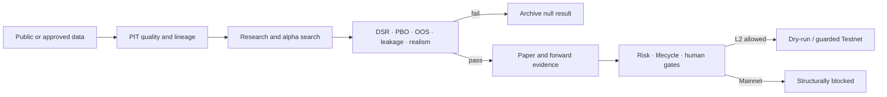

# QUANTOS

**Safety-critical AI quantitative research platform**

[](https://github.com/kerstker/QUANTOS/actions/workflows/validate.yml)


QUANTOS is a research, validation, portfolio, paper/shadow, and governance platform for quantitative strategies. It is designed to produce reproducible evidence—and to reject weak ideas—before any execution path is considered.

> Current readiness: `L2_DRY_RUN_ONLY`. Binance/Bybit test environments have adapters and guarded integration paths, but Mainnet, real capital, AI-directed trading, and unapproved order submission remain structurally blocked. This repository is not investment advice and is not a production trading mandate.

## Current status

Machine evidence as of 2026-08-11:

| Area | State | Meaning |
|---|---|---|
| Repository validation | **PASS — 27/27 stages** | Backend, frontend, governance, supply-chain and safety suites are green. |
| Research autonomy | **READY** | Agents may run bounded research workflows; they cannot approve or trade. |
| Paper/shadow infrastructure | **READY_FOR_SHADOW** | The infrastructure exists, but candidate-specific gates still apply. |
| Registered research leads | **3, all blocked** | `carry_oi_majors`, `crowd_contra`, and `top_contra` lack sufficient fresh forward evidence or have risk blockers. |
| Formal Testnet execution candidate | **0** | No automatic Testnet intent should be generated yet. |
| Top-tier assessment | **NOT_TOP_TIER — 14/22 pass** | Six partial and two unverified capabilities remain; three red lines remain open. |
| Mainnet | **BLOCKED** | L2 readiness and multi-step human gates prevent real-capital operation. |

The canonical details live in [project state](docs/PROJECT_STATE.md), [validation evidence](evidence/validation_report.json), [top-tier assessment](evidence/top_tier_assessment.json), and the [paper-cycle snapshot](evidence/alpha_paper_cycle.json).

## What is implemented

- Point-in-time data contracts, quality admission, lineage, survivorship controls, and versioned local stores.
- Factor DSLs, GP/evolutionary search, factor garden, deterministic ML stacking, IC diagnostics, and multiple public-data research surfaces.
- Event-driven and vector backtests, cost/funding accounting, DSR, PBO, purged/embargoed walk-forward validation, and leakage checks.
- Alpha catalog/lifecycle, experiment and trial ledgers, paper tracking, decay/retirement, capacity/crowding, and portfolio construction.
- Fail-closed research-risk and pre-trade gates, kill-switch authority, audit/event chains, idempotent orchestration, leases, recovery, and read-only operations views.
- A React research console plus guarded research runner; the console API is read-only.
- Testnet adapters and soak tooling behind attestations, mandates, risk gates, reconciliation, and explicit human controls.

## System flow



Strategy code proposes intent; risk and governance decide permission. Research, paper, Testnet, and Mainnet are separate trust zones.

## Quick start

Prerequisites:

- Python 3.12+; this Windows workstation validates with Python 3.14.
- Node.js 20+ for the research console.
- No broker credentials are required for validation or local research-console startup.

Install dependencies:

```bash
python -m pip install -r requirements-dev.txt
cd apps/research-console && npm ci
```

On Windows PowerShell, start the complete local **research-only** stack:

```powershell
./scripts/start_console.ps1
```

The manager starts the read-only API, guarded research runner, and frontend, records logs under `.runtime/`, and performs health checks. Stop only the managed processes with:

```powershell
./scripts/stop_console.ps1
```

For manual cross-platform startup, see the [local research stack runbook](docs/runbooks/local-research-stack.md).

## Validation

Use the repository gate instead of bare `pytest`:

```bash
# Windows verified command
py -3.14 scripts/validate.py

# Portable / CI equivalent
python scripts/validate.py
```

The gate covers dependency evidence, import boundaries, governance scanning, backend suites, live/Testnet safety tests, frontend typecheck/lint/tests/build, and readiness evidence. A timeout, empty result, malformed artifact, or unknown state is never treated as approval.

Useful focused commands:

```bash
python scripts/check_repository_hygiene.py
python apps/research-console/scripts/run_paper_to_live_governance_check.py
cd apps/research-console && npm run typecheck && npm run eslint && npm test
```

## Repository map

```text
quantos/contracts/       Stable cross-domain contracts and safety configuration
services/                Deterministic research, risk, portfolio, governance and API core
live/                    Guarded exchange/Testnet boundary; never imported by services/
tools/                   Public-data fetchers and operator/research entry points
apps/research-console/   React/Vite read-only research console
tests/                   Contract, domain, integration and governance suites
config/                  Versioned policy and coverage registries; no secrets
evidence/                Versioned machine evidence, not raw runtime databases
deploy/                  Read-only console image and deployment documentation
docs/                    Current guides plus historical specs, plans and audits
scripts/validate.py      Canonical fail-closed repository gate
```

Planned infrastructure is documented centrally in [PLANNED_SCAFFOLDS.md](docs/PLANNED_SCAFFOLDS.md); empty Kubernetes, Terraform, Kafka, Avro, and Protobuf directory trees are intentionally not committed.

## Safety boundary

These defaults are non-negotiable at L2:

```text
LIVE_TRADING_ENABLED=false
REAL_BROKER_ENABLED=false
ALLOW_ORDER_SUBMISSION=false
ALLOW_AI_DIRECT_TRADING=false
REQUIRE_HUMAN_APPROVAL=true
```

- Never commit secrets, broker credentials, runtime databases, raw market data, or signed mandates.
- AI agents cannot approve candidates, reset protected kill-switch state, handle credentials, or place Mainnet orders.
- `services/` remains network-free; public network acquisition belongs at guarded `tools/` boundaries.
- Missing, stale, malformed, timed-out, or self-reported evidence fails closed.
- Historical Sharpe, return, and capacity figures are research evidence, not guarantees or authorized sizing.

See [SECURITY.md](SECURITY.md) for reporting and credential rules.

## Documentation

- [Documentation map and authority order](docs/README.md)
- [Architecture](docs/ARCHITECTURE.md)
- [Research workflow](docs/RESEARCH_WORKFLOW.md)
- [Data sources](docs/DATA_SOURCES.md)
- [Deployment and local operations](deploy/README.md)
- [Current project state](docs/PROJECT_STATE.md)
- [Development program](docs/QUANTOS_DEVELOPMENT_PROGRAM_PLAN.md)
- [Lean institutional roadmap](docs/QUANTOS_LEAN_INSTITUTIONAL_PRODUCTION_ROADMAP.md)
- [Contributing](CONTRIBUTING.md)

## AI-assisted engineering

QUANTOS is developed with Codex/GPT-assisted engineering under human control. Agents help navigate the repository, write tests, implement deterministic components, and inspect evidence. They do not receive trading authority. Human review, machine governance tests, and the single fail-closed validation gate remain the decision boundary.

## Disclaimer

For research and educational use only. Nothing in this repository is investment advice, an offer, a recommendation, or permission to trade. Digital assets can lose all value. Past or simulated performance does not predict future results.
