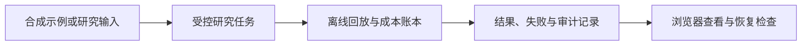

# QUANTOS

**AI 量化研究与仿真平台 · Software V1**

QUANTOS 将研究任务、离线回放、成本与持仓账本、风险检查和结果追溯放在同一套平台中，
通过浏览器操作。首个可安装版本 `v1.0.0` 已完成软件验收，包内提供合成示例，
可以先运行完整的软件流程，再单独接入真实数据和开发策略。

[下载软件 V1](https://github.com/kerstker/QUANTOS/releases/tag/v1.0.0) · [安装与首次使用](docs/releases/v1.0.0-installation.md) ·
[发行说明](docs/releases/v1.0.0.md) · [更新日志](CHANGELOG.md)

## 当前发行

截至 **2026-10-09**，软件发行与研究、交易资格分别记录：

| 项目 | 当前状态 |
|---|---|
| 软件版本 | **v1.0.0 已发行**，后台 Linux ARM64 / DGX、Python 3.12 |
| 操作端 | 浏览器；Windows PC 可通过 SSH 端口转发使用 |
| 完整软件验收 | **32/32 阶段 PASS**，零失败、错误和超时；原 71 项测试跳过保持 |
| 测试结果 | 后端 11,539 PASS；执行栈与工具 9,447 PASS |
| 安装与操作验证 | 实际隔离安装、改换解压位置、普通用户启动及六项真实浏览器操作通过 |
| 构建与运行检查 | ARM64 双冷构建一致、运行镜像扫描及无网络只读冒烟通过 |
| 真实研究材料 | 真实来源认证、锁定 OOS 与独立核验仍按实际配置记录 |
| 交易权限 | **L2_DRY_RUN_ONLY**；实盘、AI 直接交易及未经批准的订单提交关闭 |

验收对应源码 `9589c47ac341e1d6c27fdc5d2fdeabb8973b91a8`，离线安装包制品 `1b1b661ad49789827e81432a23ba60074d32c2a5`。
发行标签 `v1.0.0` 指向已验证的安装制品；`main` 随后同步发行文档。
原始[完整验收结果](docs/releases/v1.0.0-validation.json)、
[安装结果](docs/releases/v1.0.0-install-verification.json)与
[浏览器结果](docs/releases/v1.0.0-browser-verification.json)可直接核对。

## 软件 V1 可以做什么

- 在研究控制台创建受控研究任务，查看任务、失败原因与历史记录。
- 使用唯一 Decimal 永续账本进行技术回放，查看费用、资金费、持仓、现金和对账结果。
- 保存试验登记、完整输入、结果身份与审计关系，支持保留、冷读取与恢复检查。
- 查看数据、模型、风险和核验材料的当前状态；缺失材料保留明确的不足或拒绝原因。
- 从浏览器检查核心操作流程，包括缺输入失败、错误令牌拒绝和实际下单关闭。



包内示例的结果为 `TECHNICAL_VALIDATION_ONLY`。真实来源、独立核验、OOS、策略有效性
和现场交易运行在软件交付后分别验收，软件测试通过不会自动授予交易资格。
旧 V1 永续回放与纸面成交路径已隔离；其历史收益与可部署声明受
`INVALIDATED_PERP_LEDGER_V1` 失效声明约束，不作为当前准入证据。

## 下载与开始使用

[下载 Linux ARM64 离线安装包](https://github.com/kerstker/QUANTOS/releases/download/v1.0.0/QUANTOS-Software-V1-Linux-ARM64-9589c47a.zip)（约 140 MB）。
包中包含同版源码、76 个锁定依赖 wheel、已构建网页、安装器、启动配置、合成示例与使用说明。

安装包 SHA256：

```text
b85c10f24f373e38b97a6b0ef4e215608c95017c463fee7c2733fe44f76eadbf
```

在安装有 Python 3.12 的 Linux ARM64 / DGX 上解压，进入解压目录：

```bash
sha256sum -c SHA256SUMS
sudo /usr/bin/python3.12 -I -B ./install.py
```

安装父目录、三个启动入口、Windows 连接、合成回放、停止、升级和恢复的完整步骤见
[安装指南](docs/releases/v1.0.0-installation.md)。安装器不会替换正在运行的服务；
源码、运行环境、前端与可变状态分离。Windows 使用浏览器，后台安装包适用于 Linux ARM64。

## 开发与验证

开发环境使用 Python 3.12 和对应架构的哈希锁定依赖；DGX 操作见
[开发 runbook](docs/runbooks/dgx-engine-development.md)。已发行安装包运行网页无需另装 Node。
从源码开发前端时，使用 `apps/research-console/package-lock.json` 和 `npm ci`。

```bash
# canonical 完整软件门；发行验收使用其原生 QA 单阶段墙钟参数
python scripts/validate.py --timeout-seconds 14400

# 文档/仓库整洁与治理检查
python scripts/check_repository_hygiene.py
python apps/research-console/scripts/run_paper_to_live_governance_check.py
```

QA 执行时间额度不会改变原测试断言、输入、风险阈值、交易权限或生产性能预算。
详细阶段结果属于本次冻结发行的证据；GitHub Actions 的运行状态另行显示。

## 架构与文档

| 位置 | 内容 |
|---|---|
| `quantos/contracts/` | 跨模块合同与安全配置 |
| `services/` | 研究、执行数学、风险、登记、治理与 API |
| `apps/research-console/` | React / TypeScript 研究界面 |
| `tools/` | 数据边界、研究工具和人工控制入口 |
| `live/` | 隔离的场所适配与受控执行边界 |
| `tests/` | 合同、行为、集成与治理检查 |
| `docs/releases/` | 发行说明、安装文档和同版验证结果 |

[文档导航](docs/README.md) · [项目进度](docs/PROJECT_STATE.md) ·
[开发计划](docs/QUANTOS_DEVELOPMENT_PROGRAM_PLAN.md) · [架构](docs/ARCHITECTURE.md) ·
[贡献指南](CONTRIBUTING.md) · [安全策略](SECURITY.md)

## 默认安全边界

```text
LIVE_TRADING_ENABLED=false
REAL_BROKER_ENABLED=false
ALLOW_ORDER_SUBMISSION=false
ALLOW_AI_DIRECT_TRADING=false
REQUIRE_HUMAN_APPROVAL=true
```

AI 只能通过受控入口参与研究，不处理交易凭据，不批准候选或提交实盘订单。
研究、仿真与真实执行保持隔离。软件适用于研究与技术验证。
