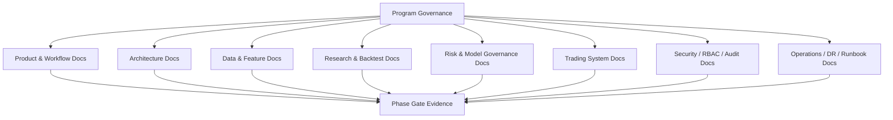
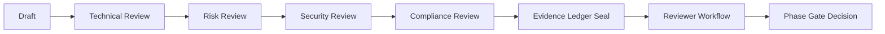

# QUANTOS 文档控制中心 / Documentation Control Center

> 状态日期: 2026-06-13  
> 适用范围: QUANTOS 从 L2_DRY_RUN_ONLY 研究控制台演进到机构级 AI 量化交易系统的全部文档资产。  
> 当前结论: 文档体系处于启动阶段，必须先完成 L2.5 研究平台硬化文档，再申请任何 L3 Broker Test Environment 准入。

## 1. 文档目标

本文档用于回答三个问题：

1. 开发 QUANTOS 需要哪些文档。
2. 每份文档属于哪个阶段、哪个负责人、依赖哪些证据。
3. 哪些文档完成后才能推进下一阶段。

所有文档必须遵守当前安全边界：

```text
READ_ONLY
L2_DRY_RUN_ONLY
NO_GO
NO_BROKER_CONNECTION
NO_LIVE_ORDER_API
NO_CREDENTIAL_FILE
```

## 2. 文档体系结构



## 3. 推荐目录结构

```text
docs/
  QUANTOS_TOP_TIER_AI_QUANT_DEVELOPMENT_PROCESS.md
  QUANTOS_DOCUMENTATION_CONTROL_CENTER.md
  QUANTOS_L2_5_RESEARCH_PLATFORM_HARDENING_BACKLOG.md

  product/
    PRODUCT_REQUIREMENTS.md
    USER_WORKFLOWS.md
    PHASE_GATE_POLICY.md

  architecture/
    SYSTEM_ARCHITECTURE.md
    SERVICE_INVENTORY.md
    DATA_FLOW_DIAGRAM.md
    DEPLOYMENT_ARCHITECTURE.md

  data/
    DATA_LAKE_ARCHITECTURE.md
    DATASET_CONTRACTS.md
    FEATURE_STORE_DESIGN.md
    POINT_IN_TIME_POLICY.md
    DATA_QUALITY_RULEBOOK.md
    DATA_LINEAGE_MODEL.md

  research/
    ALPHA_FACTORY_SPEC.md
    EXPERIMENT_REGISTRY_SCHEMA.md
    VALIDATION_ENGINE_SPEC.md
    BACKTEST_ENGINE_SPEC.md
    COST_SLIPPAGE_MODEL.md
    BACKTEST_EXPLAINABILITY_SPEC.md

  risk/
    PORTFOLIO_OPTIMIZER_SPEC.md
    RISK_ENGINE_SPEC.md
    SCENARIO_STRESS_LIBRARY.md
    MODEL_RISK_POLICY.md
    MODEL_VALIDATION_STANDARD.md

  trading/
    OMS_DESIGN.md
    EMS_DESIGN.md
    ORDER_STATE_MACHINE.md
    BROKER_ADAPTER_INTERFACE_CONTRACT.md
    BROKER_TEST_ENV_READINESS.md

  security/
    RBAC_POLICY.md
    ACCESS_REVIEW_RUNBOOK.md
    VAULT_CREDENTIAL_INTAKE_RUNBOOK.md
    AUDIT_LEDGER_DESIGN.md
    EVIDENCE_EXPORT_POLICY.md
    SECURITY_BOUNDARY.md

  operations/
    OBSERVABILITY_SLO_SLA.md
    INCIDENT_RESPONSE_RUNBOOK.md
    DAILY_RECONCILIATION_RUNBOOK.md
    ROLLBACK_RUNBOOK.md
    DISASTER_RECOVERY_PLAN.md
```

## 4. 文档状态定义

| 状态 | 含义 |
|---|---|
| `NOT_STARTED` | 尚未创建 |
| `DRAFT` | 已创建草稿，未评审 |
| `REVIEW_READY` | 可进入复核 |
| `APPROVED_FOR_L2_5` | 可用于 L2.5 开发 |
| `APPROVED_FOR_L3` | 可用于申请券商测试环境 |
| `BLOCKED` | 存在外部依赖或安全阻断 |
| `DEPRECATED` | 已被替代 |

## 5. L2.5 必须优先完成的文档

| 优先级 | 文档 | 负责人 | 阶段 | 当前状态 | 阻断原因 |
|---|---|---|---|---|---|
| P0 | `DATA_LAKE_ARCHITECTURE.md` | Research Platform | L2.5 | NOT_STARTED | 需要定义真实数据湖元数据层 |
| P0 | `FEATURE_STORE_DESIGN.md` | Research Platform | L2.5 | NOT_STARTED | 当前仅为只读 snapshot |
| P0 | `EXPERIMENT_REGISTRY_SCHEMA.md` | Alpha Research | L2.5 | NOT_STARTED | 当前 registry 未持久化 |
| P0 | `BACKTEST_ENGINE_SPEC.md` | Research Engineering | L2.5 | NOT_STARTED | 当前不是事件驱动回测 |
| P0 | `DATA_QUALITY_RULEBOOK.md` | Data Governance | L2.5 | NOT_STARTED | 需要质量规则与阈值 |
| P0 | `MODEL_RISK_POLICY.md` | Risk / Governance | L2.5 | NOT_STARTED | 当前为只读评审视图 |
| P0 | `AUDIT_LEDGER_DESIGN.md` | Security / Platform | L2.5 | NOT_STARTED | 当前 hash chain 未持久化 |
| P0 | `RBAC_POLICY.md` | Security | L2.5 | NOT_STARTED | 当前 RBAC 为只读矩阵 |
| P1 | `OBSERVABILITY_SLO_SLA.md` | Operations | L2.5 | NOT_STARTED | 需要监控与 SLO |
| P1 | `DRIFT_MONITORING_SPEC.md` | Research Platform | L2.5 | NOT_STARTED | 需要 alpha/feature/model drift |

## 6. L3 准入必须完成的文档

| 文档 | 作用 | 是否阻断 L3 |
|---|---|---|
| `PHASE_3A_GO_NO_GO_REVIEW_PACK.md` | 汇总 Phase 3A 准入证据 | 是 |
| `BROKER_TEST_ENV_READINESS.md` | 券商测试环境就绪证明 | 是 |
| `VAULT_CREDENTIAL_INTAKE_RUNBOOK.md` | 测试凭证 Vault-only 流程 | 是 |
| `NETWORK_ACCESS_REVIEW.md` | 网络白名单与访问审查 | 是 |
| `LEGAL_COMPLIANCE_APPROVAL.md` | 法务/合规批准 | 是 |
| `BROKER_ADAPTER_INTERFACE_CONTRACT.md` | 测试环境 adapter 合约 | 是 |
| `KILL_SWITCH_RUNBOOK.md` | Kill switch 演练流程 | 是 |

## 7. 文档模板要求

每份核心文档必须包含：

```text
1. Purpose / 目的
2. Scope / 范围
3. Current State / 当前状态
4. Target State / 目标状态
5. Architecture / 架构
6. Data Contracts / 数据合约
7. Failure Modes / 失败模式
8. Security Boundary / 安全边界
9. Testing Strategy / 测试策略
10. Acceptance Criteria / 验收标准
11. Evidence Links / 证据链接
12. Open Risks / 未关闭风险
13. Phase Gate Impact / 阶段准入影响
```

## 8. 文档评审流程



## 9. Definition of Done

一份文档只有满足以下条件，才算完成：

- 有明确 owner。
- 有明确适用阶段。
- 有当前系统状态。
- 有目标系统状态。
- 有安全边界。
- 有验收标准。
- 有测试策略。
- 有失败模式。
- 有 Phase Gate 影响。
- 没有把 L2 dry-run 描述成可实盘。
- 没有引入真实券商、凭证或 live order 实现。

## 10. 下一步

下一步应先创建 L2.5 的 P0 文档草稿：

1. `docs/data/DATA_LAKE_ARCHITECTURE.md`
2. `docs/data/FEATURE_STORE_DESIGN.md`
3. `docs/research/EXPERIMENT_REGISTRY_SCHEMA.md`
4. `docs/research/BACKTEST_ENGINE_SPEC.md`
5. `docs/security/AUDIT_LEDGER_DESIGN.md`
6. `docs/security/RBAC_POLICY.md`

