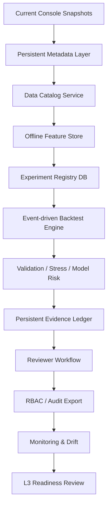

# QUANTOS L2.5 Research Platform Hardening Backlog

> 状态日期: 2026-06-13  
> 目标阶段: L2.5 Research Platform Hardening  
> 当前边界: READ_ONLY / L2_DRY_RUN_ONLY / NO_GO  
> 目标: 将当前 computed snapshot 研究控制台，升级为可持久化、可复现、可审计的研究平台。

## 1. L2.5 目标

L2.5 不进入券商测试环境，也不做实盘交易。  
L2.5 的目标是把研究平台的底座补齐：

- 真实数据目录与元数据管理。
- Offline Feature Store。
- 实验注册持久化。
- 事件驱动回测引擎。
- 数据质量与 point-in-time 防泄漏。
- Drift monitoring。
- 审计证据链持久化。
- RBAC 与证据导出策略。

## 2. L2.5 总任务图



## 3. Epic Backlog

### EPIC-01: Persistent Metadata Layer

目的: 为数据、特征、实验、artifact、证据链提供统一元数据层。

任务:

| ID | 任务 | 产出 | 验收 |
|---|---|---|---|
| META-01 | 设计 metadata schema | `METADATA_SCHEMA.md` | 支持 dataset/feature/experiment/artifact/evidence |
| META-02 | 选择存储方案 | ADR | 明确 SQLite/Postgres/Parquet/对象存储边界 |
| META-03 | 定义 migration 机制 | migration spec | 可版本化升级 |
| META-04 | 定义 metadata API | OpenAPI/contract | read-only API 可替代当前 snapshot |

禁止:

- 禁止存储 broker credential。
- 禁止存储 live order。
- 禁止引入生产交易权限。

### EPIC-02: Data Catalog Service

目的: 将当前只读 Data Catalog snapshot 升级为可持久化数据目录。

任务:

| ID | 任务 | 产出 | 验收 |
|---|---|---|---|
| DATA-01 | 建立 dataset schema | `DATASET_CONTRACTS.md` | 每个 dataset 有 version、snapshot、hash |
| DATA-02 | 建立 data quality rule schema | `DATA_QUALITY_RULEBOOK.md` | 支持 coverage/freshness/PIT checks |
| DATA-03 | 建立 lineage edge schema | `DATA_LINEAGE_MODEL.md` | dataset -> feature -> experiment 可追踪 |
| DATA-04 | 实现 read-only catalog API | API contract | 前端可从持久化层读取 |

验收指标:

- 100% dataset 有 content hash。
- 100% feature 有 source dataset。
- 100% feature 有 point-in-time policy。

### EPIC-03: Offline Feature Store

目的: 建立离线特征定义、物化、版本、回放能力。

任务:

| ID | 任务 | 产出 | 验收 |
|---|---|---|---|
| FEAT-01 | 定义 feature spec | `FEATURE_STORE_DESIGN.md` | 支持 expression、owner、version、PIT |
| FEAT-02 | 定义 materialization job | job spec | 支持按 snapshot 物化 |
| FEAT-03 | 定义 point-in-time join | `POINT_IN_TIME_POLICY.md` | 禁止未来函数 |
| FEAT-04 | 定义 feature drift metrics | `DRIFT_MONITORING_SPEC.md` | PSI/KS/coverage/freshness |

验收指标:

- 可通过 feature version 重放 alpha。
- 可证明训练/验证/回测未使用未来数据。

### EPIC-04: Experiment Registry DB

目的: 将实验注册表从 computed snapshot 升级为可持久化、可复现的 registry。

任务:

| ID | 任务 | 产出 | 验收 |
|---|---|---|---|
| EXP-01 | 定义 experiment schema | `EXPERIMENT_REGISTRY_SCHEMA.md` | config/seed/data snapshot/hash |
| EXP-02 | 定义 artifact schema | artifact contract | config/metrics/lineage/review note |
| EXP-03 | 定义 immutable update policy | registry policy | 禁止覆盖历史实验 |
| EXP-04 | 实现 read-only registry API | API contract | 前端页面切换持久化 API |

验收指标:

- 100% experiment 有 config hash。
- 100% experiment 有 reproducibility hash。
- 100% artifact 有 content hash。

### EPIC-05: Event-driven Backtest Engine

目的: 建立接近生产交易逻辑的事件驱动回测引擎。

任务:

| ID | 任务 | 产出 | 验收 |
|---|---|---|---|
| BT-01 | 定义 event schema | `BACKTEST_EVENT_SCHEMA.md` | market/signal/order/fill/risk events |
| BT-02 | 定义 order simulation model | `ORDER_SIMULATION_MODEL.md` | 支持 partial fill/cancel/reject |
| BT-03 | 定义 cost/slippage model | `COST_SLIPPAGE_MODEL.md` | 支持 turnover/impact/liquidity |
| BT-04 | 定义 replay engine | `BACKTEST_ENGINE_SPEC.md` | 可按 dataset snapshot 重放 |
| BT-05 | 定义 explainability output | `BACKTEST_EXPLAINABILITY_SPEC.md` | equity/drawdown/cost/segments |

验收指标:

- 可复现同一 run。
- 可解释订单、成交、成本、回撤。
- 不连接真实 broker。

### EPIC-06: Monitoring & Drift

目的: 建立研究平台持续监控。

任务:

| ID | 任务 | 产出 | 验收 |
|---|---|---|---|
| MON-01 | Alpha decay monitor | `ALPHA_DECAY_MONITORING.md` | IC/Sharpe/turnover drift |
| MON-02 | Feature drift monitor | `FEATURE_DRIFT_MONITORING.md` | PSI/KS/freshness |
| MON-03 | Model risk aging monitor | `MODEL_RISK_AGING.md` | open issues/SLA aging |
| MON-04 | Reviewer SLA monitor | `REVIEWER_SLA_MONITORING.md` | overdue/blocking tasks |
| MON-05 | System health SLO | `OBSERVABILITY_SLO_SLA.md` | latency/error/freshness |

验收指标:

- 每个 monitor 有 threshold。
- 每个 alert 有 owner。
- 每个 breach 可进入 evidence ledger。

### EPIC-07: Persistent Evidence Ledger

目的: 将当前 hash chain snapshot 升级为 append-only 证据台账。

任务:

| ID | 任务 | 产出 | 验收 |
|---|---|---|---|
| LEDGER-01 | 定义 ledger entry schema | `AUDIT_LEDGER_DESIGN.md` | previous_hash/content_hash/root_hash |
| LEDGER-02 | 定义 append-only policy | ledger policy | 禁止修改历史 |
| LEDGER-03 | 定义 evidence seal process | runbook | 每次 gate 生成 seal |
| LEDGER-04 | 定义 audit export metadata | `EVIDENCE_EXPORT_POLICY.md` | 不含凭证/订单 |

验收指标:

- hash chain 可验证。
- evidence package 不包含 credentials。
- evidence package 不包含 live orders。

### EPIC-08: RBAC and Audit Export

目的: 将当前只读权限矩阵升级为真实身份与审计导出设计。

任务:

| ID | 任务 | 产出 | 验收 |
|---|---|---|---|
| RBAC-01 | 定义 role model | `RBAC_POLICY.md` | Research/Risk/Model/Compliance/Admin |
| RBAC-02 | 定义 permission matrix | permission contract | 危险权限默认 deny |
| RBAC-03 | 定义 access review flow | `ACCESS_REVIEW_RUNBOOK.md` | 定期复核 |
| RBAC-04 | 定义 audit export approval | `EVIDENCE_EXPORT_POLICY.md` | signed export required |

验收指标:

- `trade:any` 永久 deny，直到生产 gate 明确批准。
- `credential:read` 永久不属于 research console。
- 导出包默认 metadata-only。

## 4. 阶段验收命令

每轮开发至少运行：

```powershell
rtk npm run typecheck
rtk npm run build
rtk proxy python -m pytest services/research/console_api/tests/test_console_api.py -q
rtk proxy python scripts\run_paper_to_live_governance_check.py
rtk proxy python scripts\run_dry_run_adapter_integration_gate.py
```

浏览器验收:

- 桌面视口无横向溢出。
- 移动视口无横向溢出。
- Console error 为 0。
- 页面显示 `BACKEND_COMPUTED`。
- 页面显示 `API_CONNECTED`。
- 页面显示 `READ_ONLY`。
- 页面显示 `L2_DRY_RUN_ONLY` 或同等安全边界。

## 5. L2.5 退出标准

L2.5 完成时，必须满足：

- Data Catalog 持久化。
- Feature Store 具备 version 和 PIT policy。
- Experiment Registry 持久化。
- Backtest Engine 可事件驱动 replay。
- Model Risk Review 具备持久化 issue register。
- Evidence Ledger append-only。
- RBAC policy 完整。
- Drift monitoring 建立。
- Phase 3A blocker 仍被明确追踪。
- 没有任何真实交易能力被启用。

## 6. L3 申请前检查

只有满足以下条件，才允许申请 L3:

- L2.5 所有 P0 epic 完成。
- Phase 3A 15/15 criteria approved。
- E01/E02/E03/E04/E06 全部关闭。
- Legal/compliance signoff 完成。
- Test credentials 仅进入 Vault。
- Network whitelist review 完成。
- Broker test account confirmed。
- Kill switch runbook approved。
- Governance scanner 0 violations。

## 7. 当前推荐下一步

按顺序推进：

1. 创建 `docs/data/DATA_LAKE_ARCHITECTURE.md`
2. 创建 `docs/data/FEATURE_STORE_DESIGN.md`
3. 创建 `docs/research/EXPERIMENT_REGISTRY_SCHEMA.md`
4. 创建 `docs/research/BACKTEST_ENGINE_SPEC.md`
5. 创建 `docs/security/AUDIT_LEDGER_DESIGN.md`
6. 创建 `docs/security/RBAC_POLICY.md`
7. 开发 Monitoring & Drift 页面和后端 snapshot

