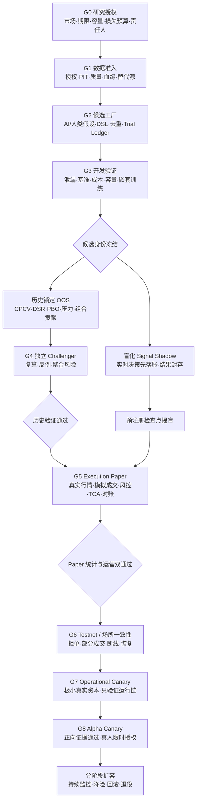

# QUANTOS 精益机构级研究到生产固定路线

状态：`FROZEN_V1`
生效日期：2026-08-02
当前边界：`L2_DRY_RUN_ONLY`
路线目标：先完成生产级实时 Paper，再完成 Testnet/场所一致性，最后才允许以独立、短期、哈希绑定的真人授权评审 Micro-Live。

本文是 QUANTOS 从研究到生产的**唯一工序排序真源**。`QUANTOS_TOPTIER_REMEDIATION_ROADMAP.md`
继续保存历史能力缺口和完成记录；`QUANTOS_TOP_TIER_STANDARD.md` 与
`config/top_tier_requirements.json` 继续是成熟度和机器证据真源。本文不覆盖安全旗标，也不构成实盘授权。

## 1. 固定决策

1. 当前第一目标不是增加模型或 Alpha 数量，而是让一个候选能够沿同一身份、同一证据合同穿过完整流水线。
2. “Alpha 通过考验后再回测”改为“假设/候选进入回测与验证；只有完成历史和前向验证后才称为 Alpha”。
3. 候选冻结后，历史锁定 OOS 与**盲化实时 Signal Shadow 并行启动**；不再等满 90 天才开始记录前向决策。
4. Signal Shadow 与 Execution Paper 分开：前者验证信号，后者验证生产等价的组合、风控、成交和对账。
5. 研究、数据和 Paper 运营可以自动化；AI 不得批准自己、改变门槛、增加真实资本或提交真实订单。
6. 快速生产采用风险分级：先生产级 Paper，再 Testnet，再极小额 Operational Canary，最后才是 Alpha Canary 和扩容。
7. 删除重复文档、重复委员会、手工搬运和串行等待；保留会影响统计真实性、订单安全、可恢复性和问责的硬控制。
8. 所有重大改变必须生成新 candidate/release 身份，并从相应 Gate 重新进入；不得沿用旧证据。

## 2. 机构级机器的完整组成

机构级系统不是一个模型，而是八个相互制衡的职能。小团队可以一人多岗，但生产资本决策不能由同一身份同时充当开发者和独立批准者。

| 职能 | 机构职责 | QUANTOS 精益落法 |
|---|---|---|
| 投资负责人 / PM | 规定市场、期限、容量、风险预算和停止条件 | 版本化 Research Mandate；不参与统计门的计算 |
| Quant Research | 经济假设、候选生成、研究实现 | AI + DSL/GP/规则搜索，只能产生候选 |
| Data Office | 授权、PIT、质量、血缘、供应商与替代源 | 数据合同 + 双时态存储 + 数据准入 Gate |
| Independent Validation | 独立复算、挑战假设、检查 OOS 和聚合模型风险 | 独立 challenger 运行身份；Micro-Live 前需真人签名 |
| Portfolio & Risk | 资本配置、容量、暴露、压力、预交易限制 | 九引擎研究风险 + 组合约束 + kill switch |
| Trading & Execution | 场所、订单、TCA、异常处理 | 先同代码路径 Paper Adapter，再 Testnet/Live Adapter |
| Platform / SRE / Security | 发布、身份、密钥、监控、恢复、供应链 | 不可变 release、最小权限、告警、演练、回滚 |
| Operations / Finance / Compliance | 头寸、现金、费用、对账、记录和访问复核 | 独立账本、三方对账、留存与定期访问复核 |

## 3. 唯一生产流水线

### 3.1 每个 Gate 的产物

| Gate | 必须产物 | 自动/人工 | 未通过 |
|---|---|---|---|
| G0 研究授权 | 经济机制、市场/期限、容量目标、最大试验数、证伪条件 | 人工设边界，机器登记 | 不进入研究 |
| G1 数据准入 | 数据合同、时间语义、质量、血缘、版本、覆盖率 | 自动 | `BLOCK/PENDING` |
| G2 候选工厂 | candidate ID、表达式、参数、依赖、Trial Ledger | 自动 | 淘汰或新 ID |
| G3 身份冻结 | 代码、数据、universe、标签、成本、风险、Provider 全部哈希绑定 | 自动 | 不允许进入 OOS/Shadow |
| G4 历史验证 | 锁定 OOS、DSR/PBO/FDR、压力、容量、组合边际贡献、独立复核 | 自动 + 独立挑战 | 退役或新版本重来 |
| G5 Execution Paper | 实时信号、订单意图、模拟成交、头寸、PnL、TCA、全链对账 | 自动 | 保持 Paper，不晋级 |
| G6 Testnet | 场所协议一致性、拒单/部分成交、重连、限流和恢复演练 | 自动 + 运维确认 | 回到 Paper/修复 |
| G7 Operational Canary | 极小限额、短期授权、实时风险与 kill switch | 真人授权 | 自动停止，不扩容 |
| G8 Alpha Canary | 正向有效性、运营稳定、独立批准、资本和场所白名单 | 独立真人签名 | 不进入生产扩容 |

Gate 只允许 `PASS / FAIL / ABSTAIN / PENDING`。AI 不能覆盖结果；材料变化必须生成新版本，不能用解释性文字豁免失败。

## 4. Shadow、Paper 与 Live 的严格定义

### Signal Shadow

- 候选冻结后立即开始，使用真实实时数据。
- 只记录“当时会做什么”，不生成模拟订单或仓位。
- 决策必须先于结果落账；结果在预注册检查点前对候选选择器封存。
- 用于验证方向、IC、换手、稳定性和数据依赖，不验证成交能力。

### Execution Paper

- 只接收历史 Gate 已通过的候选。
- 与未来生产路径共用信号、组合、风险、订单意图、TCA、账本和监控代码，只替换最后的交易所 Adapter。
- 必须模拟延迟、部分成交、拒单、取消、费用、资金费、借币、盘口冲击、场所中断和 stale marks。
- intent、order、fill、position、cash、fee、PnL 必须逐层对账；差异非零即阻断。

### Operational Canary

- 只证明真实凭证、网络、场所、订单、风险和对账链能够工作，不证明 Alpha 盈利。
- 可在长期 Alpha 有效性证据成熟前评审，但资本必须小到完全可损失、短时有效、禁止自动扩大。
- 当前 `L2_DRY_RUN_ONLY` 不授权该阶段；必须另行提交绑定 release/candidate/account/limit/expiry 的真人 mandate。

### Alpha Canary / Production

- 必须同时通过统计有效性、执行可部署性、组合增量价值和运营稳定性。
- 只允许分阶段扩容；任何异常可以自动减仓、暂停或 kill，但增加风险必须真人批准。

## 5. 全维度机构对照

| 维度 | 机构级 M4/M5 形态 | QUANTOS 当前 | 精益生产最低线 | 优先级 |
|---|---|---|---|---|
| 商业目标 | 明确收益来源、容量、风险预算、成本和停止条件 | 研究目标较多，统一 mandate 不完整 | 每个家族一份机器可读 mandate | P0 |
| 组织与职责 | 研究、验证、风险、交易、运维、审计分离 | 代码边界强，组织独立性不足 | Paper 可逻辑隔离；Micro-Live 必须独立签名 | P1/外部 |
| 法律与合规 | 数据/场所/账户合法性、记录、市场行为和报告义务 | L2 无真实市场义务，生产框架未闭合 | 上真钱前完成账户辖区与交易所条款复核 | 外部 |
| 数据采购 | 授权 tick/L2、SLA、第二源、供应商退出方案 | 公共 Binance/Bybit/Deribit 为主 | Paper 可公共源；真钱必须有可接受 SLA/替代源 | P2 |
| PIT 与血缘 | 双时态、不可变 raw、质量、版本和可重放 | 强 | 保持现有门，不简化 | 已有 |
| 数据运营 | 新鲜度、缺口回补、异常隔离、容量和成本 | 有实时管道，但历史短且 drift BLOCK | 先保证连续采集与 fail-closed | P0 |
| Alpha 假设 | 经济机制、预注册、复杂度/WIP 限制 | Factor Garden/Factory 较强 | 每个候选绑定机制和证伪条件 | P0 |
| AI/模型治理 | 模型清单、Provider 评估、漂移、红队、人工责任 | AI 权限边界强；外部 Provider/强身份部分 | AI 只提议；确定性引擎裁决 | P1 |
| 试验治理 | 全局 Trial Ledger、重复检测、多重检验 | 强 | 保持，不允许重置计数 | 已有 |
| 历史验证 | purged/nested OOS、成本、压力、容量、敏感性 | 强核；微结构校准不足 | Gate 必须承重且候选通用 | P0 |
| 独立挑战 | 独立实现/数据复算和 objective challenge | 机制存在，外部独立性不足 | Paper 用独立运行身份；真钱用真人签名 | P1/外部 |
| 候选工作流 | 一个状态机、一个证据包、一次语义明确的晋级 | Factory/forward/realtime/paper 接缝并存 | 建立唯一 `AlphaProductionWorkflow` | P0 |
| Forward | 冻结后实时记录、按独立观察数和 regime 评估 | 两套 forward 语义；实时 shadow 尚空 | 立即盲化并行，不串行等待 90 天 | P0 |
| 组合构建 | 风险预算、共同暴露、容量、拥挤、边际贡献 | 引擎强，动态候选接入不足 | 晋级必须改善组合而非只看单条 Sharpe | P1 |
| 风险管理 | 研究风险、预交易风险、盘中限制、kill switch | 九引擎和 kill switch 强；Paper 输入仍不全 | Paper 风险必须 9/9 完整且可复算 | P0 |
| 执行与微结构 | 真实 LOB、场所、延迟、队列、TCA 与反馈 | 公共盘口模拟 SOR；费用/冲击未真实校准 | Paper 先闭环；真钱前完成 Testnet/真实小额校准 | P1/P2 |
| 账户与经纪商 | 账户隔离、权限、余额/保证金、场所限额 | mainnet 结构性关闭 | Testnet 先行；真钱使用专门小额账户 | Post-L2 |
| 会计与对账 | 订单/成交/头寸/现金/费用/总账三方对账 | Paper PnL 核较强，但当前 preview/fill 未全绿 | 逐周期零未解释差异 | P0 |
| 发布与变更 | 不可变 release、双人/独立批准、可回滚、重大变化重测 | 当前工作树 dirty、领先远端且评估漂移 | 任何调度只运行已签名 release | P0 红线 |
| 安全与身份 | 外部 IdP、最小权限、mTLS、撤销、密钥托管 | 本地能力较多，外部权威不足 | Paper 不持真实密钥；真钱前必须独立凭证域 | P2/外部 |
| 供应链 | SBOM、签名 provenance、跨主机复现、外部准入 | M3 机制存在，持续外部封存失败 | Paper release 先可复现；真钱前关闭红线 | P0/P2 |
| SRE/韧性 | SLO、on-call、故障演练、依赖映射、恢复验证 | 单机恢复成功，连续历史不足 | Paper 先连续运行和自动恢复；真钱前外部监控 | P0/P2 |
| 灾备与留存 | 30 天恢复历史、90 天 WORM、异地主机 | 当前自动评估 FAILED | Paper 可本机；真钱前完成外部留存 | P2/外部 |
| 前端与运营 | 漏斗、证据新鲜度、风险、TCA、告警、人工动作清晰 | SSE 已有，页面仍混合研究和部署语义 | 单页 Production Funnel + Exception Queue | P1 |
| 经济与成本 | 数据、云、场所、滑点、借币、税费和团队成本 | 研究成本可见，完整经营 P&L 不足 | 每个策略报净收益、容量和全部可归属成本 | P1 |
| 第三方管理 | 数据/模型/云/交易所尽调、替代与退出 | 多为单一公共依赖 | 关键依赖必须有 fallback 或硬停止 | P2 |

## 6. 可以删除与绝不能删除

### 可以立即删除或合并的“繁文缛节”

- 重复手工报告：由 `CandidateEvidenceBundle` 自动生成一页摘要和机器 JSON。
- 多个候选注册表和多个 forward 术语：合并为一个状态机、两个明确账本（Signal Shadow / Execution Paper）。
- 每次研究迭代的人审：研究内自动淘汰；只在人类资本边界和重大策略变化时签名。
- 固定“先等 90 天才开始 shadow”：改为冻结后立即盲化记录，按预注册有效观察数揭盲。
- 手工启动、复制 JSON、在 IDE 中搬运候选：改为事件驱动和幂等工作流。
- 对低风险文档/UI 变化执行完整模型重审：采用变化分类，只跑受影响 Gate。
- 在 Alpha 尚未通过前采购大规模 GPU 或堆更多模型：延后到数据和流程证明瓶颈后。

### 绝不能删除的最小硬核

- PIT/数据权利/质量和可重放；
- 候选冻结、全局 Trial Ledger 和不可回看 holdout；
- 多重检验、历史锁定 OOS 与独立挑战；
- 生产等价 Paper、风险限制、kill switch 和零差异对账；
- 不可变 release、回滚、密钥隔离和最小权限；
- 实时监控、stale data 阻断、故障恢复；
- Micro-Live/扩容的哈希绑定真人授权。

砍掉这些不会让系统更快成为生产系统，只会更快产生无法区分是真 Alpha、回测污染还是执行错误的结果。

## 7. 固定开发顺序

### WP0：发布与证据原子性

退出条件：工作树可解释；调度运行的 commit/container/data/evidence 全部绑定；
`assess_top_tier.py --check` 无漂移；旧诊断 Paper 明确标记，不能获得部署资格。

状态（2026-08-09）：**输入/证据绑定前五个增量已实现，WP0 尚未闭合。** L2 release-run
receipt 已支持经 launcher 严格校验的 worker attestation；唯一候选权威
`alpha_production_workflow`、公共双场所路由 `paper_multivenue_sor` 和承重接缝
`realtime_alpha_execution_paper`，以及上游公共 data→feature 接缝 `binance_realtime_features`
和 selection-bearing feature→candidate 接缝 `realtime_alpha_discovery` 已成为强制模块。
除候选证据与策略/链头外，现已绑定完整盘口
bundle/路由合同、事务冻结的 Signal Shadow 视图、特征与合约状态、执行前后账本权威、实际消费的
路由快照和最终报告，并绑定实时特征实际消费的公共源快照/源链/漂移视图、输出批次权威，
以及 discovery 实际消费的 PIT 帧/容量/反馈/全局实验上下文和输出候选权威；
缺失、不完整或安全声明漂移均 fail-closed。其余 worker 仍逐项待接入；
container/SBOM 的同轮绑定、外部签名/WORM/独立见证和全量派生证据无漂移仍是 WP0 剩余项。

### WP1：唯一候选工作流

建立 `AlphaProductionWorkflow`、`CandidateEvidenceBundle`、唯一 Population Registry 和材料变化分类。
Factory、历史 OOS、Signal Shadow、Execution Paper、生命周期和前端只消费这一份状态。

状态（2026-08-02）：**核心已实现，进入发布激活验收。** 已落地追加式双哈希链 Population/Event
权威、并行历史 OOS + Signal Shadow 状态、候选证据包、材料变化/后继身份分类、五分钟幂等调和器、
统一消费适配、Paper health 硬门、备份 source-contract v3 和 SSE 控制台投影。现役证据诚实显示
10 个候选、0 个当前 Execution-Paper eligible、3 个 legacy diagnostic book；没有用接线完成替代统计
通过。设计与边界见
[`engineering/specs/2026-08-02-alpha-production-workflow.md`](engineering/specs/2026-08-02-alpha-production-workflow.md)。

### WP2：生产级 Paper 变绿

修复 marks 新鲜度、候选通用九引擎输入、preview/fill、intent/fill/position/PnL 对账；
同一 worker 可无人值守重启恢复，异常 fail-closed。完成前不得把系统称为“全自动纸面生产”。

状态（2026-08-04）：**继续收口，尚未宣称完成。** 工程 shadow 已覆盖 10 个候选并持续实时估值；
九引擎非时间型输入已 10/10 预计算，正式 admission 仍独立 fail-closed。当前轮 worker 接缝新增
“本轮输出制品刷新 + 语义重新验证”双门，旧成功 JSON 不能再掩盖当前估值失败，失败制品明确
`SAFE_BLOCKED`。连续运行证据层 `paper_operational_evidence.v1` 已实现并接入五分钟调度、watchdog、
API/SSE 和前端：追加式哈希链保留每轮 release/快照/对账/安全证据，预注册 30 分钟工程烟雾窗
与 24 小时 Production Paper 窗，计划重启要求 15 分钟内恢复；6 项故障注入只在临时数据库执行。
当前剩余验收是让新窗口自然积累并完成一次跨 release 重启证据，以及让正式 preview/fill 仅在候选
真实通过既有风险与前向门后自动变绿；不能用工程 shadow 或工程烟雾窗成功替代正式准入。

2026-08-04 接缝收口：正式 `paper_order_preview` 现直接以唯一
`ALPHA_PRODUCTION_WORKFLOW` 为新 fill 的承重授权源；只有出现在
`execution_paper_eligible_ids` 或 `execution_paper_ids` 的候选才能继续九引擎、模拟执行和账本追加。
旧账簿仅可历史回放，legacy 不得产生新正式 fill；工作流原文哈希绑定到 admitted preview，前端显示
authority verdict 与授权候选数。真实成熟门槛未降低。

### WP3：并行前向与自动交接

候选冻结即盲化 shadow；历史 Gate 通过后自动进入 Execution Paper；
按候选预注册的有效独立观察数、持有期和 regime 覆盖揭盲，不以频繁查看结果替代证据。

### WP4：组合与执行承重

把边际组合贡献、共同暴露、容量、拥挤、真实盘口成本和多场所 Paper TCA 接入晋级 Gate。

### WP5：生产外部边界

补数据 SLA/第二源、外部身份与凭证域、持续签名/外部封存、恢复/WORM、外部监控和供应商退出方案。

### WP6：Testnet 与 Operational Canary

使用与 Paper 相同 release 做 Binance/Bybit testnet 一致性、拒单、部分成交、重连和故障演练。
Operational Canary 只在另行真人 mandate 后开放，且不自动成为 Alpha 通过证据。

### WP7：Alpha Canary 与扩容

只有统计、组合、执行、风险、运维和独立批准全部通过后，才允许以新 mandate 进入 Alpha Canary；
扩容分阶段、可自动减险、不可自动增险。

固定优先顺序为：`WP0 → WP1 → WP2 → WP3 → WP4 → WP5 → WP6 → WP7`。
WP0–WP4 可在 L2 内完成；WP5 包含外部资源；WP6–WP7 不由本文授权执行。

## 8. 最快可交付目标

### 目标 A：Production Paper

必须同时满足：

- 一个已签名、可复现、无制品漂移的 release；
- 唯一候选工作流；
- 实时数据 freshness 通过，断流自动阻断；
- 九引擎证据完整且可复算；
- 模拟订单、成交、头寸、现金、费用和 PnL 无未解释差异；
- 重启、重复消息和中断恢复不产生重复副作用；
- 前端无需刷新即可显示漏斗、状态、TCA、风险和异常；
- 连续运行证据与故障注入达到预注册的运营窗口。

### 目标 B：Operational Canary

它是“生产管道试车”，不是“Alpha 已盈利”。除目标 A 外还必须满足：Testnet 一致性、独立凭证域、
真实预交易限制、kill switch 演练、外部告警、逐笔对账和一次性真人 mandate。

### 目标 C：Institutional Alpha Production

除目标 B 外还必须满足：正向统计证据、组合边际价值、真实成交 TCA、容量区间、独立验证、
恢复/留存、访问复核和分阶段资本批准。不能用 Operational Canary 的成功替代这些证据。

## 9. 路线变更规则

- 本文状态为 `FROZEN_V1`。实现细节可以调整，阶段顺序和硬控制不得静默变化。
- 变化必须说明：原因、影响的 Gate、证据时钟是否重置、安全边界、回滚方案和批准者。
- 只有新的实证表明当前顺序造成错误或无效时，才能发布 `FROZEN_V2`；不得因候选未通过而降低门槛。

## 10. 公开权威依据

- [Federal Reserve, *Supervisory Guidance on Model Risk Management*](https://www.federalreserve.gov/frrs/guidance/supervisory-guidance-on-model-risk-management.htm)：模型目的、OOS/out-of-time、独立有效质询、持续监控、第三方模型责任。
- [FINRA Regulatory Notice 15-09](https://www.finra.org/rules-guidance/notices/15-09)：算法开发、变更管理、独立 QA、有限规模 pilot、实时监控和版本归档。
- [SEC Rule 15c3-5](https://www.sec.gov/rules-regulations/2011/06/risk-management-controls-brokers-or-dealers-market-access)：市场接入风险控制、授权访问、直接控制和周期复核。
- [ESMA 2026 Algorithmic Trading Supervisory Briefing](https://www.esma.europa.eu/sites/default/files/2026-02/ESMA74-1505669079-10311_Supervisory_Briefing_on_Algorithmic_Trading_in_the_EU.pdf)：部署前和重大变化后测试、内部授权、压力与场所一致性。
- [NIST AI RMF](https://airc.nist.gov/airmf-resources/airmf/5-sec-core/) / [NIST CSF 2.0](https://www.nist.gov/publications/nist-cybersecurity-framework-csf-20)：AI 生命周期、治理、供应链、识别、保护、检测、响应和恢复。
- [BCBS 239](https://www.bis.org/publ/bcbs239.htm) / [Principles for Operational Resilience](https://www.bis.org/bcbs/publ/d516.htm)：风险数据完整及时、三道防线、关键操作、依赖映射、业务连续性和第三方风险。
- [SLSA v1.2](https://slsa.dev/spec/v1.2/build-track-basics)：构建 provenance、隔离构建和不可变发布身份。
