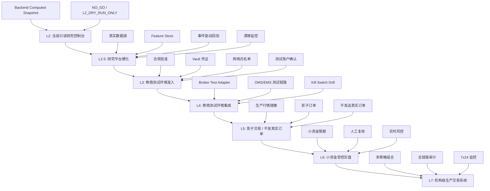
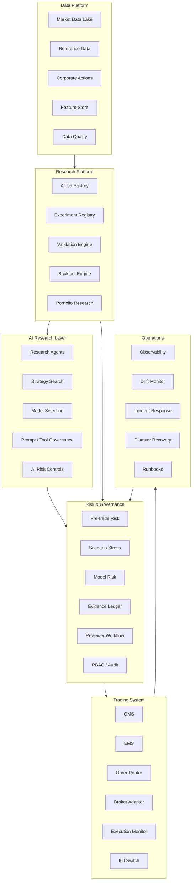
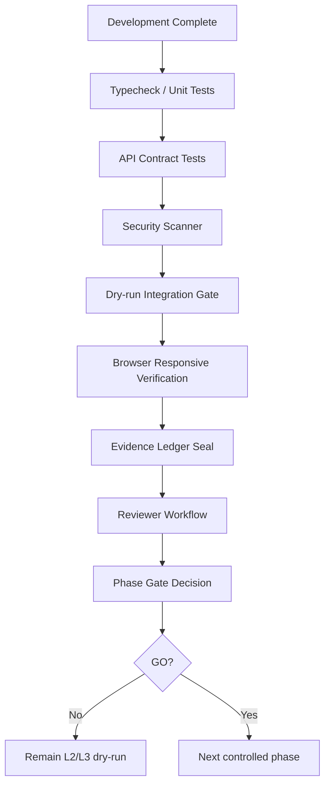

# QUANTOS 顶级机构级 AI 量化交易系统开发全流程

> 状态日期: 2026-06-12  
> 当前阶段: L2_DRY_RUN_ONLY / Research Console  
> 当前结论: NO_GO，禁止券商连接、禁止实盘下单、禁止凭证读取、禁止生产交易授权。

本文档定义 QUANTOS 从当前只读研究控制台，逐步演进为顶级量化机构级 AI 交易系统所需的完整开发流程、阶段门禁、系统模块、交付文档和验收标准。

## 0. 配套文档入口

| 文档 | 作用 |
|---|---|
| `docs/QUANTOS_DOCUMENTATION_CONTROL_CENTER.md` | 文档控制中心，管理全部 PRD/ADR/Runbook/API/验收文档状态 |
| `docs/QUANTOS_L2_5_RESEARCH_PLATFORM_HARDENING_BACKLOG.md` | L2.5 研究平台硬化执行 Backlog |

## 1. 当前系统定位

当前 QUANTOS 已经具备一个较完整的研究治理控制台雏形：

- 前端: `apps/research-console`
- 后端: `services/console/api`
- 运行模式: `BACKEND_COMPUTED_SNAPSHOT`
- 安全边界: `READ_ONLY` + `L2_DRY_RUN_ONLY`
- 阶段准入: `Phase 3A = NO_GO`
- 已完成能力: 数据目录、因子工厂、实验注册、验证、回测解释、压力测试、模型风险、证据链、复核工作流、权限与审计导出。

当前系统不是实盘交易系统。它只能用于研究、验证、解释、审计和治理展示。

## 2. 当前页面路径

```text
http://127.0.0.1:3100/research                          -> 总览 / Overview
http://127.0.0.1:3100/research/alpha-factory            -> 因子工厂 / Alpha Factory
http://127.0.0.1:3100/research/experiments              -> 实验注册表 / Experiment Registry
http://127.0.0.1:3100/research/data-catalog             -> 数据目录 / Data Catalog
http://127.0.0.1:3100/research/validation               -> 验证 / Validation
http://127.0.0.1:3100/research/backtest-explainability  -> 回测可解释性 / Backtest Explainability
http://127.0.0.1:3100/research/scenario-stress          -> 场景压力库 / Scenario Stress
http://127.0.0.1:3100/research/model-risk-review        -> 模型风险评审 / Model Risk Review
http://127.0.0.1:3100/research/evidence-ledger          -> 不可变证据链 / Evidence Ledger
http://127.0.0.1:3100/research/reviewer-workflow        -> 复核工作流 / Reviewer Workflow
http://127.0.0.1:3100/research/access-control           -> 权限与审计导出 / Access Control
http://127.0.0.1:3100/research/agents                   -> 研究智能体 / Agents
http://127.0.0.1:3100/research/paper-trading            -> 纸面交易 / Paper Trading
http://127.0.0.1:3100/research/portfolio                -> 组合研究 / Portfolio
http://127.0.0.1:3100/research/risk                     -> 风险 / Risk
http://127.0.0.1:3100/research/events                   -> 事件 / Events
http://127.0.0.1:3100/research/computation-lab          -> 计算实验室 / Computation Lab
http://127.0.0.1:3100/research/architecture             -> 系统架构 / Architecture
http://127.0.0.1:3100/research/phase-3a                 -> Phase 3A 准入 / Phase 3A
http://127.0.0.1:3100/research/system-health            -> 系统健康 / System Health
```

## 3. 当前后端 API 路径

```text
http://127.0.0.1:8400/health
http://127.0.0.1:8400/api/v1/console/overview
http://127.0.0.1:8400/api/v1/console/alpha-factory
http://127.0.0.1:8400/api/v1/console/experiments
http://127.0.0.1:8400/api/v1/console/data-catalog
http://127.0.0.1:8400/api/v1/console/validation
http://127.0.0.1:8400/api/v1/console/backtest-explainability?alpha_id=alpha-1
http://127.0.0.1:8400/api/v1/console/scenario-stress?alpha_id=alpha-1
http://127.0.0.1:8400/api/v1/console/model-risk-review
http://127.0.0.1:8400/api/v1/console/evidence-ledger
http://127.0.0.1:8400/api/v1/console/reviewer-workflow
http://127.0.0.1:8400/api/v1/console/access-control
http://127.0.0.1:8400/api/v1/console/agents
http://127.0.0.1:8400/api/v1/console/paper-trading?alpha_id=alpha-1
http://127.0.0.1:8400/api/v1/console/portfolio
http://127.0.0.1:8400/api/v1/console/risk-dashboard?alpha_id=alpha-1
http://127.0.0.1:8400/api/v1/console/events
http://127.0.0.1:8400/api/v1/console/computation-lab?alpha_id=alpha-1&cost_bps=18&stress=1.2
http://127.0.0.1:8400/api/v1/console/architecture
http://127.0.0.1:8400/api/v1/console/phase-3a-readiness
http://127.0.0.1:8400/api/v1/console/system-health
```

## 4. 目标系统总路径图



## 5. 目标业务闭环

```mermaid
flowchart LR
  A["Market / Alternative / Fundamental Data"] --> B["Data Lake"]
  B --> C["Feature Store"]
  C --> D["Alpha Factory"]
  D --> E["Experiment Registry"]
  E --> F["Validation"]
  F --> G["Event-driven Backtest"]
  G --> H["Scenario Stress"]
  H --> I["Portfolio Optimizer"]
  I --> J["Risk Engine"]
  J --> K["Model Risk Review"]
  K --> L["Evidence Ledger"]
  L --> M["Reviewer Workflow"]
  M --> N["Access Control / Audit Export"]
  N --> O["Phase Gate"]
  O --> P["Broker Test"]
  P --> Q["Shadow Trading"]
  Q --> R["Controlled Live"]
  R --> S["Production Trading"]
```



## 6. 生产级系统模块



## 7. 阶段开发流程

### L2 当前阶段: Research Console

目标: 完成只读研究、验证、治理、审计展示。

已完成:

- 研究控制台
- 后端 computed snapshots
- 数据目录
- 实验注册
- 回测解释
- 压力测试
- 模型风险
- 证据链
- 复核工作流
- RBAC 审计导出

禁止:

- 禁止真实券商连接
- 禁止 CTP/FIX 实现
- 禁止 socket 交易连接
- 禁止凭证读取
- 禁止 live order API
- 禁止 `live_trading_allowed=true`

退出条件:

- 当前所有 console API 合约测试通过
- Phase 3A blocker 明确
- 所有页面标记 read-only
- Governance scanner 0 violations

### L2.5 研究平台硬化

目标: 从 snapshot 原型转向可持久化、可复现的研究平台。

必须建设:

- 真实 Data Lake 元数据服务
- Offline Feature Store
- Feature materialization jobs
- 数据质量规则引擎
- 实验持久化数据库
- Artifact storage
- Event-driven backtest engine
- Drift monitor
- Immutable audit metadata

交付物:

- `DATA_LAKE_ARCHITECTURE.md`
- `FEATURE_STORE_DESIGN.md`
- `EXPERIMENT_REGISTRY_SCHEMA.md`
- `BACKTEST_ENGINE_SPEC.md`
- `DATA_QUALITY_RULEBOOK.md`
- `DRIFT_MONITORING_SPEC.md`
- `ARTIFACT_STORAGE_DESIGN.md`

验收:

- 可通过 dataset version 重放实验
- 可通过 feature snapshot 重放 alpha
- 可解释每次回测输入、参数、输出
- 回测结果可生成 reproducibility hash

### L3 Broker Test Environment Readiness

目标: 准备进入券商测试环境，但仍不能生产交易。

必须关闭 Phase 3A blockers:

- E01: Governance signatures incomplete
- E02: Broker test environment not confirmed
- E03: Legal/compliance approval incomplete
- E04: Test credentials not provisioned in Vault
- E06: Network access not reviewed

必须建设:

- Vault-only test credential intake
- Broker test account evidence
- Network whitelist review
- Legal/compliance signoff
- Broker adapter interface contract
- Kill switch test plan

交付物:

- `PHASE_3A_GO_NO_GO_REVIEW_PACK.md`
- `BROKER_TEST_ENV_READINESS.md`
- `VAULT_CREDENTIAL_INTAKE_RUNBOOK.md`
- `NETWORK_ACCESS_REVIEW.md`
- `LEGAL_COMPLIANCE_APPROVAL.md`
- `BROKER_ADAPTER_INTERFACE_CONTRACT.md`

验收:

- 15/15 Phase 3A criteria approved
- `implementation_authorized=true` 仅限 broker test
- 仍禁止生产实盘

### L4 Broker Test Integration

目标: 在券商测试环境验证订单链路。

允许:

- 测试环境 broker adapter
- 测试环境 order submit/cancel
- 模拟成交回报
- 测试环境 kill switch

禁止:

- 生产 broker endpoint
- 生产资金账户
- 真实交易下单

必须建设:

- OMS test module
- EMS test module
- Broker test adapter
- Order state machine
- Execution report parser
- Pre-trade risk gate
- Post-trade reconciliation

交付物:

- `OMS_DESIGN.md`
- `EMS_DESIGN.md`
- `ORDER_STATE_MACHINE.md`
- `BROKER_TEST_ADAPTER_SPEC.md`
- `EXECUTION_REPORT_CONTRACT.md`
- `PRE_TRADE_RISK_RULES.md`
- `KILL_SWITCH_RUNBOOK.md`

验收:

- 测试订单生命周期完整
- Cancel/replace 可验证
- 风控拦截可验证
- Kill switch 可验证
- 所有测试事件进入 evidence ledger

### L5 Shadow Trading

目标: 接入生产行情镜像，但不发送真实订单。

允许:

- 生产行情读取
- 影子订单生成
- 虚拟成交模拟
- 风控实时监控

禁止:

- 真实订单发送
- 真实账户交易

必须建设:

- Shadow order generator
- Market data live mirror
- Latency monitor
- Slippage estimator
- Real-time risk dashboard
- Intraday drift monitor

交付物:

- `SHADOW_TRADING_DESIGN.md`
- `LIVE_MARKET_DATA_READONLY_CONTRACT.md`
- `SHADOW_ORDER_SCHEMA.md`
- `REAL_TIME_RISK_MONITORING.md`
- `LATENCY_SLO.md`

验收:

- 连续 N 个交易日影子订单稳定
- 风控报警可追踪
- 与回测/纸面交易差异可解释
- 所有结果进入 model risk review

### L6 Controlled Small-Capital Live Pilot

目标: 小资金、限额、人工复核的受控实盘试点。

前置条件:

- L5 shadow trading 通过
- 独立模型验证完成
- 合规批准
- 风险委员会批准
- Broker production account approval
- Emergency kill switch drill passed

必须建设:

- Production OMS/EMS
- Real broker adapter
- Hard pre-trade risk limits
- Intraday kill switch
- Position reconciliation
- PnL attribution
- Incident response

交付物:

- `CONTROLLED_LIVE_PILOT_PLAN.md`
- `PRODUCTION_RISK_LIMITS.md`
- `LIVE_TRADING_RUNBOOK.md`
- `INCIDENT_RESPONSE_RUNBOOK.md`
- `DAILY_RECONCILIATION_RUNBOOK.md`
- `PILOT_EXIT_CRITERIA.md`

验收:

- 小资金限额执行
- 每日 reconciliation 完成
- 异常可回滚
- 风控可一键停止
- 交易后审计完整

### L7 Institutional Production Trading System

目标: 机构级生产交易系统。

必须具备:

- 多策略组合
- 多 broker redundancy
- OMS/EMS 高可用
- Real-time risk
- Portfolio optimizer
- Scenario stress intraday
- Model governance
- AI agent governance
- RBAC
- Immutable audit trail
- Disaster recovery
- 7x24 observability

交付物:

- `PRODUCTION_TRADING_ARCHITECTURE.md`
- `MULTI_BROKER_ROUTING.md`
- `HIGH_AVAILABILITY_DESIGN.md`
- `DISASTER_RECOVERY_PLAN.md`
- `OBSERVABILITY_SLO_SLA.md`
- `MODEL_GOVERNANCE_OPERATING_MODEL.md`
- `AI_AGENT_GOVERNANCE.md`
- `ANNUAL_REVIEW_PACK.md`

验收:

- 生产稳定性达标
- 风控独立有效
- 审计链完整
- 权限最小化
- 灾备演练通过
- 模型风险周期复核通过

## 8. 必需文档清单

### 8.1 产品与业务文档

| 文档 | 目的 | 阶段 |
|---|---|---|
| `PRODUCT_REQUIREMENTS.md` | 产品范围、用户、核心流程 | L2.5 |
| `USER_WORKFLOWS.md` | 研究员、风险、合规、运维流程 | L2.5 |
| `PHASE_GATE_POLICY.md` | L2-L7 阶段准入规则 | L2.5 |
| `OPERATING_MODEL.md` | 组织角色与责任边界 | L3 |

### 8.2 系统架构文档

| 文档 | 目的 | 阶段 |
|---|---|---|
| `SYSTEM_ARCHITECTURE.md` | 总体架构 | L2.5 |
| `SERVICE_INVENTORY.md` | 服务清单 | L2.5 |
| `DATA_FLOW_DIAGRAM.md` | 数据流与依赖 | L2.5 |
| `DEPLOYMENT_ARCHITECTURE.md` | 部署拓扑 | L3 |
| `HIGH_AVAILABILITY_DESIGN.md` | 高可用设计 | L6 |
| `DISASTER_RECOVERY_PLAN.md` | 灾备设计 | L6 |

### 8.3 数据与特征文档

| 文档 | 目的 | 阶段 |
|---|---|---|
| `DATA_LAKE_ARCHITECTURE.md` | 数据湖设计 | L2.5 |
| `DATASET_CONTRACTS.md` | 数据集 schema 与版本 | L2.5 |
| `FEATURE_STORE_DESIGN.md` | 特征库设计 | L2.5 |
| `POINT_IN_TIME_POLICY.md` | 防未来函数策略 | L2.5 |
| `DATA_QUALITY_RULEBOOK.md` | 数据质量规则 | L2.5 |
| `DATA_LINEAGE_MODEL.md` | 血缘模型 | L2.5 |

### 8.4 研究与回测文档

| 文档 | 目的 | 阶段 |
|---|---|---|
| `ALPHA_FACTORY_SPEC.md` | 因子生产规则 | L2.5 |
| `EXPERIMENT_REGISTRY_SCHEMA.md` | 实验注册 schema | L2.5 |
| `VALIDATION_ENGINE_SPEC.md` | 验证门禁 | L2.5 |
| `BACKTEST_ENGINE_SPEC.md` | 事件驱动回测引擎 | L2.5 |
| `COST_SLIPPAGE_MODEL.md` | 成本与滑点模型 | L2.5 |
| `BACKTEST_EXPLAINABILITY_SPEC.md` | 回测解释标准 | L2.5 |

### 8.5 组合与风险文档

| 文档 | 目的 | 阶段 |
|---|---|---|
| `PORTFOLIO_OPTIMIZER_SPEC.md` | 组合优化 | L3 |
| `RISK_ENGINE_SPEC.md` | 风险引擎 | L3 |
| `PRE_TRADE_RISK_RULES.md` | 交易前风控 | L4 |
| `SCENARIO_STRESS_LIBRARY.md` | 压力测试库 | L2.5 |
| `RISK_LIMITS_POLICY.md` | 限额政策 | L4 |
| `KILL_SWITCH_RUNBOOK.md` | 停止交易机制 | L4 |

### 8.6 模型风险与 AI 治理文档

| 文档 | 目的 | 阶段 |
|---|---|---|
| `MODEL_RISK_POLICY.md` | 模型风险政策 | L2.5 |
| `MODEL_INVENTORY_SCHEMA.md` | 模型台账 | L2.5 |
| `MODEL_VALIDATION_STANDARD.md` | 独立验证标准 | L3 |
| `AI_AGENT_GOVERNANCE.md` | AI agent 治理 | L2.5 |
| `PROMPT_TOOL_RISK_CONTROLS.md` | Prompt/tool 风险控制 | L2.5 |
| `MODEL_DRIFT_MONITORING.md` | 模型漂移监控 | L3 |

### 8.7 交易系统文档

| 文档 | 目的 | 阶段 |
|---|---|---|
| `OMS_DESIGN.md` | 订单管理系统 | L4 |
| `EMS_DESIGN.md` | 执行管理系统 | L4 |
| `ORDER_STATE_MACHINE.md` | 订单状态机 | L4 |
| `BROKER_ADAPTER_INTERFACE_CONTRACT.md` | 券商 adapter 合约 | L3 |
| `EXECUTION_REPORT_CONTRACT.md` | 成交回报合约 | L4 |
| `BROKER_TEST_ENV_READINESS.md` | 券商测试环境准入 | L3 |
| `SHADOW_TRADING_DESIGN.md` | 影子交易 | L5 |
| `CONTROLLED_LIVE_PILOT_PLAN.md` | 小资金实盘试点 | L6 |

### 8.8 安全、权限与审计文档

| 文档 | 目的 | 阶段 |
|---|---|---|
| `RBAC_POLICY.md` | 角色与权限 | L2.5 |
| `ACCESS_REVIEW_RUNBOOK.md` | 权限复核 | L2.5 |
| `VAULT_CREDENTIAL_INTAKE_RUNBOOK.md` | 凭证进入 Vault | L3 |
| `AUDIT_LEDGER_DESIGN.md` | 不可变审计链 | L2.5 |
| `EVIDENCE_EXPORT_POLICY.md` | 证据导出政策 | L2.5 |
| `SECURITY_BOUNDARY.md` | 安全边界 | L2.5 |

### 8.9 运维与可靠性文档

| 文档 | 目的 | 阶段 |
|---|---|---|
| `OBSERVABILITY_SLO_SLA.md` | 监控与 SLO | L3 |
| `INCIDENT_RESPONSE_RUNBOOK.md` | 事故响应 | L4 |
| `DAILY_RECONCILIATION_RUNBOOK.md` | 每日对账 | L4 |
| `ROLLBACK_RUNBOOK.md` | 回滚流程 | L4 |
| `DISASTER_RECOVERY_PLAN.md` | 灾备 | L6 |
| `POSTMORTEM_TEMPLATE.md` | 复盘模板 | L4 |

## 9. 每阶段门禁



## 10. 测试策略

必须覆盖:

- TypeScript typecheck
- Python API contract tests
- Frontend production build
- Governance scanner
- Dry-run adapter integration gate
- Browser desktop/mobile verification
- API source badge verification
- No horizontal overflow
- No console errors
- Forbidden capability scanner

当前标准命令:

```powershell
rtk npm run typecheck
rtk npm run build
rtk proxy python -m pytest services/console/api/tests/test_console_api.py -q
rtk proxy python scripts\run_paper_to_live_governance_check.py
rtk proxy python scripts\run_dry_run_adapter_integration_gate.py
```

## 11. 当前绝对禁止事项

在 Phase 3A 变成 GO 之前，禁止:

- 真实 CTP/FIX 实现
- 真实券商 SDK import
- 真实 socket broker connection
- 真实凭证文件
- 真实订单 API
- 真实生产账户
- `live_trading_allowed=true`
- 绕过 Vault 的凭证读取
- 绕过 reviewer workflow 的授权
- 绕过 evidence ledger 的阶段晋升

## 12. 下一步开发优先级

### P0

1. Monitoring & Drift Dashboard
2. Persistent Data Catalog
3. Feature Store materialization
4. Experiment Registry database
5. Event-driven backtest engine

### P1

1. Model drift monitor
2. Reviewer signed attestation
3. Evidence export workflow
4. RBAC integration with identity provider
5. Portfolio optimizer

### P2

1. Broker test adapter interface
2. OMS/EMS test environment
3. Shadow trading replay
4. Live market data read-only mirror
5. Disaster recovery drills

## 13. 参考标准

本项目后续设计应参考以下官方或监管标准:

- Federal Reserve / OCC / FDIC, Supervisory Guidance on Model Risk Management: https://www.federalreserve.gov/frrs/guidance/supervisory-guidance-on-model-risk-management.htm
- Federal Reserve SR 11-7 historical model risk guidance: https://www.federalreserve.gov/supervisionreg/srletters/sr1107.htm
- NIST AI Risk Management Framework: https://www.nist.gov/itl/ai-risk-management-framework
- Basel Committee Stress Testing Principles: https://www.bis.org/bcbs/publ/d450.htm
- SEC Rule 15c3-5 Market Access Risk Controls: https://www.sec.gov/files/rules/final/2010/34-63241-secg.htm

## 14. 总结

QUANTOS 当前已经从 mock 展示页推进到研究治理闭环，但距离顶级量化机构 AI 交易系统仍需要完成真实数据基础设施、事件驱动回测、持久化特征库、生产级风控、OMS/EMS、券商测试、影子交易、小资金试点、权限与审计、运维灾备等关键工程。

下一阶段应集中在 L2.5 Research Platform Hardening，目标是把当前 read-only computed snapshots 升级为可持久化、可复现、可审计、可扩展的研究平台。
