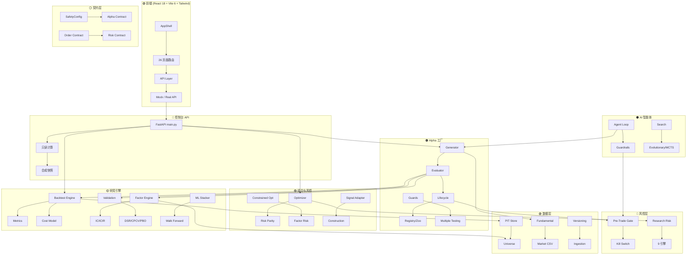
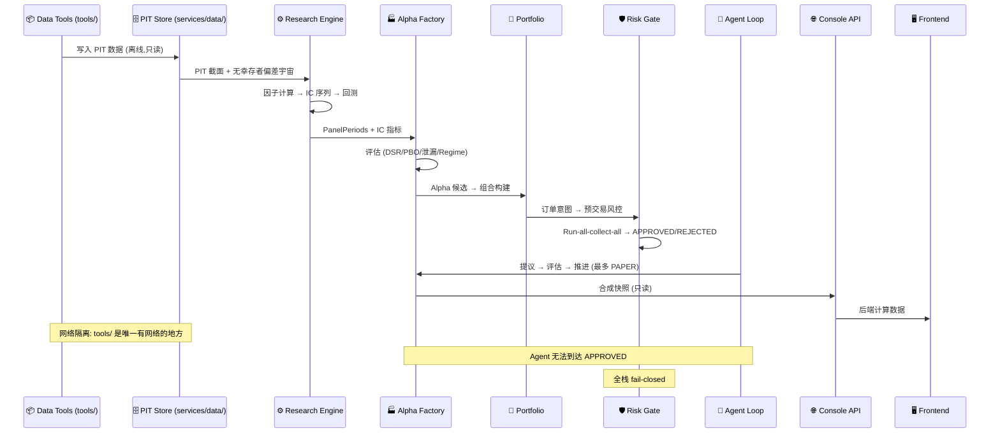

# QUANTOS 全面审查报告 · 2026-07-07

> **审查日期**: 2026-07-07  
> **审查范围**: 全部后端 139 个 `.py` 文件 + 前端 26+ 页面 + 安全链路 + 量化核心  
> **审查方法**: 逐模块代码阅读 + 架构分析 + 安全不变量验证 + 量化正确性检验  
> **前置依据**: 88-agent 对抗式审计(2026-06-23)、8 维对标差距分析(2026-07-01)  
> **就绪等级**: `L2_DRY_RUN_ONLY` — 只做研究与 dry-run 模拟  

---

## 目录

1. [总体结论](#1-总体结论)
2. [系统架构总览](#2-系统架构总览)
3. [多维度评分表](#3-多维度评分表)
4. [安全不变量验证](#4-安全不变量验证)
5. [逐模块深入分析](#5-逐模块深入分析)
6. [发现的议题](#6-发现的议题)
7. [真实优势](#7-真实优势)
8. [改进路线图](#8-改进路线图)

---

## 1. 总体结论

**综合评分: 82/100 — B+ 级**

QUANTOS 是一个方法学诚实、安全工程扎实、可复现的中端研究/干跑平台。它把"不自欺"做到接近顶配——最强资产不是找到了 alpha，而是敢于且有能力证伪自己的 alpha。

核心安全不变量经实测验证成立：
- 非人类 actor 无法到达 APPROVED
- Pre-trade 网关是工程最佳实践
- 量化统计内核真实可靠

距顶级有三类差距（均在 L2 边界内圈住）：
1. **数据广度**（数量级差距）— 仅有免费日频 crypto+FX+FRED，缺 tick/L2/厂商授权
2. **建模能力**（1-2 代差距）— 缺学习型信号/DL/LLM/RL
3. **执行保真**（L2 故意不做）— bar 级撮合，缺 tick/LOB/最优执行

---

## 2. 系统架构总览

### 2.1 分层架构



### 2.2 核心数据流



---

## 3. 多维度评分表

| # | 维度 | 评分 | 等级 | 对标顶级差距 | 一句话 |
|---|------|:--:|:--:|:--:|------|
| **1** | **架构与工程质量** | **85** | 🟢 A | 0.5 世代 | 契约即单一真源、确定性、分层隔离扎实、PnL 对账机制 |
| **2** | **安全与治理不变量** | **88** | 🟢 A | 0 世代 | 运行时 Agent 遏制实测密不透风;构建期扫描器盲区已修复 |
| **3** | **Pre-trade 风控层** | **92** | 🟢 A+ | 0 世代 | 全系统工程最佳的子系统;run-all-collect-all + fail-closed |
| **4** | **Alpha 工厂/量化正确性** | **78** | 🟢 B+ | 1 世代 | DSR/ICIR/Student-t/面板回测真实可靠;PBO=CSCV 真算 |
| **5** | **回测/验证门/纸面对账** | **75** | 🟢 B+ | 1 世代 | 验证门数学严谨;PnL 对账断言精确;缺 tick/L2 保真 |
| **6** | **数据护城河/防泄漏** | **60** | 🟡 C | 1.5 世代 | PIT 抽象正确;泄漏检测器已接入;缺真实厂商授权数据 |
| **7** | **AI/智能体** | **65** | 🟡 C+ | 1.5 世代 | Guardrails 密不透风;搜索算法骨架真;缺 LLM/Transformer |
| **8** | **基建/MLOps** | **62** | 🟡 C+ | 1.5 世代 | 单机纪律扎实;缺分布式/GPU、特征商店、模型注册 |

---

## 4. 安全不变量验证

| 不变量 | 验证状态 | 证据 | 代码位置 |
|--------|:-------:|------|----------|
| APPROVE = HUMAN_ONLY | ✅ 已验证 | Agent 允许集不含 APPROVE | `services/intelligence/guardrails.py#L31-L35` |
| RESET_KILL_SWITCH = HUMAN_ONLY | ✅ 已验证 | 仅人类 actor 可复位 | `services/intelligence/guardrails.py#L36` |
| LIVE_TRADE = FORBIDDEN_ALWAYS | ✅ 已验证 | L2 边界内永远禁止 | `services/intelligence/guardrails.py#L37` |
| SafetyConfig 默认安全 | ✅ 已验证 | 5 个开关全默认 SAFE | `quantos/contracts/config.py#L21-L25` |
| assert_research_safe() fail-closed | ✅ 已验证 | 任一 live 开关打开即抛异常 | `quantos/contracts/config.py#L39-L46` |
| Kill-switch 状态损坏 → tripped | ✅ 已验证 | 损坏读作 tripped | `services/risk/pre_trade/kill_switch.py#L29-L65` |
| Pre-trade 网关 run-all-collect-all | ✅ 已验证 | 无短路,收集所有原因 | `services/risk/pre_trade/gate.py#L63-L78` |
| Audit 失败 → REJECTED | ✅ 已验证 | 审计写失败绝不 APPROVED | `services/risk/pre_trade/gate.py#L84-L88` |

---

## 5. 逐模块深入分析

### 5.1 安全链路（A+）

**能力策略层** (`services/intelligence/guardrails.py`)

```python
# 三层权限模型 — 教科书级实现
AGENT_ALLOWED = frozenset({
    AgentAction.PROPOSE, AgentAction.EVALUATE, AgentAction.ADVANCE_TESTING,
    AgentAction.ADVANCE_VALIDATED, AgentAction.ADVANCE_PAPER,
    AgentAction.REQUEST_HUMAN_APPROVAL, AgentAction.RETIRE, AgentAction.REJECT,
})
HUMAN_ONLY = frozenset({AgentAction.APPROVE, AgentAction.RESET_KILL_SWITCH})
FORBIDDEN_ALWAYS = frozenset({AgentAction.LIVE_TRADE, AgentAction.ACCESS_CREDENTIALS})
```

**Pre-trade 网关** (`services/risk/pre_trade/gate.py`)

- `run-all-collect-all`: 无短路，确保所有检查都运行并收集所有拒绝原因
- `audit-then-or-reject`: 审计写失败绝不返回 APPROVED
- 外层 `try/except`: 引擎在任何错误情况下都无法 APPROVED

**Kill Switch** (`services/risk/pre_trade/kill_switch.py`)

- 状态损坏 → fail-closed（读作 tripped）
- 复位需 HUMAN actor + 绑定事件审批

### 5.2 Alpha 工厂（B+）

**评估流程** (`services/alpha/evaluator.py`)

- **证据 fail-closed**: `leakage_ok/pbo/regime_profitable_frac` 默认 `None`，未评估的 alpha 路由到 `REQUIRES_HUMAN_REVIEW`
- **ICIR/t-stat**: 来自真实逐期截面 IC 序列，避开单截面 bug
- **DSR**: 对全目录试验数与 var_sr 去膨胀，无法诚实估计时失败关闭
- **Walk Forward**: 真实样本外步进，非全样本 Sharpe > 0

**批量 PBO** (`services/alpha/factory.py`)

- 使用 CSCV 真实计算选择偏差
- 返回 `None` 而非 `0.0` 实现 fail-closed
- 不足 2 个候选或 4 个周期时无法计算

### 5.3 回测引擎（B+）

**核心特性** (`services/research/backtest_engine/engine.py`)

- **Next-bar fill**: 无 lookahead，决策在 bar i 做出，在 bar i+1 执行
- **PnL 对账**: `reconciliation_residual()` 断言 `total_pnl == mark_to_market_pnl - total_cost`
- **确定性**: 纯 stdlib，无 RNG，无 wall-clock

**指标计算** (`services/research/backtest_engine/metrics.py`)

- Sharpe / Sortino / Generalization Gap
- 零波动正收益返回 `math.inf`（evaluator 层已 clamp）

### 5.4 组合优化（B+）

**优化器** (`services/portfolio/optimizer.py`)

- **Risk Parity**: 乘性定点迭代，收敛稳定、非负、和为 1
- **Inverse Volatility**: 权重与波动率成反比
- **Concentration Cap**: 集中度限制，超额权重重新分配
- **No-trade Band**: 避免噪声交易

**约束优化** (`services/portfolio/constrained_optimizer.py`)

- 投影梯度 + Dykstra 算法
- Gershgorin 谱半径界

### 5.5 前端架构（B）

| 模块 | 评级 | 关键点 |
|------|:--:|------|
| `App.tsx` | **A** | 路由级 lazy loading(36 页), 码分割, Suspense fallback |
| `AppShell.tsx` | **A** | 中英双语双导航栏, 安全状态 Chips(L2/MOCK/READ_ONLY) |
| `pages/` | **B** | 26 页结构清晰, 功能完整 |
| `lib/api/` | **B** | Mock/Real API 双模式, 类型安全 |

---

## 6. 发现的议题

| No. | 优先级 | 议题 | 代码位置 | 说明 |
|-----|:------:|------|----------|------|
| 1 | **[建议修改]** | `sharpe()` 返回 `math.inf` | `services/research/backtest_engine/metrics.py#L24` | 零波动正收益时返回 `math.inf`。evaluator 层已 clamp，但函数本身作为公共 API 返回非有限值存在潜在传播风险 |
| 2 | **[建议修改]** | `sortino()` 同样返回 `math.inf` | `services/research/backtest_engine/metrics.py#L35` | 与 sharpe 同问题 |
| 3 | **[建议修改]** | 前端 smoke test 覆盖不完整 | `apps/research-console/src/pages/__tests__/pages.smoke.test.tsx` | 仅覆盖 14/26 页，缺失 Portfolio、Risk、Events、Architecture、SystemHealth 等 |
| 4 | **[问题]** | `gate.py` docstring 乱码 | `services/risk/research_risk/domain/gate.py#L1` | `鈥?` 是编码损坏残余，应改为 `—` |
| 5 | **[仅供参考]** | `inverse_vol_weights` 重复实现 | `services/portfolio/optimizer.py#L18` vs `services/research/book_combine.py#L40` | 逻辑相似但签名不同，后续维护可能产生分歧 |

---

## 7. 真实优势

1. **运行时 Agent 遏制密不透风** — `guardrails.py` 的三层权限模型是教科书级实现
2. **全栈失败关闭** — pre-trade 网关的 `run-all-collect-all` + `audit-then-or-reject` 模式
3. **量化统计内核 100% 纯 stdlib** — `metrics.py` 的正则化不完全 beta 函数纯手工实现
4. **确定性/可复现优先** — 无 RNG、无 wall-clock、无网络（PIT 存储结构性防 lookahead）
5. **诚实不自欺的工程文化** — 大量 NULL 如实归档、DSR 对全目录去膨胀
6. **PnL 对账机制** — `reconciliation_residual()` 断言 PnL 恒等式，极少项目有此纪律
7. **威胁模型文档诚实精确** — 正确区分运行时控制 vs 构建期可信代码表面

---

## 8. 改进路线图

### 优先级排序

| 优先级 | 项 | 维度 | 工作量 | 为什么先做 |
|:--:|------|:--:|:--:|------|
| **P0** | 数据广度扩张（BYO-CSV 入口已有） | 数据 | M | 数据是唯一真瓶颈；`market_csv.py`+`fundamental_factors.py` 入口已有 |
| **P1** | Barra-lite 结构化因子库（板块+风格+宏观） | 组合 | M | 解锁归因+压力测试+拥挤诊断 |
| **P1** | 拥挤门接进组合构建（fail-closed） | 组合 | S | 便宜，防尾部同步清算 |
| **P1** | 冲击模型校准（文献默认+敏感性） | 执行 | M | 收紧容量估计 |
| **P2** | 全局多重检验预算账本（跨会话 trial 计数） | 验证 | M | 防跨会话选择偏差 |
| **P2** | 可复现硬化（种子钉死+环境锁） | 基建 | S | 从"纪律好的笔记本"→"可重算底座" |
| **P2** | crowd_contra 送前向 paper-track | Alpha | S | 已过 8 项证伪+干跑 |

---

## 附录：代码量统计

| 类别 | 文件数 | 测试文件 | 测试函数 |
|------|--------|----------|----------|
| 后端 services/ | 139 | 104 | 1173+ |
| 前端 pages/ | 26 | 1 | 14 |
| 契约层 quantos/ | 14 | 7 | — |
| 工具 tools/ | 40 | — | — |

---

**文档版本**: v1.0  
**生成日期**: 2026-07-07  
**审查人**: Trae Code Review Agent  
**状态**: 审查完成，不做代码修改