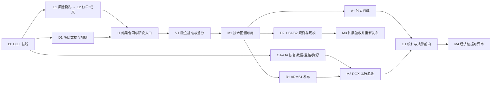

> 执行记录：用户于 2026-09-05 提供本稿并要求直接开始、加速开发。下文审查稿原文保留；当前实施进度见 [首批实施记录](../specs/2026-09-05-dgx-engine-foundation-increment1.md)。稿中 Windows 路径所指复审报告尚未同步，不能声称已读取该报告。

> 2026-09-05 范围调整：用户明确“异机先不做，没有条件完成”。O1 异机恢复验收延期；继续本机开发和隔离验证，不将延期项计入 M2 完成。最新增量见 [技术回放与诊断记录](../specs/2026-09-05-dgx-engine-foundation-increment3.md)。

**QUANTOS DGX 引擎与底层开发路线——审查稿 v1**

状态：DRAFT_FOR_REVIEW。日期：2026-09-05。本文将同日 DGX 审查转化为开发工作包，不表示已经开始实施，也不修改现有发布或经济准入状态。

依据：[DGX 底层复审报告](H:/code/QUANTOS/docs/reports/2026-09-05-dgx-foundation-followup-audit.md)。审查源提交为 `1e324568b4bfd1e3b98eab7de5dde0632aa33103`；运行版本为 `cd7698f168c05d01127ede2dd8a60424d9816b7e`。执行前必须重新核对实际 HEAD、状态和运行版本，不能将这些快照当作实时状态。

本计划是当前引擎修复的工程分解，延续 PROJECT_STATE 与现行 V1 隔离约束，并接回既有固定生产路线；不另建一套与现有 trial ledger、候选身份和人工准入平行的流程。旧 program plan 的早期百分比及历史“盈利/可部署”快照不作为本轮验收依据。

**目标与建议范围**

首个交付目标：在 DGX 上，通过研究入口运行一组冻结的公共行情，完成策略意图→订单准入→模拟成交→统一账本→定频净收益→可重放报告，能够解释每一笔成交、拒绝、费用与风险决策。

建议第一批覆盖 Binance USDⓈ-M 线性 USDT 永续、现有全仓/逐仓模式、主动成交、市价与限价、减仓、反手、撤单和部分成交。具体交易规则由冻结的场所 profile 指定。Bybit 用于已有数据采集和后续独立场所适配。A 股数据更新继续维护；其 T+1、涨跌停、公司行为等执行机制单列后续工作包，不混入永续引擎修复。

建议继续复用 QUANTOS 的 Decimal 账本与研究组件；LEAN/VectorBT 首先承担隔离的差分对照，快速研究库的正式引入以适配验收决定。全部新模拟结果仍为 TECHNICAL_VALIDATION_ONLY，直到独立经济准入合同实际满足。

**里程碑及完成定义**

| 里程碑 | 可交付成果 | 必须通过的工作包 | 不能据此宣称的能力 |
|---|---|---|---|
| M0 基线可重复 | 明确 DGX 源码、依赖、状态目录和测试入口 | B0 | 新引擎正确或已部署 |
| M1 技术回测可用 | 从研究入口完成真实冻结数据的完整技术运行，能复跑和解释结果 | E1、E2、D1、I1、V1 | 有盈利能力、已有正式 paper 准入 |
| M2 DGX 可持续运行 | 当前代码完成 ARM64 发布验收，故障可发现、状态可恢复 | M1、O1–O4、R1 | 所有历史场所规则与模型均已覆盖 |
| M3 研究规模可扩展 | 长历史规则切换、流式回放、任务恢复、批量实验 | D2、S1、S2；相关变化重新经过 V1/R1 | 大量试验自动提高有效性 |
| M4 经济证据可评审 | 来源与结果独立验证，统计和成熟前向证据完整 | A1、G1，及其所用版本的 M2 验收 | 自动进入真钱交易 |

**B0：锁定 DGX 开发基线**

依赖：无。交付一个基线和环境说明变更。

- 从 `/home/kerstker/QUANTOS-backtest-runtime-integration` 复核当前分支及提交；保留旧 `/home/kerstker/src/QUANTOS` 中的未提交成果。
- 后续任务从核实的提交建立 `codex/` 分支/工作树。制定分支合入与证据生成顺序，避免多个目录分别被称为“最新”。
- 按当前锁文件建立 ARM64 开发环境，固定 Python/Node 调用路径；测试输出使用任务独立状态根。
- 给出统一开发入口，执行前检查架构、源码身份、依赖、工作目录和输出目录。读取实际 AGENTS、PROJECT_STATE 及相关设计。
- 区分 immutable release、运行状态、研究数据快照、开发测试输出。不得用运行数据库作为可写测试夹具。

验收：从全新非交互 SSH 会话可执行选定专项测试；源码及依赖身份可记录；原运行状态无测试写入；默认目录不再隐式决定版本。

**E1：修复成交后风险预算**

依赖：B0。主要修改 `services/execution/perpetual_simulation.py`、`perpetual_ledger_v2.py` 及相应 execution/risk 测试。

- 将本次 1,000 权益/1,000 敞口/1 手续费反例纳入失败回归；补充已知即时价差造成的权益变化。
- 使用拟实际成交数量预演账户状态：先根据深度、数量精度和容量确定切片，再计算费用、持仓、权益及保证金。
- 从预演状态计算 gross exposure、单名暴露、可用保证金及相关风险阈值；返回逐项限额与拒绝原因。
- 预演与提交复用同一账本转换逻辑，不能复制出第二套 PnL/费用公式。
- 首版默认对新增风险的超限拟成交明确拒绝，不做未声明的自动缩量。未来缩量必须是显式、版本化策略。
- 拒绝必须同时撤销账本、订单状态、深度、容量和资金预留的临时变化；历史日志不做全量 deepcopy。

验收：成本后的新增风险通过明确配置的风险限制；拒绝后状态与重试结果一致；对账残差为零；改变未来行情不改变过去许可。已发生的市场估值、资金费或真实成交事实必须记录，不能通过事后拒绝删除损失。减风险处理沿用明确政策，不用开仓限制误拦必要退出。

**E2：拆分订单准入、执行切片与订单状态**

依赖：E1。建议拆成三个独立、可回归的变更。

- E2.1 订单准入：原订单的价格/数量精度、最小/最大金额、订单类型、reduce-only 和额度预留。反手最小量按场所政策核对，不能直接把会计上的新仓残量当作一张新订单。
- E2.2 执行切片：合法已接受订单的小额部分成交不重新检查开仓最低金额；按真实切片记费用、消耗流动性并减少 remaining。保留精度、累计数量、容量和身份检查。
- E2.3 状态转换：明确 OPEN/PARTIALLY_FILLED/FILLED/CANCELED/EXPIRED/REJECTED 的合法边、原因及释放预留规则；核对部分成交后撤单、重复事件、反向挂单和多腿的资金竞争。
- 多腿默认逐腿处理并暴露中间风险；需要原子组合的策略必须声明相应模型，不能把独立市场成交伪装成原子交易。

验收：金额 10 的合法订单能由十笔金额 1 的可用流动性完成；累计成交与剩余量守恒；费用随真实成交量计算；重复事件不重复成交；撤单/到期后不再成交；现有持仓、开平仓和反手测试继续有效。

**D1：接入冻结公共数据与最小场所规则**

依赖：B0，可与 E1/E2 的实施分开推进；合并后通过 E2 的合同。

主要范围：复用 `services/data/`、现有历史规则合同及 `SimulationFrame`；在 tools 边界提供离线驱动。新文件名在详细设计中确定，避免与已有适配器重复。

- 建立唯一的 frame 构造入口，区分 event time、首次可用时间、决策时间、执行时间。
- mark、可执行 bid/ask、资金费事件分别建模；历史聚合深度只能用于它能支持的容量诊断，不得冒充逐档可成交订单簿。
- 冻结数据清单：场所、标的、时间段、来源、分区 hash、缺口、字段单位及规则版本。
- 增加首版必需的价格 tick、数量步长/上下限、手续费和资金费日程，规则缺失时拒绝对应运行。
- 首版可采用“整段样本位于一个已证明规则区间”的明确限制；不得用今天的规则无声覆盖所有历史。

验收：追加未来数据或后到修订不会改变既有决策；乱序/重复/缺口有明确处理结果；数据不足以支持的实验会明确拒绝；至少一个有限样本从冻结公共数据完成 replay 并核验逐事件账本。

**I1：统一结果合同并接通研究入口**

依赖：E2 + D1。建议三个变更分别评审。

- I1.1 结果合同：冻结 run、dataset、strategy、rules、cost、risk、seed/确定性配置及源码身份；保留订单明细、费用、资金费、保证金、权益、拒绝原因和对账结果。
- I1.2 统计适配：事件序列保留顺序；另按明确日历/频率输出净权益与收益。明确同一时点多事件、无成交期间、外部资金流、年化及零/负权益处理。
- I1.3 入口接线：在 `services/research_runner/run_kinds.py` 增加有界、白名单化的技术回测项，接入既有 runner/run registry 和控制台。参数不得任意指定 shell、代码或生产写入路径。
- 任务失败、取消、重复请求的语义必须准确。若底层只有软取消，前端必须说明，不承诺进程已停止。
- 旧 V1 隔离入口保留，新结果不能冒充旧格式恢复盈利或晋级记录。

验收：从研究入口发起一次运行，控制台展示实际配置、代码/数据身份、净结果和拒绝原因；同一输入重跑语义结果一致；失败不能显示成功；插入不改变经济过程的额外事件不改变固定频率统计。

**V1：建立独立基准与跨引擎差分验证**

依赖：I1。差分环境独立于运行服务，固定引擎、依赖与 ARM64 构建身份。

- 建立独立手算/参考实现的黄金案例，避免测试直接调用被测函数计算预期值。
- 首批案例覆盖：无交易、长短仓、费用、价差、资金费、部分成交、减仓、反手、双订单竞争、容量截断、过期/迟到报价、保证金不足、强平与失败回滚。
- LEAN/VectorBT 仅在共同支持且配置相同的简化模型上对照。没有相同资金费、强平或队列模型的案例标记不适用，不能为了数字一致删掉 QUANTOS 的成本。
- 比较逐笔数量、现金、持仓、费用和定频净权益；记录精度约定与每个差异，不能只比最终收益。
- 增加确定性和性质测试：前缀不变、时间因果性、幂等、状态守恒；常量费用假设下拆分等价交易的费用与账户变化一致。

验收：所有适用黄金案例通过；共同模型下无未解释差异；不适用案例明确列出；执行/风险专项和受影响治理检查通过，形成 M1 技术回测验收包。

**O1–O4：DGX 并行运维工作包**

依赖：B0；可与引擎开发分别推进。

| 工作包 | 具体开发 | 验收标准 | 外部依赖 |
|---|---|---|---|
| O1 备份与恢复 | 分解恢复各阶段耗时，定位 RESTORE_RTO_EXCEEDED；核对一致性快照；建立独立故障域副本 | 在隔离目标真实恢复，达到现行 RTO/RPO，验证文件/数据库/账本完整性，并由后续定时运行再次通过；不靠延长目标时间消除失败 | 运营方提供独立物理盘或异机存储位置 |
| O2 数据质量与更新 | 对 14 标的盘口归档逐层复现；区分源问题与解码假设；拒帧按场所/类型/原因计数；核查 A 股增量供应 | 问题样本可解释，修复经过独立对照；历史坏数据保留隔离；last_attempt/last_success 分开；A 股按声明交易日历检测停更 | 数据源若不提供后续样本，需要明确替代供应或导入路径 |
| O3 健康与外部告警 | 区分存活、新鲜度、质量、漂移、研究有效性和发布状态；保留 Bybit 拒帧原因；配置 heartbeat 与外部封存 | 陈旧 PASS 不能掩盖新失败；进程退出、数据停更、备份失败及主机失联均在指定接收端可见；有去重和恢复通知 | 运营方控制的外部接收端/封存端；外发测试在地址和授权确定后进行 |
| O4 资源和测试隔离 | 清点采集、模型、数据库及其他项目进程；设置合理的 CPU/RAM/IO 配额与重任务并发限制 | 训练/验证压力下，采集延迟和可用性满足冻结的运行预算；超限任务可控退出，不破坏生产状态 | 不擅自停止同主机其他项目服务 |

单机备份与本机日志可以保留，但它们不能完成异机恢复和整机失联告警的验收。缺少外部目标时，内部开发与本地演练继续推进，相应外部验收项保持未完成。

**R1：完成当前代码的 ARM64 发布**

依赖：M1；M2 还要求 O1–O4 验收。

- 先明确最终源码提交与正式证据提交/锚点关系，使用现有生成器，避免“提交证据后又使其过期”的循环。
- 针对最终代码执行 ARM64 原生构建、容器扫描、可复现构建和隔离 console smoke；重新生成供应链及 top-tier 评估绑定。
- 执行 canonical `python scripts/validate.py`，保存逐项结果和环境；不能用专项通过替代完整发布结果。
- 版本绑定检查通过不等于 top-tier 成熟度评级必须为 PASS；评级必须保留真实缺口。
- 在隔离状态目录运行 L2 canary，核对 API/runtime-contract、数据路径、回放结果和告警；完成适用发布流程后再切换运行服务。
- 回滚必须同时考虑代码和状态 schema 的兼容；仅切回旧进程不一定能回滚已变更数据库。

验收：实际运行 release 与验收清单一致；五项证据的绑定问题关闭；canonical gate 满足当前发布合同；旧 V1 和 live 边界保持；恢复/回滚演练通过。每次后续源码或执行语义变更都重新进入适用发布检查。

**D2：历史规则切换及第二场所适配**

依赖：M1 的合同稳定；交付前重跑 V1/R1。

- 将单 epoch 扩展为按 event/available time 选择历史规则；处理价格/数量精度、保证金档位、资金费政策和合约状态变化。
- 明确切换点已有持仓与挂单如何迁移、重新校验或取消；保留前后规则身份。
- 第二场所单独实现 profile 与数据映射，禁止仅替换 venue_id 就宣称兼容。
- 为尚无可靠历史证明的字段记录 unavailable，限制相应样本范围。

验收：规则切换前后逐事件结果可复算；晚到规则不改写此前决策；旧持仓、未完成订单和资金费安排不丢失或重复；多场所适用范围有测试支持。

**S1/S2：长样本与批量研究**

依赖：M1。可以先做性能基线；执行合同变更必须重过 V1/R1。

S1 流式执行：

- frame 迭代输入、分段输入摘要、分段结果和检查点；校验不能在分段边界放松。
- 策略声明必要回看窗口；无限历史访问和有界内存不能同时无条件承诺。
- checkpoint 包含账本、挂单、预留、容量、行情水位、策略状态及统计累积器。
- 以 10 万、100 万、1,000 万事件及多标的有持仓负载测吞吐、峰值内存、IO；这些是验收负载档位，不是已达到的性能成绩。

S1 验收：相同负载条件下内存增长受配置窗口/活动状态约束；中断恢复与不中断运行的语义结果一致；事件不丢失、不重放成交；性能预算在基线测量后冻结，不临时调整目标迎合结果。

S2 批量研究：

- 将因子/参数广播、数据缓存与任务分片接到既有实验登记。
- 统一登记成功、失败、取消和所有有选择影响的尝试；保留明确幂等标识。
- 快速层的候选进入事件引擎复算；结果差异按成本、资金约束和执行假设归因。
- 依据实际热点决定是否使用 VectorBT/Numba/Rust；不强制改写已经足够快的会计内核。

S2 验收：选定冻结参数网格可重复运行；试验总数与调度/结果记录可对账；每个被选候选可追溯至事件复算；没有因快速层吞吐提高而漏计多重检验。

**A1/G1：独立权威与经济证据**

依赖：M1 的结果合同；A1 的接口可提前设计，不必等待所有性能工作完成。准入使用的实际版本必须通过适用 M2 验收。

A1 独立验证：

- 外部原始来源/采集回执、冻结数据清单、源码与依赖、结果 hash 建立可验证绑定。
- 验证器与签发权限由不同控制面管理；开发者写入的自称签名 JSON 不能替代验证。
- 测试输入替换、结果替换、过期/撤销签名、未知签发方、伪造或跨候选复用的拒绝路径。
- 按项目现有权威合同集成；当前“没有验证器则拒绝”的边界不能改成开关放行。

G1 统计与前向：

- 九项研究风险输入逐项列出来源、时点、覆盖、计算和绑定，消费新账本实际净结果。
- 复用 OOS/CPCV、DSR、PBO 及全局 trial ledger；缺历史/缺独立证明明确未通过。
- 候选冻结后，允许的历史验证与盲化前向记录按既有政策并行；不提前查看结果，不回填不合格观察。
- 90 天、60 事件日等只适用于已预注册的对应实验，不能一概套给所有候选；已有门槛不为赶进度而降低。
- 正式 Execution Paper 需先满足当前准入合同。Testnet、Micro-Live 和真实资本是此后独立阶段，本稿不包含它们的执行授权。

验收：数据、代码、策略、成本、风险和结果任意必要部分变化均使旧证据失效；所有适用风险和统计证据完整；达到该候选预注册的成熟度与人工评审条件。签名、测试或回测盈利单项均不能代替其余证据。

**依赖关系**

**审查时建议确认的决策**

| 决策 | 本稿推荐值 | 如果改变，影响什么 |
|---|---|---|
| 第一批品种 | Binance 线性 USDT 永续；主动成交；明确支持范围 | 同时加入 A 股/期权/反向合约需要独立结算、交易日历和规则模型 |
| 超限处理 | 首版对新增风险明确拒绝；缩量必须显式配置 | 自动缩量会改变策略实际执行轨迹，需新增策略身份与验证 |
| 引擎采用方式 | QUANTOS 账本继续做会计核心；LEAN/VectorBT 用于隔离对照和可选快速层 | 全量迁移会增加历史数据、策略、结果合同及回归迁移工作 |
| 第一批交付终点 | M1 技术回测 + M2 DGX 运行验收 | M3/M4 有额外性能工作和外部/自然时间依赖 |
| 外部运维目标 | 指定异机备份与独立告警接收端 | 目标未确定不影响本地开发，但相关验收不能完成 |

每个工作包提交：设计与行为变化说明、先失败后通过的相关测试、源码/依赖身份、实际验证日志、适用范围和遗留阻塞；更新现有状态文档。专项验证按修改范围执行，里程碑与发布采用 canonical gate；不能删除失败检查或将诊断变成准入。

本文暂不承诺日历完成日期。执行排期由 M0 环境确认、首批工作包拆分和外部目标可用性确定；前向成熟度遵守自然时间。审查通过前，本轮仅提供这份计划，不推进源码或服务变更。

