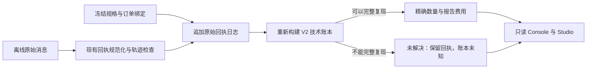

# Demo 接入第二批：成交回执、可恢复日志与 V2 技术回放

2026-09-11。承接用户“继续”，开发起点 `dc0f7ab74278c65427a3a1506d64c23d0a25583e`，分支 `codex/demo-integration-20260911`。
本批属于 R4/P5 与 R6 的执行诊断增量，未部署、未采集私有数据、未提交订单。完整软件验收仍属于先前 `3f65322c5` / `244dd6fbe`，不转移到本批。

## 交付与实际边界

| 内容 | 本批实现 | 未因此成立的结论 |
|---|---|---|
| 冻结输入 | 单合约、报价币、初始空仓/抵押金、版本化合约/保证金规则、容量预算、固定订单、来源声明、时间窗口、订单绑定 | 声明不等于核实过的场所账户条件 |
| 原始回执日志 | SQLite 追加记录、不可变规格、逐条摘要链、完整前缀校验；相同报文重复导入不新增；冲突批次拒绝并登记摘要 | 摘要不是独立签名；日志不是第二本现金账 |
| 原始消息规范化 | 复用既有 Binance ORDER_TRADE_UPDATE 校验器；四类时钟、订单/成交身份、状态序列与累计数量；重复交易只投影一次 | 没有新增私有流连接、补拉或实际断线恢复验收 |
| 精确 V2 回放 | 新 `ReportedFillReplayEvent` 仅用于技术回放；实际报告的非负报价币费用按 Decimal 原值计入一次；成交价格内含的成本不重复附加 | 不把报告费用认证为真实支付费用，不授予交易或候选权威 |
| 未解决状态 | 缺费用、外币费用、返佣、声明缺口、模型容量/保证金等不匹配时，保留原始回执并隐藏账本数值 | 不把已报告成交裁剪成零成交，不把未知费用当作零 |
| 恢复 | 每次从冻结规格与追加日志重建同一 V2 状态；无需独立现金检查点；只读重开不改文件 | 这是离线进程恢复，不是运行中的 OMS 重连或订单补偿 |
| Console 与 Studio | 既有 Demo API 增加 `execution`，页面展示日志数量、拒绝批次、原值费用、订单、逐笔成交、终态/声明持仓比较与来源身份；手机可直达和键盘横滚 | 公共连接、账户读取、实际订单流、现金对账仍各自判定；未用离线数据填绿 MFT 总体就绪状态 |

`scope=TECHNICAL_VALIDATION_ONLY`、`source_verified=false`、`authoritative=false`、`submission_enabled=false` 固定保留。
`venue_cash_reconciliation=UNKNOWN` 与 `actual_paid_fees=null` 始终成立。报价 USDT/USDC 不合并；未核对标记价格、资金费、外部现金流与真实钱包。
只有全部固定订单进入终态后，才比较回放持仓和**声明**期末持仓；没有把声明匹配写成场所对账通过。



现有 `live/execution/position_ledger.py` 的浮点订单/持仓记录没有被包装成永续现金权威，也没有重新连接失效的 V1 paper 路径。本批输入日志复用研究原始回执规范化，现金投影复用唯一 Decimal V2 内核。

## 固定支持范围与复现

入口为 `python -m tools.demo_execution_replay`。只读取显式本地输入，不读取密钥、不接网络、不注册为 AI/Runner 操作。
每份规格限制单个 BTCUSDT 或 BTCUSDC、同一 UTC 日内 2–150,000 毫秒窗口、至多 200 个固定 LIMIT/GTX 单向全仓订单；消息与日志有数量/字节上限。
当前不是任意订单类型、逐仓、非空初始仓位、跨日或长期账户流的导入器。

冻结规格字段与校验见 `services/research/demo_execution_journal.py::prepare`；原始报文包装和绑定沿用 `services/research/binance_order_receipts.py`。
`declared_source_commit` 只是规格声明；报告另外记录回放进程导入时的七个相关实现文件指纹 `replay_source_sha256`，以及规格、日志末端和 V2 状态哈希。它们不能替代完整运行身份、依赖环境或独立来源签名。

本机开发复现材料在 `/home/kerstker/quantos-dev-output/demo-receipts-20260911/`，全部标为 `SYNTHETIC_TEST_FIXTURE`。以下读取已有日志并重新生成诊断报告，不追加回执：

```bash
/home/kerstker/quantos-dev-output/dgx-engine-foundation-20260905/venv/bin/python -m tools.demo_execution_replay \
  --journal /home/kerstker/quantos-dev-output/demo-receipts-20260911/state/data/cache/binance_demo_execution.db \
  --report /home/kerstker/quantos-dev-output/demo-receipts-20260911/recovered-report.json
```

首次导入需指定 `--manifest` 与 `--messages`；之后只追加 `--messages`，已有冻结规格不能替换。报告目录须已存在；报告路径不能覆盖数据库或输入。
CLI 退出码：0 表示技术回放成功，2 表示回放未解决，3 表示输入/存储/报告写入失败。失败不覆盖已有报告，调用者必须检查退出码；报告写入失败后可重新只读恢复。
Console 只读当前 `QUANTOS_STATE_ROOT/data/cache/binance_demo_execution.db`，不存在不创建，损坏明确报告，未来接收时间拒绝展示。它不读取 CLI 生成的旧报告。

## 预先限定的工程验证

本批没有新增 Alpha 候选、模型调用或盈利试验。固定比较以下工程场景：

1. 部分成交后关闭进程，重开追加剩余成交；只读重建与一次完整导入一致。
2. 同报文重导入、新接收时间的重复成交，只收费一次；冲突费用不能覆盖已存事实。
3. 费用缺失、非报价币、返佣、容量不匹配，保留事实且账本未知。
4. 冻结规格变更、摘要链损坏和批次中途写入失败，拒绝/回滚并保留既有记录。
5. 前端不对大整数编号、数量和费用做浮点转换；公共快照缺失仍能独立查看离线回放；刷新失败保留“上次读取”说明。

继续条件是上述行为成立。若实际回执超出支持范围，保留原文并记录未支持原因，先扩充明确语义与对应测试，不通过修改数据或降低容量/费用约束制造成功结果。

## 验证结果

- 后端相关 **362 通过 / 1 跳过**：V2、订单准入、主动/被动仿真、动态规则、原始回执、恢复、CLI、Console 契约及服务依赖图。旧 Starlette 弃用告警仍保留。
- 前端全量 **373 通过**，类型、ESLint 通过；直达入口补充后相关 9 项复检及构建结果一并保存。
- 五次独立 CLI 运行：部分导入 → 只读恢复 → 完整导入 → 重复导入 → 再次恢复。完整回放数量 `1 BTC`，两笔合成费用 `0.00792 + 0.01188 = 0.0198 USDC`，相同输入状态哈希一致。这是合成工程核对，不是交易收益。
- 真实临时 Console → 前端 GET 接线：桌面、390px 手机、暗色三种视图，无页面溢出或 WCAG 2 A/AA 扫描违规；0 页面异常、0 HTTP 写请求、0 浏览器直连场所请求。覆盖精确大整数 ID、缺费用、部分成交、刷新、恢复身份、导航往返与表格键盘横滚。
- 仓库卫生、治理扫描与依赖图检查通过。新增文件已纳入前端构建身份；构建是开发产物，不是发布验收产物。

先失败再实现的回归包括新增成交事件、缺失日志模块/Console 消费、页面状态与运行时契约。首轮浏览器启动误用了 API 环境变量名，未取得新接口；改为既有 `VITE_API_URL` 后通过，失败 JSON 保留。手机直达入口的暗色对比度首检未过，修正文字颜色后桌面/手机/暗色复检通过；失败材料单独保留。
完整材料见 `targeted-tests.xml`、`offline-recovery-check.json`、`browser-check.json`、各场景截图和 `frontend-dist-final/`。前一构建 `frontend-dist/` 保留修正前身份，最终构建单独输出。
本批未运行完整 `scripts/validate.py`、ARM64 双冷构建或部署验收，不称作全路线软件验收。

## 路线图下一步

1. 本批完成离线回执持久化、恢复、精确技术投影和前端；接下来仍需将真实 Demo 订单身份、冻结执行目标/风险结果与回执来源绑定，补实际私有流断线、查询补拉、撤单竞争和 OMS 状态收敛。普通提交的独立权威缺口没有被本批替代。
2. 接入同账户、同窗口的持仓/钱包、标记与资金费、外部流水，逐项对齐唯一账本。仅有订单回执不能验收真实账户现金；再将完整运行事件送入既有 MFT，而非填充虚假就绪分区。
3. Demo 工程证据成熟后再准备有限小额真实成交校准；实际执行仍使用已有人工交易门。P5 误差评价与 P6 自然成本后盈利分别验收。
4. P3/P4/P6 继续各自冻结观察；本批没有重跑外层、修改预测、增加杠杆或切换任何常驻服务。
