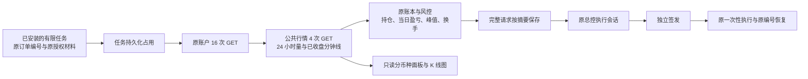

# Demo 当前行情到原执行会话的任务接线

2026-09-13。承接[执行路线](../plans/2026-09-12-demo-execution-completion.md)和
[独立签发增量](2026-09-13-demo-independent-issuer.md)。本批是开发与隔离验证，尚未安装。
用户已授权 Demo 自动测试；本批不扩展主网、经济准入或 AI 直接下单权限。

## 本批行为

原总控只接受已生成的完整请求。新增流程可从固定任务生成当时的请求，随后交回原总控：

实现入口：`tools.demo_task`、`tools.demo_request_prepare`、
`live.execution.demo_request_inputs`、`tools.binance_demo_market_inputs`。
没有增加默认策略、虚构 HUMAN、默认授权、自动生成新订单编号或新的现金账本。

## 行情与计算口径

- 固定 Binance USDⓈ-M Demo 地址，两个时钟读取夹住单币种 24 小时统计和分钟 K 线。
  每次最多四个公共 GET，不携带 API 头，不接受调用者指定域名或订单路径。
- 使用基础资产 `volume`，不把 `quoteVolume` 当成 BTC 数量。
- 按首个场所时钟选取最后一个已结束的分钟，读取 61 根连续闭合 K 线。
  检查开闭时刻、OHLC 关系、成交量及数据缺口，不使用仍在形成的蜡烛。
- 波动率是 60 个分钟对数收益平方和的平方根，Decimal 计算，向上保留 18 位小数。
  方法版本 `SQRT_SUM_LOG_RETURNS_SQUARED_60X1M_CEIL18_V1`；不是年化波动率或预测。
- 完整捕获不超过 40 秒；独立公共子进程硬预算 35 秒，超时保留失败，不自动重试。
  风控要求捕获完成后最多 30 秒；页面可保留过期测量，并标为历史。
  这些短时行情约束与全规模恢复的运行预算无关。
- 原始响应、请求/接收时钟、内容摘要及失败都追加保留。双时钟仅提供兼容性检查，
  不自称无时钟跳变或已取得独立来源权威。

官方接口字段依据为[币安合约市场数据文档](https://developers.binance.com/en/docs/catalog/core-trading-derivatives-trading-usd-s-m-futures/api/rest-api/market-data)。
实际 Demo 24 小时统计还出现“起点按分钟对齐、结束在分钟内”的窗口。本批根据原响应，
接受 24 小时至不足 24 小时加一分钟的这类窗口；不把更短窗口放大成全天成交量。

## 请求与进程

`DEMO_REQUEST_TASK_V1` 精确包含源码提交、起止时间、独立签发政策摘要、完整 profile、
原订单列表及预期的持久化停机快照。profile 包含明确的原风险限制、策略状态、mandate、
attestations、首次起点盈亏/峰值声明和最低换手值；不填补缺失字段。
声明不等同于已核验的历史账户收益。

任务必须在政策有效期内。任务、政策、账户、采集源码和波动率方法在网络读取前核对；
捕获后再次检查有效期。已有持仓或历史提交时，读取原完成回执/OMS 的持仓、现金、
当日亏损及峰值，不用首次起点声明覆盖它们。任何原编号未完成状态仍由原流程拒绝。

总控在采集前以排他创建、fsync 留存 task claim。中断后不自动重试这个任务。
完整请求以规范 JSON 原字节摘要命名；原 supervisor 的独立 request claim、签发、
最终风控、停机核对和一次性发送保持原路径。改变任务文件也不能复用已占用的订单编号。

准备进程使用固定 executor UID、固定源码和受保护状态目录，由 root 私有 FIFO 交接。
仅固定网络配置可用；签发目录不可见。准备子进程运行预算 155 秒，总控交接预算 150 秒。
准备进程不签发、不发送普通订单、不创建或复位停机/订单/资金数据库。

新增私有目录须与原备份/归档计划整合：

| 目录 | 内容 |
| --- | --- |
| `/var/lib/quantos-demo-controller/tasks` | 预先安装的规范任务 JSON，root 0600 |
| 同根 `task-claims`、`task-results`、`requests` | 任务占用、结果、完整原请求，root 私有 |
| `/var/lib/quantos-demo-executor/market-inputs-BTCUSDC`、`market-inputs-BTCUSDT` | 公共行情原文与失败 |
| 同根 `request-preparation-results` | 准备输入/失败及其原始关联 |

这些目录本轮未安装。控制侧目录上限 16,000 文件/256 MiB，执行侧每目录上限
1,000 文件/64 MiB；到限保留历史并停止写入，不删除记录换取继续运行。
原 contract 16 备份不因此自动覆盖这些命名空间。

## 前端与接口

Console 的 `market_inputs` 按 BTCUSDC、BTCUSDT 分开返回，并同步 TypeScript 和接口回归。
页面显示量、已实现波动率、最后收盘时间及 61 根 K 线，可切换币种、键盘逐点查看、
切换数据表、放大和导出。缺失、损坏、未来、过期与采集失败分别可见。
不把原始响应正文放入页面，不从另一币种补数，不因行情存在就显示可交易。

当前采集 CLI 的输出目录可以直接使用隔离研究空间的
`data/cache/binance_demo_market_inputs/<symbol>`。受保护任务保存到 executor 私有目录；
实际运行仍需按已核验的公开记录单独发布到研究展示目录，本批未复制受保护账户材料。

## 验证与真实采集

输出根：`/home/kerstker/quantos-dev-output/demo-request-inputs-20260913`。

- 首次缺模块、实际窗口兼容性、超时缺实现等红记录保留；持仓测试的一次错误 import
  和前端两处歧义/不完整可访问名称测试定位也保留，修正后重跑通过。
- 最终相关后端 **221 通过 / 1 跳过**：原风险、持久停机、连续持仓、签发、任务、
  原总控及 Console 接口。包含真实本地管道交接、过期重检、同任务重启不重发、
  pending 拒绝与原亏损/峰值保持；这些是隔离合成材料，不是实际成交。
- 前端 **428 通过**；类型、ESLint 和构建通过。HTTP 使用本次真实公共行情的采集时刻回放，
  加显式合成失败/缺失/损坏，五种状态各检查桌面、390px 手机、暗色，共 **15 组通过**；
  无页面错误、水平溢出、WCAG A/AA 检查项或写请求。币种切换、键盘样本和数据表通过。
- 实际最后一轮公共采集：USDC **3.286 秒**、量 **328763.502 BTC**、波动率
  **0.000796159305070286**；USDT **2.526 秒**、量 **386331.1335 BTC**、波动率
  **0.00037320355339156**。各 61 根闭合分钟线，非订单回执。
- 最后一轮原文分别在 `public-final/BTCUSDC/74a41fc9d43dcd0fd156bfa18c7e98f3bc0a6f85bd628fe56b5d49474f99fcfd.json`
  与 `public-final/BTCUSDT/0254fb60a40e745b40866ca6edc519deb426b7dbabb52e379d2d682ceec6a49b.json`。
  09:46 首次 USDC 窗口拒绝及后续记录完整保留。旧采集不重新标记为当前新鲜输入。

## 未完成与下一步

1. 本批新源码尚未完整 canonical/ARM64 验收、安装或常驻接线；实际执行仍 92ecc/3d，
   研究入口仍 a599/59。独立签发材料、实际政策/任务/停机来源仍需完成受保护安装。
2. 普通 Demo 新系统订单、实际 D4 工况、后续减仓和唯一现金闭合仍未验收。
   本批只完成现有任务到原执行会话的软件接线，不宣称自主策略已经交易。
3. b8dbc51cd 的两个 ARM64 冷构建、扫描、断网启动已通过；后续 canonical 在后端
   96% 左右被终止，退出 143，原因未确认，无完整结果。原记录保留。
   新 attempt 3 复用同冻结 b8 源码与其原生证据，只重跑完整 canonical，改用持久用户单元
   `quantos-issuer-acceptance-b8-attempt3-20260913.service`；仍不能覆盖本批后续源码。
4. 原全规模恢复 PID 682779 于 10:28 结束，恢复阶段约 6 小时 8 分钟。
   65 个内部阶段完成，但最终超过 2 小时 RTO，结果 `RESTORE_RTO_EXCEEDED`。
   10:41 已将后续本机恢复目标设置为 8 小时、总工作者预算 12 小时，原夜间定时器不变；
   见[实际调整和失败保留](2026-09-13-full-restore-target.md)。没有把阈值更新视作新恢复成功。
5. P3/P4/P6 的冻结窗口、数据与计划不变；没有新盈利、经济准入或主网结论。
