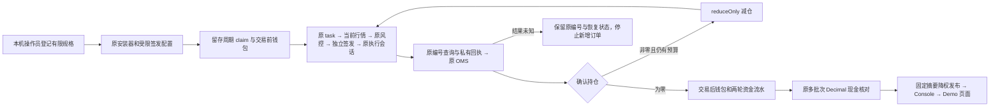

# Demo 首次启用与有限交易闭环

2026-09-14。用户本轮明确优先完成实际 Demo 闭环。承接
[Demo 执行计划](../plans/2026-09-12-demo-execution-completion.md)，先完成首次启用、订单、回执恢复、
减仓、唯一现金账本及页面状态。归档扩展与盈利研究不作为首次功能测试的前置条件。

## 实际断点

本轮只读检查：研究入口运行 5d97043c6/e99c4caab，执行侧运行 92ecc6747/3d57b0e0d。
Demo 凭证、账户读取及私有流存在；受保护注册表的签发键为空，签发配置与控制器目录不存在。
没有本系统新普通订单或现金闭合证据。旧安装器只能导入已有完整材料，缺少首次操作员登记流程。

另已确认执行观测目录恰有 1,000 文件，触及旧输出上限，导致观察服务失败和页面过期。
本批将文件预算改为 10,000，保留 64 MiB 字节预算和全部旧文件；这是有限测试的容量修复，
不是无限保留承诺。原 34 文件恢复任务本日恢复核验约 2 小时 58 分，满足现有 8 小时目标；
本批不重复启动恢复任务或修改自然研究实验。

## 固定测试规格与首次接入

- 仅 `BINANCE_USDM_DEMO`、BTCUSDC，使用当前已安装账户。
- 先确认该计价账户空仓、无冲突订单，USDC 钱包至少 2,500。
- 单笔不超过 250 USDC，累计不超过 750 USDC，最多 3 笔；数量不超过 0.01 BTC。
- 有效期 1 小时，日亏损限额 10 USDC；沿用原风控及持久化停机记录。
- 一笔 IOC 开仓；后续只能按原始确认持仓生成 IOC `reduceOnly` 减仓。
- 无成交、剩余持仓、回执不明、现金差异分别报告。

`tools/demo_operator_setup.py` 默认仅生成未签发提案。本机操作员使用 `--enroll --run-cycle`
时，先查看并登记固定规格，再生成受限材料，调用原 `demo_operating_bundle` 安装器。
新公钥仍在全部校验后最后发布。原停机库只复制验证过的既有字节，不初始化或复位。
研究 API 不提供此入口。代理不能替操作员键入确认或虚构 HUMAN 记录。
用户此前的 Demo 测试授权持续有效，不需要再次提供交易所 API 密钥。
本机操作记录不是密码学意义上对可信 root 的防御。

## 流程与进程

`demo_functional_cycle` 是 root 控制器；`demo_functional_worker` 使用原 executor 身份。
签发由原独立 issuer 身份和断网子进程完成。一个登记对应一个周期；第一笔任务前持久化 claim，
重复运行不会生成新开仓。响应丢失时先查询原编号，原回执/OMS 确认的数量才用于减仓。

现金采集先留存钱包，交易尝试结束后取得交易后钱包。观察等待最少 30 秒、最多 600 秒，
记录实际时长，不要求固定等待 300 秒。原时钟、GET 重试、分页及二次确认检查保留。
失败保留有效读取前缀，不以缺失费用推断零成本。

页面只有在至少两次订单尝试、至少两条核对成交、最终数量为零且原现金核对匹配时显示完成。
旧成交和账户连接不算本轮完成。来源异常、过期和刷新失败可见。
匹配属于报告输入的技术核对，不授予经济准入或主网权限。
控制器周期、研究周期与现金摘要纳入原快照范围；未启用周期的旧控制器布局仍兼容。

## 验证与限制

本批先复现并修复输出上限、旧成交误判完成、丢失响应未恢复和观察窗口衔接等问题。
隔离测试覆盖原风控与独立签发/单次发送、多批次账本费用、部分减仓、未知结果、重复启动、
开盘钱包失败、固定发布来源与降权写入、旧/新控制器恢复布局及前端合同。
合成夹具只写临时目录，不构成实际 Demo 成交。

本批后端/原执行链/Console 合同与导入图联合 **352 通过、1 跳过**；前端定向 20+6 项通过，
类型、ESLint 和构建通过。六种状态的桌面/手机/暗色共 **18 组 HTTP 检查**通过，零页面异常、
写请求、水平溢出和 WCAG A/AA 扫描违规，手机截图已目视核对。
首次联合 1,824 通过/25 失败/1 跳过保留：一项旧控制器布局兼容错误已修复；导入图已重新生成；
其余版本绑定检查须在干净冻结源码上随完整验收重跑。首次浏览器检查因缺少可访问区域名称失败，
补齐语义后重测通过。材料位于 `/home/kerstker/quantos-dev-output/demo-functional-20260914`。

完整软件验收、DGX 安装、实际操作员登记、真实往返成交及现金闭合尚待本轮后续记录。
首次有限 IOC 往返不等于全部撤单竞争、故障工况或长期稳定性验收。
