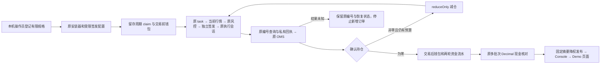

# Demo 首次启用与有限交易闭环

2026-09-14。用户本轮明确优先完成实际 Demo 闭环。承接
[Demo 执行计划](../plans/2026-09-12-demo-execution-completion.md)，先完成首次启用、订单、回执恢复、
减仓、唯一现金账本及页面状态。归档扩展与盈利研究不作为首次功能测试的前置条件。

## 实际断点

本轮只读检查：研究入口运行 5d97043c6/e99c4caab，执行侧运行 92ecc6747/3d57b0e0d。
Demo 凭证、账户读取及私有流存在；受保护注册表的签发键为空，签发配置与控制器目录不存在。
没有本系统新普通订单或现金闭合证据。旧安装器只能导入已有完整材料，缺少首次操作员登记流程。

另已确认执行观测目录恰有 1,000 文件，触及旧输出上限，导致观察服务失败和页面过期。
本批将文件预算改为 10,000，保留 64 MiB 字节预算和全部旧文件；这是有限测试的容量修复，
不是无限保留承诺。原 34 文件恢复任务本日恢复核验约 2 小时 58 分，满足现有 8 小时目标；
本批不重复启动恢复任务或修改自然研究实验。

## 固定测试规格与首次接入

- 仅 `BINANCE_USDM_DEMO`、BTCUSDC，使用当前已安装账户。
- 先确认该计价账户空仓、无冲突订单，USDC 钱包至少 2,500。
- 单笔不超过 250 USDC，累计不超过 750 USDC，最多 3 笔；数量不超过 0.01 BTC。
- 有效期 1 小时，日亏损限额 10 USDC；沿用原风控及持久化停机记录。
- 一笔 IOC 开仓；后续只能按原始确认持仓生成 IOC `reduceOnly` 减仓。
- 无成交、剩余持仓、回执不明、现金差异分别报告。

`tools/demo_operator_setup.py` 默认仅生成未签发提案。本机操作员使用 `--enroll --run-cycle`
时，先查看并登记固定规格，再生成受限材料，调用原 `demo_operating_bundle` 安装器。
新公钥仍在全部校验后最后发布。原停机库只复制验证过的既有字节，不初始化或复位。
研究 API 不提供此入口。代理不能替操作员键入确认或虚构 HUMAN 记录。
用户此前的 Demo 测试授权持续有效，不需要再次提供交易所 API 密钥。
本机操作记录不是密码学意义上对可信 root 的防御。

## 流程与进程



`demo_functional_cycle` 是 root 控制器；`demo_functional_worker` 使用原 executor 身份。
签发由原独立 issuer 身份和断网子进程完成。一个登记对应一个周期；第一笔任务前持久化 claim，
重复运行不会生成新开仓。响应丢失时先查询原编号，原回执/OMS 确认的数量才用于减仓。

现金采集先留存钱包，交易尝试结束后取得交易后钱包。观察等待最少 30 秒、最多 600 秒，
记录实际时长，不要求固定等待 300 秒。原时钟、GET 重试、分页及二次确认检查保留。
失败保留有效读取前缀，不以缺失费用推断零成本。

页面只有在至少两次订单尝试、至少两条核对成交、最终数量为零且原现金核对匹配时显示完成。
旧成交和账户连接不算本轮完成。来源异常、过期和刷新失败可见。
匹配属于报告输入的技术核对，不授予经济准入或主网权限。
控制器周期、研究周期与现金摘要纳入原快照范围；未启用周期的旧控制器布局仍兼容。

## 验证与限制

本批先复现并修复输出上限、旧成交误判完成、丢失响应未恢复和观察窗口衔接等问题。
隔离测试覆盖原风控与独立签发/单次发送、多批次账本费用、部分减仓、未知结果、重复启动、
开盘钱包失败、固定发布来源与降权写入、旧/新控制器恢复布局及前端合同。
合成夹具只写临时目录，不构成实际 Demo 成交。

本批后端/原执行链/Console 合同与导入图联合 **352 通过、1 跳过**；前端定向 20+6 项通过，
类型、ESLint 和构建通过。六种状态的桌面/手机/暗色共 **18 组 HTTP 检查**通过，零页面异常、
写请求、水平溢出和 WCAG A/AA 扫描违规，手机截图已目视核对。
首次联合 1,824 通过/25 失败/1 跳过保留：一项旧控制器布局兼容错误已修复；导入图已重新生成；
其余版本绑定检查须在干净冻结源码上随完整验收重跑。首次浏览器检查因缺少可访问区域名称失败，
补齐语义后重测通过。材料位于 `/home/kerstker/quantos-dev-output/demo-functional-20260914`。

本节为开发阶段检查点；完整验收、安装和账户预检的后续结果见下。实际操作员登记、
真实往返成交及现金闭合仍未发生。
首次有限 IOC 往返不等于全部撤单竞争、故障工况或长期稳定性验收。

### 14:43 首轮完整验收与环境修复

冻结源码 `3b1ed3941568c63d364332c16e831b74da5d252c` 的两次 ARM64 冷构建、
可复现性、扫描及原生启动通过。首轮 canonical 为 **24/28 FAIL**：主测试
8,276 通过/19 跳过，执行栈 4,250 通过/2 跳过；四个前端检查因干净检出漏装
依赖而未启动（`tsc`、ESLint、Vitest 不存在），不是通过记录。
已使用原锁文件离线安装依赖，并验证编译器、检查工具和原生 esbuild 可执行。
源码未修改；原 ARM64 证据保留，canonical 整套重新执行中。
首轮报告与日志分别保留在本轮验收目录的 `canonical-report-attempt1.json`、
`canonical-attempt1.log`；准备任务因该失败停止，尚未安装或签发。

### 完整验收、实际安装及账户预检

原源码未修改，补齐锁定依赖后的 canonical 重跑 **28/28 PASS**：主测试 8,276 通过/
19 跳过、执行测试 4,250 通过/2 跳过、前端 434 通过；类型检查、ESLint、构建及
原生 ARM64 验证通过。首轮失败保留。证据提交为
`8d61aef5f01ade1b348d02b910fb28b47f73ae56`，绑定源码
`3b1ed3941568c63d364332c16e831b74da5d252c`。

研究入口及受保护的有限周期工具已安装该证据版本。原执行私有流保留旧 92ecc 生产者，
未更换其协议；五个执行数据库的 inode 均未变化。固定原始采集定时器保留原生产者。
实际 Console 中执行观测及私有流为 AVAILABLE，有限周期/现金链为 NO_SNAPSHOT，
提交开关为 false。真实桌面、390px 手机及暗色页面检查通过：无页面异常、写请求、
水平溢出或 WCAG A/AA 扫描违规；实际手机截图已目视核对。

保留的安装与检查失败及处理：

- 显式单元审查曾将缓存目录中的模块名误判为执行入口；改为核对拆分后的 ExecStart
  命令及参数，原失败脚本/日志保留，重新审查通过。
- 旧观察服务累计失败触发 systemd 启动限流；初次回滚跨文件系统重命名又返回 EXDEV。
  原报告保留，改用同文件系统替换并恢复安装，仅清理该观察/发布服务的 systemd
  失败计数；未复位交易停机状态。安装恢复核对通过。
- Git 根用户检查曾把索引变为仅 root 可读。仅修复安装副本的 Git 元数据读取权限，
  先以独立仓库复现，再验证 root、executor、issuer 三身份均能读取并核对干净源码；
  已验收的受跟踪文件未修改。
- 实际浏览器首轮因继承代理而无法到达页面；保留失败，使用局域网直连后通过。

账户预检发现 BTCUSDC/USDT 原始快照分别超过固定 64 MiB 上限。仅在注册表无键、
六个执行/订单/成交/恢复表全部为空时，执行一次可逆归档：718 份原始记录中的
462 份移入原执行目录下 `execution-origins/retained/`，两币种各保留最新 128 份。
全部 718 份的 inode、字节摘要、语义摘要、原解码器及 latest 指针复核通过；
其中 51 份失败原始记录也完整保留。活动目录分别约 23.9/24.5 MB，原 64 MiB
输入预算未改变。归档在原快照允许范围内，此次并未重新运行全规模恢复演练。

归档计划 SHA-256：`0e6ed7393e66d9d9d574723a76ed2daa3945bbb18e1a03cd53984ef948dd4e4c`；
清单 SHA-256：`e7fa8aa7a303e91df76fd71de09497e2d7e4a469c436261941593200ff819ef4`。
归档后，已安装原 CLI 的实际账户未签发预检为 **UNSIGNED_PREFLIGHT_PASS**。
两种原采集定时器已恢复；同时恢复时一份时钟质量失败及一次写锁冲突保留，
随后按币种顺序重新采集，两种均成功。一次归档不构成无限保留或长期稳定性验收。

验收、安装准备及实际浏览器材料保存在
`/home/kerstker/quantos-dev-output/demo-functional-acceptance-20260914`。
可读取的最终安装摘要为该目录下 `runtime-review/final-installation-summary.json`。
受保护安装审计位于 `/run/quantos-demo-functional-install-8d61aef5f`；
归档清单和复核结果随原始字节保存在上述 `retained/<计划摘要>/`。
配置重载产生的额外备份周期不计作多个自然 12 小时周期。

### 仍需真实操作员完成的步骤

目前受保护注册表仍无签发键，六个执行/订单/成交/恢复表仍为零；没有生成操作员记录、
签发私钥或实际订单。因此本轮是“软件已安装、实际账户预检通过”，**不是实际 Demo 闭环已完成**。

在 DGX 的终端运行：

```bash
sudo /usr/local/sbin/quantos-demo-functional
```

从另一台 PC 连接可使用：

```bash
ssh -t -o GSSAPIAuthentication=no kerstker@192.168.5.68 "sudo /usr/local/sbin/quantos-demo-functional"
```

程序展示 BTCUSDC 的固定额度和规格摘要；操作员按屏幕提示登记后，自动执行本次有限
开仓→回执→减仓→现金核对。最长观察窗口为 600 秒，不要求固定 300 秒。
页面为 `http://192.168.5.68:15911/studio/demo`，只有实际成交与现金均满足条件才显示完成。
IOC 无成交、回执不明、未完全减仓及费用未成熟仍可能使本次测试停止，不能保证一次成交。
重复入口不会创建第二个开仓周期；出现失败时保留原编号和状态供恢复，不反复重跑新开仓。

该入口依据 [AGENTS.md](../../../AGENTS.md) 的 “Do not fabricate a HUMAN actor”
保留真实本机操作员登记，代理不能代输确认。已有 Demo/API 授权仍有效，无需重新提交密钥。
