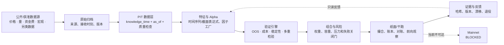
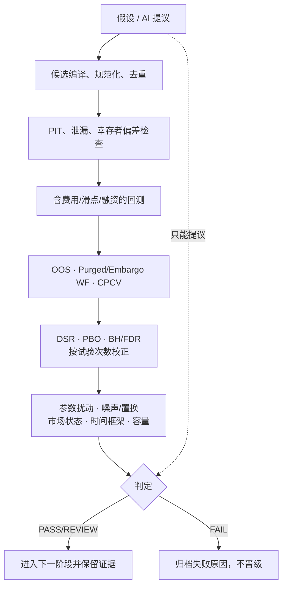
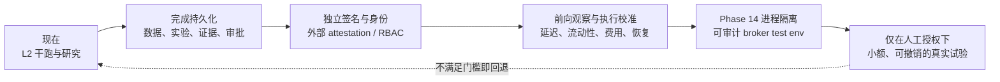

<!-- _class: lead -->

# QUANTOS

## 可审计的 AI 量化研究基础设施

把公开数据变成**可复现、可反证、可治理**的策略证据。

**投资人版系统说明｜2026-09-07**

> 本材料只使用当前源码和运行快照。历史材料中的回测收益数字不作为当前业绩或投资依据。

---

# 投资逻辑先说清楚

量化团队真正稀缺的能力，不是再写一个指标，而是能持续回答四个问题：

1. 这个信号在当时是否真的可知？
2. 它是否只是在大量试验中碰巧胜出？
3. 扣除费用、滑点、容量和市场状态变化后，还剩多少证据？
4. 谁能批准它进入下一阶段，出了问题能否追溯和停机？

QUANTOS 把这些问题做成一条机器可执行的研究流水线。产品出售的是**研究效率与证据质量**，不是一条未经验证的“神奇策略”。

---

# 外部启发：从“信号库”走向“证据工厂”

Build Alpha 公开内容给出的重要方向，是把研究输入从价格扩展到成交量、波动率、市场广度、持仓、收益率与宏观、情绪、期权流/GEX、暗池、新闻、季节性、天气、市场间关系、多时间框架和另类数据；同时允许自定义公式、Python、CSV 或自然语言生成信号。

QUANTOS 将这个方向转译为分层能力：

| 能力 | 当前状态 | 产品含义 |
|---|---|---|
| 多源数据与来源谱系 | **已建基础，持续扩展** | 每条数据保留来源、接收时间、版本和质量状态 |
| 自定义因子/表达式 | **已建** | 因子可进入统一面板、筛选和验证流程 |
| Python/外部数据接入 | **边界已定义，逐步扩展** | 网络采集留在工具边界，研究核心保持离线可复现 |
| AI 用自然语言提议信号 | **路线图** | AI 可以加速提出假设，不能替代验证或审批 |
| 自动化策略验证 | **核心方法已建，权威闭环部分完成** | 验证会留下证据和失败原因，而不是只返回一个 Sharpe |
| 导出、晋级与实盘执行 | **治理和实盘边界未开放** | 当前只到 L2 干跑；任何更高阶段需要独立证据和人工授权 |

因此，QUANTOS 的长期价值不是复制某一个网站的信号数量，而是把更广的信号空间放进同一套反自欺、风险和审计体系。

---

# 产品是什么：从数据到证据的闭环

前端 Research Studio 负责让研究人员查看这条链；Console API 提供只读快照；Research Runner 只允许白名单研究任务。网络采集、研究计算、风险门和执行边界彼此隔离，便于审计和替换。

---

# 数据护城河：时间语义比数据数量更重要

每条观测同时携带“事件发生时间”和“系统知道它的时间”。研究在决策时刻只读取当时已经知道的数据：

- `knowledge_time` 与 `as_of(t)` 限制可见信息，拦截未来数据和在途 K 线；
- 原始响应、规范化记录、数据质量和版本信息可追溯；
- 特征计算只回看自身历史，截面计算只读取同一时点可知的信息；
- 结果标注真实来源或确定性合成来源，缺失数据保持 UNKNOWN，不被静默填成好看的数字；
- 新数据源可以通过适配器接入，不改变研究核心的离线与可复现约束。

这形成的是**可复用的数据与证据基础设施**：数据源越丰富，统一的时间语义、质量和验证规则越有价值。

---

# 验证机器：让自动发现也自动面对反证

系统已具备 IC/ICIR、成本、容量、衰退、purged/embargo walk-forward、CPCV、Deflated Sharpe、PBO 和 BH/FDR 等核心方法。噪声、置换、蒙特卡洛、跨市场和延迟/流动性等专项测试按实验启用；它们不是被夸大成“所有策略默认通过”的万能门。

验证覆盖可以按两层理解：

| 验证层 | 当前定位 |
|---|---|
| OOS、Purged/Embargo WF、CPCV、DSR、PBO、BH/FDR、成本、容量、衰退、市场状态 | 核心验证组件；由研究流程组合使用 |
| 方差、噪声、信号/参数置换、合成数据、随机基线、随机退出、时间框架偏移、跨市场、延迟和流动性、蒙特卡洛 | 专项实验组件；按候选的假设预注册后启用并留证 |

“自动化”在这里意味着自动运行、记录和拒绝，不意味着自动把结果变成可交易资产。

---

# AI 的位置：加速研究，不拥有经济权力

AI 可以提出假设、组合信号、运行受控搜索、解释失败原因，并把候选送入确定性的验证器。它不能：

- 把候选直接标记为 `APPROVED`；
- 重置 kill switch 或绕过研究风险门；
- 读取凭据、调用券商 SDK 或提交真实订单；
- 把模拟结果、技术诊断或历史记录改写成权威业绩。

生命周期从 `DRAFT → TESTING → VALIDATED → PAPER_TRADING → SHADOW` 逐级推进。`APPROVED` 需要人类审批和独立证据；当前主网构造即失败关闭。

---

# 当前系统：可演示、可研究，尚未宣称实盘

当前可验证快照：

| 项目 | 当前状态 | 对投资人的意义 |
|---|---|---|
| Research Studio / Console | **READY** | 15 个前端页面、64 个只读端点，可查看研究、风险、治理和系统健康 |
| Alpha / Factor Engine | **READY** | 因子表达式、IC、候选筛选和自动搜索基础已在代码中运行 |
| Validation Engine | **PARTIAL** | 核心统计和反泄漏方法存在；统一权威结果、完整制品持久化仍在收口 |
| Portfolio / Risk | **READY** | 权重、容量、压力和失败关闭风险门可用于研究与模拟 |
| Paper / Dry-run | **READY（受限）** | 纸面成交、账本、对账和执行意图链路可演示；不产生实盘资金结果 |
| 证据账本 / 审批 / 监控 | **PARTIAL** | 结构与只读视图已在，签名、身份、持久化工作流仍是下一阶段 |
| 主网与真实下单 | **BLOCKED** | `L2_DRY_RUN_ONLY`；`LIVE_TRADING_ENABLED=false`，订单提交不可用 |

工程规模快照：**514 个服务模块、180,819 行服务代码、837 个测试文件、8,235 个测试函数**。当前 `phase3a_decision=NO_GO`，目标级别是 `L3_BROKER_TEST_ENV_READY`；这些是工程库存指标，不是收益承诺。

---

# 研究结果的诚实边界

近期 BTC、现货、订单块和机制研究均保留了失败情景与技术诊断，但当前没有可宣称的已验证 Alpha、账户 PnL 或实盘 track record。历史路径中存在的旧版账本和纸面结果已按治理规则降级为诊断历史，不能重新包装成投资业绩。

对投资人的含义是：QUANTOS 当前证明的是**研究与控制能力**，不是已经证明的收益曲线。这个边界让尽调可以围绕可复现代码、数据时间语义、失败样本、成本假设和审计链进行，而不是围绕一张挑选过的净值图。

---

# 交付路线：把技术验证推进到可审计的测试环境

下一阶段的工程重点：

1. 把数据集、特征、实验、回测、压力和审批制品改为追加式持久化；
2. 完成独立签名、身份隔离、审计导出和模型风险复核；
3. 让前向观察覆盖足够的窗口、市场状态、延迟和容量，而不是只看历史回测；
4. 在独立进程和明确场所规则下完成 broker test environment，随后仍需人工批准小额试验。

资金应优先投入证据基础设施、数据源扩展、执行校准和安全隔离；不以放宽门禁换取更快的“上线”叙事。

---

# 投资人演示与尽调入口

本地演示可打开：[`Research Studio`](http://127.0.0.1:3500/research)。演示内容包括市场观察、Alpha 控制面、验证证据、组合与风险、执行意图和系统治理抽屉；所有页面都显示数据来源、快照状态和当前权限边界。

建议尽调顺序：

1. 查看数据目录和 PIT/质量证据；
2. 运行一个候选并检查 OOS、成本、容量和失败原因；
3. 打开实验登记、哈希证据和风险门；
4. 查看 dry-run 对账与系统健康；
5. 验证主网、凭据和订单提交仍处于 BLOCKED。

外部产品启发： [Build Alpha 主页](https://x.com/buildalpha) · [信号范围](https://x.com/buildalpha/status/2095819197410336868) · [研究自动化](https://x.com/buildalpha/status/2095101541002739830) · [相关产品讨论](https://x.com/buildalpha/status/2095183551553483129)。这些链接用于说明市场方向，不代表 QUANTOS 已复制或集成其全部功能。

---

<!-- _class: lead -->

# QUANTOS 的承诺

让每一个信号都必须回答：

**数据从哪里来？当时是否可知？经过了哪些反证？谁批准下一步？出了问题如何停下？**

这是一套面向长期研究团队的证据生产系统。当前阶段是安全的 L2 干跑，不是实盘募集或收益保证。

<small>仅研究与演示用途；模拟/历史结果不代表未来表现；不构成投资建议或交易授权。</small>
