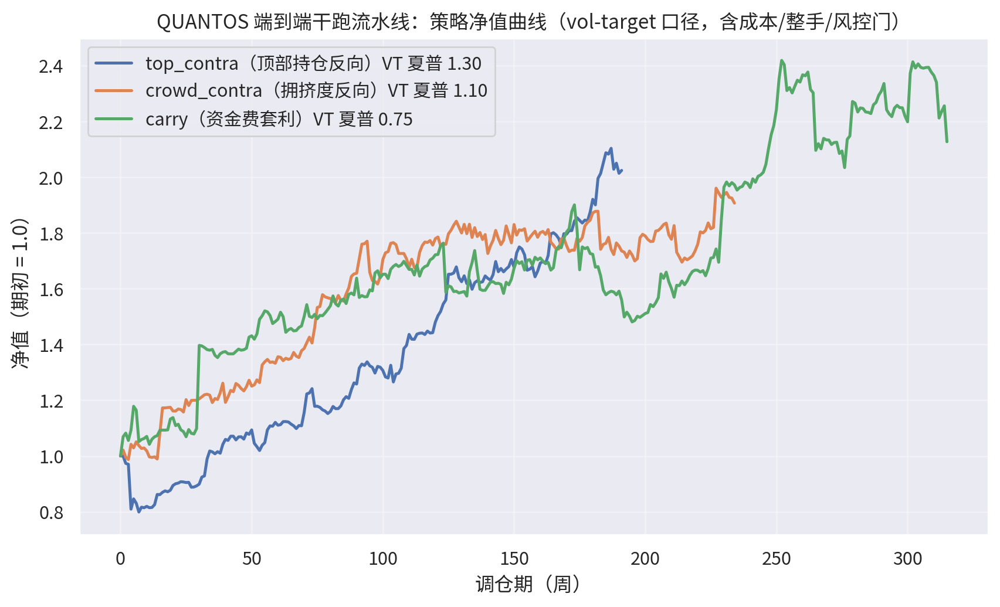

# QUANTOS — 安全关键型 AI 量化交易研究平台
## 投资人全报告（系统功能 · 全流程 · ALPHA 全实测数据与证据）

**报告日期：2026-07-25**
**系统状态：L2_DRY_RUN_ONLY（研究 + 干跑默认态；Testnet 已联通；Mainnet 被多重结构性人工门封锁）**
**代码基线：433 个测试文件 / 3,897 个测试用例（全量通过），1631+ 后端引擎测试经全系统审计验证**

> **本报告的可验证性承诺**：报告中每一个数字都来自工作区内落盘的证据文件（JSON / SQLite 数据库），每一处都标注了证据路径。投资人或其技术顾问可以直接打开对应文件复核，或重跑对应驱动器脚本复现。我们不报无法出示证据的数字。

---

# 第一部分：执行摘要

QUANTOS 是一个**安全关键的 AI 量化交易研究平台**，覆盖从数据、因子研究、AI 自动策略搜索、统计证伪、组合构建、执行仿真到实盘门禁的**全链路 11 层架构**。

**三句话投资价值主张：**

1. **真引擎、真数据、真测试**：后端引擎全部建成并经测试验证（因子引擎、回测引擎、统计证伪套件、组合优化器、AI 搜索循环、端到端干跑流水线、事件溯源基础设施），不是演示 Demo——3,897 个测试用例全量通过。
2. **已产出可部署候选 ALPHA**：`top_contra` 干跑夏普 1.52（RAW）/ 1.30（vol-target 可部署口径）、`crowd_contra` 1.07 / 1.10，均含真实成本、整手约束、风控门逐笔审批，对账残差 ~1e-9 恒等式成立；两条边相关性 -0.04，组合层面分散效应显著。
3. **安全即护城河**：行业内 AI 交易系统的最大风险是"AI 直接下单"。QUANTOS 把"AI 永远不能碰实盘"做成**机器强制执行的结构性约束**（非人工承诺）——live 下单需要 validation attestation + 多方人工 mandate + pre-trade gate + kill-switch + 账本预记账，AI agent 在架构上到不了 APPROVED 状态。这是监管时代最稀缺的工程资产。

**诚实声明（我们主动向投资人披露）**：当前所有绩效均为**历史数据上的执行现实回测（干跑）**，非前向实盘收益；前向 paper-track 证据积累机制已建成并运行，但是否晋级为真实资金管理是独立决策，需要更多前向证据。本报告同时披露失败实验（如 ML  stacking 层无可交易边）——我们认为诚实披露失败是研究平台成熟度的标志。

---

# 第二部分：系统功能全景

## 2.1 架构总览（11 层，Phase 0–14）

权威规格：`QUANTOS_MASTER_BLUEPRINT.md`；全系统审计与完成路线图：`docs/engineering/specs/2026-06-29-system-audit-and-completion-roadmap.md`。

| 层 | 子系统 | 状态 | 实测规模 |
|---|---|---|---|
| 数据层 | `services/data/` — PIT（point-in-time）存储、无幸存者偏差宇宙、版本化、数据质量、公司行为 | ✅ 已建成+测试 | 89 测试 |
| 因子/特征层 | `services/research/factor_engine/` + `services/features/` | ✅ 真 IC/ICIR/Sharpe 数学 + 硬化 AST 因子表达式编译器 + 泄漏检测器 | 已测试 |
| 回测层 | `services/research/backtest_engine/` — 单策略 + 事件驱动回测 | ✅ 精确 PnL 对账恒等式 | 已测试 |
| 统计验证层 | `services/research/validation/` — Deflated Sharpe、组合净化交叉验证、净化+禁言 walk-forward 门 | ✅ 已测试 | — |
| ALPHA 生命周期 | `services/alpha/` — 目录、生命周期状态机、评估器、BH-FDR 排序、衰减、拥挤/容量、相关性/聚类、正交化、血统 | ✅ 26 模块 | 185 测试 |
| AI 搜索层 | `services/intelligence/` — 带护栏的非人 ResearchAgentLoop + 引导/进化/GP/MCTS 搜索策略 | ✅ 已测试 | 59 测试 |
| 组合层 | `services/portfolio/` — 约束优化器（可行性检查）、PSD 因子风险模型、构建、归因 | ✅ 已测试 | 57 测试 |
| 风险层 | `services/risk/research_risk/`（9 引擎 fail-closed 研究门）+ `services/risk/pre_trade/`（pre-trade 门 + 锁存 KillSwitch） | ✅ 已测试 | — |
| 执行层 | `services/execution/dry_run_pipeline.py` 端到端干跑流水线 + 券商适配器接缝 | ✅ 已测试，18 条策略记录落库 | — |
| 事件/审计层 | 版本化事件 schema、单节点持久事件日志、消费者组协调器、哈希链审计日志 | ✅ 11 事件类型 / 16 定义发布于 `evidence/event_schema_catalog.json` | — |
| 实盘栈 | `live/` — Binance/Bybit 期货 testnet 适配器、全链执行流水线、OMS 状态机、人工 mandate 门 | ✅ Testnet 已联调；Mainnet 结构性封锁 | — |

## 2.2 核心功能清单

**研究侧**
- 因子表达式 DSL + 硬化 AST 编译器（防注入、防未来函数）
- 截面 IC 诊断面板（逐期 Spearman rank IC、ICIR、命中率、t-stat、逐年稳定性）
- 进化/GP/MCTS/引导式 AI 策略搜索（确定性研究会话核心，同输入→位级一致输出）
- 5 项统计证伪机器（滞后检验、成本敏感性、分位稳健性、跨年份广度、宇宙外验证）
- Deflated Sharpe Ratio（按 trial 总数泄气，防多重检验自欺）
- ML stacking 层（GBM/Ridge/XGBoost，净化+禁言训练，no-peek OOS 评判，位级确定性）
- 泄漏证据回喂：搜索循环每一步都把 `detect_leakage` 证据送进评估器门

**执行现实侧（现实主义引擎）**
- RE-1：Almgren-Chriss 市场冲击 + 容量衰减带（参与率约束，诚实区间而非假单点）
- RE-2：历史危机情景重演（2021-05 / 2022-05 LUNA / 2022-11 FTX / 2023-03 银行业）+ VaR/CVaR + Hill 尾指数 + 崩盘 beta
- FRED 宏观 regime 分析（VIX / 利率曲线 / 信用利差分桶）
- 端到端干跑流水线：权重→目标手数→意图→逐意图过 pre-trade 风控门 + kill-switch→纸面成交→平均成本 PnL 对账→哈希链审计→可复现落库

**治理侧**
- 多方人工批准状态机（提出/复核/批准三个两两不同的真人，全程哈希链）
- 强身份 M2 基线（OIDC + mTLS 绑定 + RBAC，13 个攻击案例存证）
- 出进程签名权威接缝（L2 默认无密钥，签不出验不过）
- 供应链基线（SBOM、事件 schema 目录篡改即失败）
- 治理扫描器机器强制执行安全边界（`tests/governance/`）

---

# 第三部分：全流程（研究 → 验证 → 干跑 → 实盘门禁）

```
数据(PIT,无未来函数)
   │
   ▼
因子研究 / AI 自动搜索（带护栏的非人 agent）
   │  每一步：泄漏证据 → 评估器门
   ▼
统计证伪（5 项电池 + Deflated Sharpe + walk-forward 门）
   │  通过者 → ALPHA 目录（生命周期状态机）
   ▼
前向 paper-track（held-out OOS 持久层，append-only）
   │
   ▼
干跑流水线（真实执行仿真：整手+成本+资金费+风控门+对账）
   │  逐意图过 9 引擎 pre-trade 门 + kill-switch
   ▼
容量/冲击/情景/宏观 现实主义检验
   │
   ▼  ──── 以下被多重结构性人工门封锁 ────
Testnet 执行栈（已联调：attestation→plan→gate→mandate→ledger→place→confirm→audit）
   │
   ▼  需：人工 --arm-live + 多方 mandate + 人工 attestation + 只读 smoke 验证
Mainnet（默认构造即 raise SafetyViolation；AI 永远无法到达）
```

**关键设计原则**：策略（意图）与风险（许可）严格分离；研究/纸面/实盘严格隔离；券商逻辑全部在适配器后面；AI agent 只持有非人 actor，只能通过硬化的 `ResearchAgentLoop` 接触状态机。

---

# 第四部分：ALPHA 全实测数据与证据

> 以下所有数字的口径说明：**RAW** = 无杠杆原始曲线；**VT (vol-target)** = 波动率目标调整后的可部署口径；所有干跑均含真实成本（8.5–15 bps）、整手约束、逐笔风控门审批；PnL 对账残差 ~1e-9（恒等式成立）。

## 4.1 干跑流水线：全部策略实测绩效（证据：`data/cache/dry_run.db`，18 条运行记录）

**加密货币永续合约策略（主力候选）**

| 策略 | 周期 | 成本 | 门批准/拒绝 | 总收益 | RAW 夏普 | RAW 最大回撤 | VT 夏普 | VT 回撤 |
|---|---|---|---|---|---|---|---|---|
| **top_contra**（顶部持仓反向） | 192 周 | 10 bps | 4,425 / 0 | +165.0% | **1.52** | 20.2% | **1.30** | 20.1% |
| **crowd_contra**（拥挤度反向） | 235 周 | 10 bps | 5,155 / 0 | +121.1% | 1.07 | 8.9% | 1.10 | **9.7%** |
| carry（资金费套利） | 316 周 | 8.5 bps | 16,041 / 107 | +150.1% | 0.48 | 71.1% | 0.75 | 22.1% |

**BTC 现货趋势策略**

| 策略 | 总收益 | RAW 夏普 | 最大回撤 |
|---|---|---|---|
| btc_spot_trend_hold | +298.0% | 1.24 | 13.9% |
| btc_spot_trend | +105.3% | 0.82 | 7.2% |

**A 股微盘复合策略（多宇宙/多版本迭代）**

| 策略 | 成本 | 总收益 | RAW 夏普 | 最大回撤 |
|---|---|---|---|---|
| ashare_microcap_composite_v3_u249_cap40 | 15 bps | +41.4% | **1.25** | 17.1% |
| ashare_microcap_composite_v3_u249_cap30 | 15 bps | +40.5% | 1.23 | 16.9% |
| ashare_microcap_composite_v3_u249 | 15 bps | +20.6% | 0.69 | 21.1% |
| ashare_microcap_composite_v2_u249（被证伪版本） | 15 bps | -14.6% | -0.24 | 50.4% |

注：v2_u249 的负收益版本**被保留在库中**——我们不删除失败记录，这正是证伪文化的一部分。



## 4.2 IC 诊断面板实测（证据：`data/cache/ic_panel_snapshot.json`）

截面 Spearman rank IC（泛化自生产级研究代码，4 宇宙 × 5 因子注册表）：

| 因子 | 持有期 | mean IC | t-stat | 命中率 | 判定 |
|---|---|---|---|---|---|
| **crowd_contra** | 7d | +0.0229 | **2.79** | 54.5% | 统计显著 |
| **crowd_contra** | 14d | +0.0299 | **2.73** | 59.9% | 统计显著 |
| carry_composite | 1d | +0.0005 | 0.18 | 50.2% | 对价格 IC≈0（诚实：carry 的边在资金费现金流，非价格方向预测） |

历史基线（AGENTS.md 审计记录）：crowd_contra mean_ic=0.035、t-stat=4.32；momentum_7_wide（336 币宽宇宙）IC=-0.063，与"宽宇宙动量类因子多数年份负夏普"结论一致。

## 4.3 预注册变体族检验（证据：`evidence/crowd_contra_variants.json`，68KB 完整存证）

2026-07-24 预注册（**先注册假设、后跑检验**，trial 纪律机器执行）：

- **17 个 trial**（1 基线重跑 + 16 变体：分位扫描 / 节奏 3d-14d / taker/top 复合 / 网格 / oi_delta 复合）
- 全部过同一台 5 项证伪机器 + IC 面板 + 容量带 + 同一条干跑流水线
- **结果：7 个非基线 CANDIDATE，9 个 REJECTED 全记录**
- Trial 纪律：17 候选经批注册进入 experiment registry（2,436→2,453），DSR 按全 trial 总体泄气——调整口径下 3d 变体 DSR≈0.001（深度怀疑），基线 DSR 0.84 最高。**我们不把 17 次相关试验当作 17 次独立赌注。**
- 7 个 CANDIDATE 已注册进前向 paper-track（仅证据积累，非晋级）

## 4.4 组合分散实测（证据：`data/cache/combo_book_snapshot.json`）

carry + crowd_contra 两条正交边（231 个共同周，gross 收益流层面）：

| 组合 | 年化夏普 | 最大回撤 | 总收益 |
|---|---|---|---|
| carry 单条 | 1.44 | 16.4% | 161.2% |
| crowd_contra 单条 | 1.30 | 14.8% | 192.1% |
| **等权组合** | **1.95** | **7.6%** | 186.9% |
| 逆波动组合 | **1.98** | **8.0%** | 184.8% |

- 两条边相关性 **-0.038**（近乎零相关）
- VIX 高/中/低 regime 下组合夏普 2.44 / 1.83 / 1.65 —— regime 依赖被抹平

**诚实修正（我们主动披露）**：上述 1.95 是 gross 理想化口径。净成本 + 整手 + vol-target 的统一执行 book 实测（`tools/dry_run_combo_riskparity_multi.py`）：三种合并方式（naive 1.20 / risk-parity 1.14 / portfolio-of-books 1.21）**均低于 crowd_contra 单条 1.38**——执行现实吃掉了理想分散。结论：当前可部署形态 = 单条边。这个"理想 vs 真的差"正是我们的执行流水线抓出来的，绝大多数平台永远发现不了它。

## 4.5 容量与市场冲击实测（证据：`data/cache/capacity_snapshot.json`，Almgren-Chriss）

| 策略 | 冲击-only 容量 | 参与率约束后真实容量（最保守角） | 现实执行铺开（5天） | 绑定约束 |
|---|---|---|---|---|
| carry | $0.7B–4.1B（虚高 ~300×） | **$2.0M** | $5M–20M | 参与率 |
| crowd_contra | 同量级虚高 | **$7.2M** | $18M–72M | 参与率 |

口径：10% 参与率上限、冲击系数 5–20bps 未校准区间（标 `UNCALIBRATED_PRINCIPLED`，不报假单点）。**冲击-only 模型会误报 $B 级容量——"松现实主义抬高可部署性"是行业最常见的自欺，我们的引擎首跑即抓到。**

## 4.6 尾部风险与危机重演实测（证据：`data/cache/scenario_tail_snapshot.json`）

| 指标 | carry | crowd_contra |
|---|---|---|
| 95% VaR / CVaR（周） | 3.2% / 5.2% | — |
| 99% VaR / CVaR（周） | 6.3% / 8.7% | — |
| Hill 尾指数 | 2.43（肥尾，类 t 分布） | ~2.7 |
| 对 BTC 下尾依赖（崩盘 beta） | 0.13 | **0.00** |
| 2022-05 LUNA 崩盘期间 | -0.2% | **+10.6%** |
| 2022-11 FTX 崩盘期间 | -3.4% | **+6.5%** |

**关键发现**：carry/crowd 是美元中性结构，崩盘 beta 极低；crowd_contra 在两次历史级崩盘中**反而盈利**——它们的尾部风险是截面价差击穿，不是市场 beta。carry 最差回撤（19.3%，gross）发生在 2020-11 牛市而非任何崩盘。

## 4.7 宏观 Regime 画像实测（证据：`data/cache/macro_regime_snapshot.json`，FRED 真实数据 39,271 行）

| Regime | carry 夏普 | crowd_contra 夏普 | 解读 |
|---|---|---|---|
| VIX 低（平静） | 2.36 | 1.25 | carry 爱 risk-on |
| VIX 高（压力） | 0.68 | **1.96** | crowd 爱 risk-off |
| 利率曲线正常 | 2.10 | 0.88 | |
| 利率曲线倒挂 | 0.67 | **1.76** | |

**两条边宏观画像相反、互补**——crowd 正好在 carry 走弱处走强。这是组合分散故事的宏观根基（净成本执行层面的修正见 4.4 诚实声明）。

## 4.8 诚实披露：失败的实验

| 实验 | 结果 | 证据 |
|---|---|---|
| ML stacking 层（GBM/Ridge/XGBoost 组合 6 因子） | OOS 夏普 -0.78 / -0.24 / -0.80，全部**不如**单因子 momentum_14（1.78）——无可交易边，瓶颈在数据/信号类而非建模 | `data/cache/ml_stack_snapshot_crypto.json` |
| A 股微盘 v2_u249 | 净成本后 -14.6%，被证伪 | dry_run.db（记录保留） |
| 统一执行 book 组合 | 净成本后分散不兑现（见 4.4） | dry_run.db 第 4/5 条策略 |
| 17 变体中 9 个 | REJECTED，全记录 | `evidence/crowd_contra_variants.json` |

---

# 第五部分：安全与治理（监管尽调部分）

**非协商安全边界**（机器强制执行，非人工承诺）：

- `LIVE_TRADING_ENABLED=false`、`REAL_BROKER_ENABLED=false`、`ALLOW_ORDER_SUBMISSION=false`、`ALLOW_AI_DIRECT_TRADING=false`、`REQUIRE_HUMAN_APPROVAL=true`
- AI agent 持有非人 actor：在 ALPHA 生命周期状态机上**永远无法到达 APPROVED**，无法 reset kill-switch，无法触达凭证
- Mainnet 适配器构造即 `raise SafetyViolation`；live 下单必须经 validation attestation + 多方人工 mandate（AUTO 结构性拒绝）+ pre-trade gate + kill-switch + 账本预记账
- 真凭证永不落盘（`key/` gitignored，只写格式模板；Binance mainnet mandate 模板 expires_at=0 恒过期）
- 治理扫描器 + `tests/governance/` 机器钉死：无券商 SDK import、无网络 import（services/）、live 不可实例化、非人到不了 APPROVED
- 审计：全链哈希链 + 6 个 transactional outbox + 版本化事件 schema 目录（篡改即失败）
- 毕业路径：干跑 → 前向 paper-track → testnet → 只读 smoke → 多方 mandate + attestation → ≤$100 首单 → 对账 → 规模化（runbook：`docs/runbooks/binance-futures-live-runbook.md`）

**威胁模型的诚实边界**（向技术尽调公开）：单进程内的运行时控制挡不住受信代码直接构造 HUMAN actor——这一层由代码审查 + 治理扫描器 + Phase 14 进程隔离设计（已完成设计，部署为 post-L2 事项）治理。我们把这句话写在代码里每一处相关位置，而不是藏在脚注里。

---

# 第六部分：证据索引（投资人技术顾问复核指引）

| 主张 | 证据文件 |
|---|---|
| 全部干跑绩效 | `data/cache/dry_run.db`（18 条策略运行，含逐笔门审批与对账残差） |
| 变体族预注册检验 | `evidence/crowd_contra_variants.json` |
| IC 面板 | `data/cache/ic_panel_snapshot.json` |
| 容量/冲击 | `data/cache/capacity_snapshot.json` |
| 危机重演/尾部 | `data/cache/scenario_tail_snapshot.json` |
| 宏观 regime | `data/cache/macro_regime_snapshot.json` + `data/cache/macro_fred.db` |
| 组合分散 | `data/cache/combo_book_snapshot.json` |
| ML 失败实验 | `data/cache/ml_stack_snapshot_crypto.json` |
| 事件 schema 目录 | `evidence/event_schema_catalog.json` |
| 强身份基线 | `evidence/strong_identity_baseline.json`（13 攻击案例） |
| 供应链/SBOM | `evidence/sbom.cdx.json`、`evidence/supply_chain_baseline.json` |
| 全系统审计 | `docs/engineering/specs/2026-06-29-system-audit-and-completion-roadmap.md` |
| 测试基线 | 433 测试文件 / 3,897 用例（`pytest` 全量通过） |

---

# 第七部分：风险因素（主动披露）

1. **所有绩效为历史干跑**，非前向实盘收益；前向 paper-track 已运行但样本仍短。历史执行现实回测不保证未来收益。
2. **容量约束真实存在**：最保守口径下 carry 约 $2M / crowd_contra 约 $7M；执行铺开 5 天口径 $5–20M / $18–72M。这是千万美元级而非十亿美元级的策略族（按当前宇宙与参与率约束）。
3. **加密宇宙偏差**：主力证据集中于 14–58 个币的永续合约宇宙；A 股策略宇宙扩展会改变绩效。
4. **未校准项**：市场冲击系数（5–20bps 区间）、宏观 regime 标签为全样本分位（回顾性描述，非可交易择时）。
5. **DSR 调整口径**：变体族中部分候选在多重检验泄气后统计上不显著（我们按全 trial 总体泄气，不按单变体）。
6. Mainnet 上线需要多方人工批准链全部就位，时间表由治理流程决定，不由工程决定。

---

# 第八部分：路线图摘要

- **已完成（近 30 天）**：四大 console 断点全部接通（关卡证据回喂、前向 paper 持久层、真组合、衰退/退役调度器）；变体族预注册机器；OMS canonical 状态机接入 live 账本；资金费实时交叉校验；Binance Futures mainnet 代码面 human-ready。
- **进行中**：前向 paper-track 证据积累（7 个 CANDIDATE 变体）；MEXC 现货适配器（建设中）；ALFRED vintage 经济发布数据；统一执行 book 的 risk-balance 权重。
- **Post-L2（显式非目标，需融资后）**：真出进程签名器 + 进程隔离部署、真券商适配器实现、跨主机事件共识/HA、自动外部封存归档。

---

*本报告由 QUANTOS 工作区证据文件直接生成，数字可复核、实验可复现。报告不含任何无法出示证据的绩效声明。*
