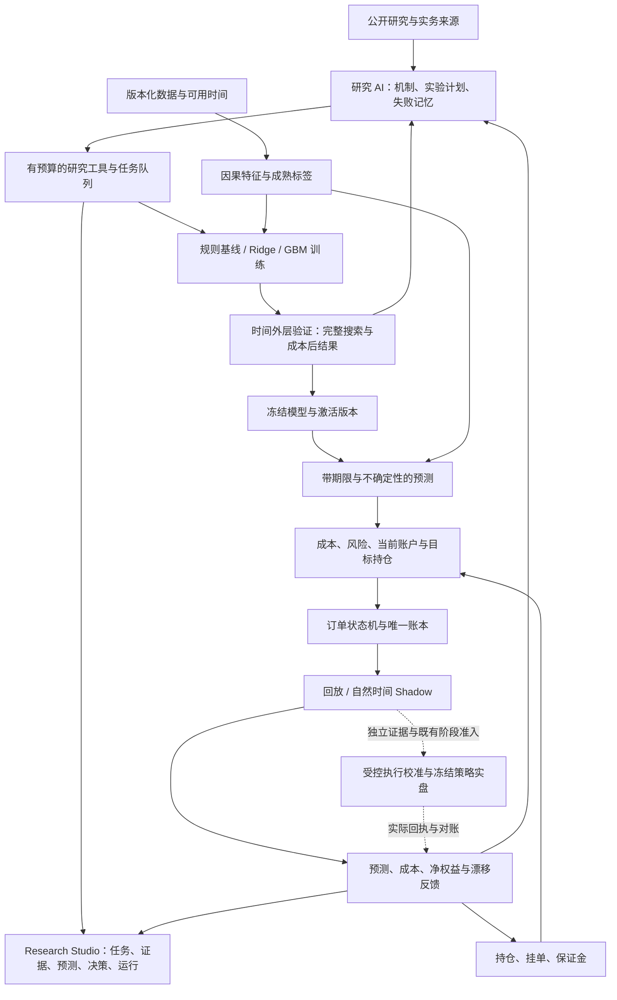

# QUANTOS：从自动研究工厂到可落地的 AI 量化交易系统

日期：2026-09-07。类型：公开资料定向研究、当前源码对照与后续开发建议。
源码/部署核对版本：`2d56da1b6904a1a4f4ab07c60bfd43f900c15782`；其已验收源码锚点为 `7436acd8f3017b5af4f6801a7fefa3a60ff92534`。
本报告没有运行新的策略收益实验、修改生产服务或改变经济准入。文中“建议”“验收”均指尚待实施的工作。

## 1. 结论与首期产品定义

QUANTOS 应成为一套能把经济假设变成可执行实验、让模型持续产生有时间戳的预测、把预测转为成本与风险约束下的持仓，并用真实执行反馈校正研究的系统。

AI 必须承担两项实际职责：**研究 AI 决定下一步做什么实验；交易模型估计何时、朝什么方向、以多大风险承担敞口。** LLM 可以调用研究工具、生成特征和解释失败；确定性的执行系统负责订单、持仓、费用和恢复。机器学习也可以用于执行成本和成交概率估计，不能把所有 AI 都缩成一个聊天框。

建议首个产品收敛为：**一个 BTCUSDC 永续研究与执行闭环，小时级决策、数小时持有的可检验规格，简单基线 + Ridge + 小型 GBM；有预算的 AI 研究与前向观察同时运转。** BTCUSDT/其他场所先提供解释变量和对照，不混接成 BTCUSDC 历史。日频已有模型继续保留为对照。这里的频率是拟议新实验，不意味着改动现有冻结实验或将日频结果外推到小时级。

成功标准不是“有很多图表”“生成很多 Alpha”或“用了大模型”，而是同一候选能够追溯：来源→特征→成熟标签→模型版本→预测→目标持仓→订单/拒绝→费用与净权益→前向评价。允许系统得出“目前没有值得交易的机会”，同时继续积累可用数据和研究证据。

## 2. 检索范围与 X 的访问限制

本轮从用户指定的 [@buildalpha](https://x.com/buildalpha) 出发，检索 Build Alpha 官方文章、X 中量化系统/回测/成本讨论，并追溯作者网站、机构公开资料、论文与项目文档。

X 主页直接读取返回 403；其他账户也出现访问失败或无关搜索结果。搜索曾返回 Build Alpha 的第三方镜像片段，但**不把镜像当作已核验推文正文，也不采用其中的业绩与发布日期**。因此，本轮完成的是 Build Alpha 与相关实务作者原文的交叉研究，未完成 X 全时间线或付费长文综述。不能声称已读到所有推文。

下表中商业软件功能是作者自述，机构内容是公开方法，论文结论受样本和实验设定限制。均不等于 QUANTOS 账户盈利证明。论文阅读范围是摘要、方法相关段落及公开说明，不是全文逐式审计；仓库阅读也不是逐行安全审计。

| 对象与原始材料 | 可核实的借鉴 | QUANTOS 应采用的方式 |
|---|---|---|
| [Build Alpha LLM Orchestrator](https://www.buildalpha.com/llm-orchestrator/) | LLM 调整搜索配置，读取实验反馈并保留会话经验；GA 在配置内搜索 | 让 AI 真正调用有类型的研究工具，保存每次提议、执行结果和失败；不只返回建议文字 |
| [Build Alpha 稳健性指南](https://www.buildalpha.com/robustness-testing-guide/) | 不同测试回答不同问题，单策略与组合均需检查 | 为机制匹配检验，不要求所有策略机械通过所有测试 |
| [Build Alpha 组合回测](https://www.buildalpha.com/portfolio-backtest-trading/) | 共享资金会改变订单和仓位，不能仅拼接独立交易列表 | 组合必须共同重放账户、资金与订单，复用唯一账本 |
| [Build Alpha 功能](https://www.buildalpha.com/features/) | 信号构建、验证、组合、导出与监控形成工作流 | 借鉴“从结果点回原因”的交互，不照抄“通过测试便证明优势”的营销表述 |
| [Rob Carver 的规则原文](https://qoppac.blogspot.com/2015/09/python-code-for-two-trading-rules-in.html)、[pysystemtrade](https://github.com/pst-group/pysystemtrade) | 可解释规则和系统化实现的公开实例；项目有回测及生产相关结构 | 为 AI 保留可解释、低复杂度比较基线；不移植其股票/期货规则来假装 BTC 已适配 |
| [HangukQuant 延迟基准文章](https://www.research.hangukquant.com/p/hft-benchmarking-done-wrong-part-fe0) | 可见正文强调突发行情下排队造成的延迟变化 | 观察端到端延迟尾部和积压，不以单函数平均速度证明 HFT 能力；付费部分未读取 |
| [Robot Wealth 换手成本文章](https://robotwealth.com/a-simple-effective-way-to-manage-turnover-and-not-get-killed-by-costs/) | 用不交易区间减少不必要的调仓 | 把持有/减仓/不交易列为正式动作，阈值只在内层样本确定 |
| [Two Sigma 公开介绍](https://www.twosigma.com/) | 假设、数据科学和端到端工程共同支撑投资研究 | 每个模型有机制、数据和生产反馈；不把其算力规模当成我们的前提 |
| [Jane Street ML](https://www.janestreet.com/join-jane-street/machine-learning/) | 研究、工程和交易协作，并研究模型在生产中的交易表现 | 建立预测→订单→成交质量反馈，不止训练准确率榜单 |
| [Man AHL 的 ML 说明](https://www.man.com/insights/intro-machine-learning) | ML 用于策略、执行及文本信息；需比较简单方法和不同环境 | 收益预测、风险/成本模型分工；NLP 后置到有可靠历史时间戳的数据上 |
| [AQR 可实施有效前沿](https://www.aqr.com/insights/research/working-paper/machine-learning-and-the-implementable-efficient-frontier) | 机器学习与交易成本约束共同决定可实施组合 | 不能只按预测 MSE 排名选交易模型；经济评价必须扣费并控制相同风险 |
| [Gu/Kelly/Xiu](https://www.nber.org/papers/w25398) | 原研究比较 ML 方法，非线性交互可改善其资产定价任务 | 以小型树模型挑战线性基线；原股票横截面结论不能证明单一 BTC 时间序列有效 |
| [Qlib](https://arxiv.org/abs/2009.11189)、[RD-Agent-Quant](https://arxiv.org/abs/2505.15155) | 数据/模型研究工作流，以及提议、开发、反馈迭代 | 复用思想和接口，检验本项目中 AI 搜索的净增益；不照搬论文收益 |
| [PBO](https://www.davidhbailey.com/dhbpapers/backtest-prob.pdf)、[DSR](https://www.davidhbailey.com/dhbpapers/deflated-sharpe.pdf) | 策略筛选带来过拟合，尝试次数影响证据解释 | 记录完整搜索与上层选择；这些方法不能单独认证任意自适应 LLM 搜索 |
| [Boyd 等多期优化](https://web.stanford.edu/~boyd/papers/cvx_portfolio.html)、[Nautilus 对账](https://nautilustrader.io/docs/latest/concepts/reconciliation/) | 成本/风险约束的决策与外部订单持仓对账分别需要明确机制 | 先单资产简单约束决策，随后共享账户组合；实盘状态以实际回执持续核对 |

## 3. 对用户所附架构图的修订

原图的 P0 数据/时间/身份、P1 候选工厂、P2 执行/验证、P3 证据/界面、P4 前向/授权结构有用，建议保留。截图中的圆点状态没有本轮对应的机器证据，不沿用为完成度。

需要明确补充的不是更多治理方框，而是以下六条实质链路：

1. **LLM Research Advisor → 有预算的研究编排器。** 自动提出并执行研究任务、解释失败、调整内层搜索；普通实验无需逐次审批。不能修改测试集、费用事实、冻结配置或风险上限来使结果好看。
2. **在 Feature Garden 后加入标签、训练、验证、模型注册与推理。** 预测结果必须包含预测期限、单位、模型版本和可用时间。LLM 写规则与 ML 学参数是不同能力。
3. **在预测与执行之间加入成本/风险决策。** 预测值不直接成为订单；读取当前持仓、挂单、可用保证金和交易成本后，决定持有、调整或不交易。
4. **Portfolio Fit 从事后筛选升级为共同账户仿真。** 冻结既有组合上下文，比较加入/替换后的净增益、尾部风险和共享资本竞争。相关性图只提供诊断。
5. **增加实际成交反馈。** 拒单、成交概率、费用、延迟和滑点进入成本校准；漂移触发新研究版本，不能静默修改正在观察的旧版本。
6. **Evidence 区分三类状态。** 工程完整性、统计/经济证据、线上运行健康分别呈现；签名证明身份与控制关系，不证明模型未来赚钱。

原图的 Random OOS、MC/置换、合成数据、跨市场检验不能作为不加条件的统一认证：时间依赖标签不能任意随机拆分；打乱交易顺序主要测试路径风险，不检验信号生成；只置换胜出者遗漏选择偏差；合成样本不增加独立实盘样本；特定场所机制跨市场失效也可能符合原假设。应预先写明检验的零假设、保留的依赖和适用范围。Build Alpha 的 [MCPT 说明](https://www.buildalpha.com/monte-carlo-permutation/) 提供可借鉴方法描述，具体置换设计仍需按我们的数据过程实现和验证。

实盘框为后续阶段，不是当前已连通的能力；研究与 Shadow 可以先自动持续运行。

## 4. QUANTOS 当前到底有什么

本轮读取源码、此前具体交付记录及在线接口，不重新把历史文档中的所有“已完成”当成事实。前一轮 28/28 工程验收与本轮研究报告是两件事；本轮没有重跑全量测试。

| 能力 | 本轮核实的状态 | 具体缺口/下一动作 |
|---|---|---|
| 上线基础设施 | `2d56da1b6` 已上线，前端/Console/Runner/两路公共流运行；部署后 watchdog 未通过 | 盘口归档刷新、备份既有失败仍须处理；不能把已上线等同全健康 |
| BTC 数据 | USDT 常驻流存在；BTCUSDC 冻结观察另走受限公共 REST | 小时级 USDC 必需输入覆盖及可用时间需单独接入；USDT 跨市场特征与 USDC 执行身份分离 |
| 实验工作流 | JobQueue、RunRegistry、TrialLedger，机制/工厂技术结果已经接到 Studio | 扩展新模型/新频率时沿用同一试验身份，不能重建另一个无追踪脚本工厂 |
| 当前 BTC 模型 | 四种特征组合用 OLS 拟合；月度按过去成熟 MSE 选择 | 不是四种不同 AI 算法。现有 19.2bp 阈值和 ±25% 目标仓位是冻结政策，尚非成本/风险自适应决策 |
| 其他 ML | `fit_stacker` 有 Ridge、HistGradientBoosting 和可选 XGBoost/CUDA | 代码存在不等于已接入当前 BTC 候选→预测→成本后评价链；需专用 adapter 和一致性验收 |
| 研究代理 | 搜索、演化、模型 runtime 等基础代码存在 | `ResearchAgentLoop` 仍受 legacy diagnostic seam 约束；不能直接恢复旧 evaluator 为新经济权威。应对新研究数据契约接线 |
| 在线模型工厂 | 已有月度版本、观察锁和接收时间训练代码 | 线上 forward-dashboard 当前 observations=[]、NOT_CONFIGURED；有调度但无已冻结实验。不是正在自动训练交易 |
| 样本启动 | 在线规则 `train_min=180`，选择窗口 60–90，且按自然接收日频样本 | 从零开始需要数月级积累，增加 GPU 或两分钟定时频率不能缩短日频标签成熟时间 |
| 账本与仿真 | 统一 Decimal V2、执行回放和成本情景已有实现与技术验证 | 新数据/规则/订单类型仍逐项验收，不将旧 V1 或历史技术收益变成经济权威 |
| 组合 | 风险预算、约束、相关性和优化模块存在 | 当前 BTC 工厂非完整共享账户组合/AI allocator；需验证资金、挂单、净额和归因一起运转 |
| 实际执行 | live 目录有 OMS、恢复、对账、风险、TCA 和场所适配代码 | 本轮未执行 testnet/mainnet 验收；USDC 具体规则、费用、资金流和恢复仍需场所验收 |
| 经济准入 | 外部 signed-authority integrated 标志为 False；公开谓词拒绝所有记录 | 明确建设独立控制的输入/结果校验与验证入口；不是把布尔值改 True 或多签几份文档 |
| 前端 | Studio 已有行情、研究分析、模型、观察、运维图表 | 增加研究 AI 任务与工具轨迹、模型预测校准、决策成本分解、模型生效时间、实际成交归因 |

源码锚点：

- [当前 BTC OLS 与特征](../../tools/btc_mechanism_study.py)、[模型选择与仓位政策](../../services/research/btc_factory_replay.py)。
- [在线工厂规则](../../tools/btc_online_factory.py)、[USDC 公共观察](../../tools/btc_forward_observation.py)、[USDT 常驻流](../../tools/binance_realtime_stream.py)。
- [ML 组件](../../services/research/ml/stacker.py)、[研究代理](../../services/intelligence/agent_loop.py)、[Runner 白名单](../../services/research_runner/run_kinds.py)。
- [组合优化](../../services/portfolio/optimizer.py)、[经济准入](../../services/execution/backtest_authority.py)、[真实执行流水线](../../live/pipeline.py)。
- [本轮前端与运维实施记录](../engineering/plans/2026-09-07-studio-operations.md)、[已有在线工厂](../engineering/specs/2026-09-07-btc-online-factory.md)。

## 5. AI 的实际工作合同

### 5.1 研究编排器：完成任务，而不止聊天

用户配置一次研究会话：市场、数据集、目标、搜索预算、计算预算、允许特征与停止条件。AI 可在此范围内调用读取资料、生成 typed hypothesis、构建特征、提交实验、分析失败和保存记忆工具。会话可暂停、恢复、取消；失败试验计入账本。

首版用一个编排器承担规划/执行/复盘三个步骤，不先建设多代理相互评审组织。工具返回结构化事实，LLM 说明与结果数值分开保存。LLM 不负责心算 PnL、生成缺失的统计值或裁定自己获胜。

最小实验合同：`hypothesis_id, family_id, source_ids, dataset_hash, as_of, feature_spec_hash, target_horizon, label_available_at, split_plan_hash, model_spec, search_budget, cost_profile_hash, risk_profile_hash, parent_trial_ids`。

记忆合同另含 `created_at, data_cutoff, evaluation_scope, failed_reason, contradictory_evidence`。改搜索空间也是新尝试。跨轮记忆不能把外层测试结果泄漏到后续“未见”实验。通用 LLM 预训练可能知道历史事件，因此历史研究代理回放不能伪称完全当时可知；采用匿名化数值任务降低污染，并以启动后的自然时间表现核实。

没有用户配置的可调用模型时，界面明确显示“模型未连接”；保留规则搜索可用，不能暗中用固定模板冒充 AI。模型由现有 provider 边界接入，不将真实凭证写进研究配置、日志或报告。

### 5.2 预测模型：低误差还不够

首批三种比较：固定趋势/波动规则、Ridge、小型 GBM。数据成熟后再评估 XGBoost、序列模型或文本模型。深度学习不是首期验收前提，强化学习先留在执行仿真研究，不以稀疏在线收益直接探索真钱动作。

预测输出至少含：预期收益、期限、模型版本、输入快照、生成/可用时间、是否可用及校准诊断。区间/分位数只有经过时间外验证和覆盖率检查才展示为估计区间，不能包装成保证。

建议新实验：整点使用当时已闭合且已收到的特征，预测之后四小时收益，实际执行发生在决策与计算延迟之后；标签在目标终点价格已收到后成熟。每小时产生的四小时标签重叠，不能当独立样本，切分需隔离跨边界标签并处理序列相关。样本稀少时报告不确定，不硬给 Sharpe 排名。

旧历史数据用于研究及冻结模型的初始拟合，明确历史可用时间不足的范围；新接收数据用于真实前向。已有冻结日频模型可先观察，新频率另建实验，不回填“早已预测过”的记录，也不降低旧180样本门槛。

### 5.3 决策层：把预测变成可实施持仓

以一个持有期 h 和同一计价单位表达建议目标：

\[
\max_w\; \hat\mu_{t,h}^{\top}w-\frac{\lambda}{2}w^{\top}\hat\Sigma_{t,h}w
-C_t(w-w_{current})-H_{t,h}(w)
\]

其中 w 是相对权益的目标敞口，收益、风险、交易成本 C 与资金/持仓成本 H 均换成相同持有期下的权益比例；实际合约数量由场所规则转换。必须限制杠杆、仓位、保证金、容量及预算，并计入挂单承诺。无可靠成本预测时使用已冻结的保守情景，不让优化器把 UNKNOWN 当零成本。

此式是拟议设计，借鉴成本约束优化方法，不是现有引擎已执行的公式，也不证明真实最优。单一 BTC 首版可用离散候选仓位 + 不交易区间，逐个用同一账本预演约束；多策略后再扩展求解器，避免一开始部署脆弱的高维优化。

maker 0 只影响费用，不能保证挂单成交或没有逆向选择。maker 模型需要队列、撤单、延迟与成交后价格变化数据；在没有这些证据时，主动成交基线更容易形成诚实对照。账户费率仍需具体场所/账户核验。

### 5.4 怎样证明“AI 有用”

建议预注册三组研究：固定人工规格、随机/GA 搜索、LLM 编排相同工具。每组初始最多96个有效或失败的评估尝试；这是可修改的实验预算草案，不是统计阈值。各组使用相同数据、费用、风险、候选语法及相当的计算上限，单列 LLM token、耗时和失败成本。扩展预算必须在看外层结果之前形成新计划。

比较两个层面：研究效率（完成率、重复率、覆盖机制、单位计算产出）与经济结果（未用于选择的成本后效用、回撤、尾部和基线增量）。LLM 自评不作为度量。

整个生成→筛选→模型选择→组合规则都属于待评估策略。内层开发和多个时间外层测试分开；对自适应研究流程按截止时点运行完整流程。外层数据不返回编排器。PBO/DSR 是诊断补充，不替代完整过程验证；最终自然时间观察不因看完结果后改名而恢复独立性。

## 6. 后续路线：沿用原路线，按可运行交付推进

以下 A0–A6 是本报告便于执行的工作包编号，不是取代现有 M0–M4/WP0–WP7 的新准入等级。沿用既有阶段边界，自动化研究开发可并行准备，实际交易晋级仍按原顺序。

| 工作包 | 交付与主要落点 | 验收/停止条件 | 对应已有路线 |
|---|---|---|---|
| A0 运行与数据起点 | 修复真实备份瓶颈；盘口问题定位到源/转换/合同；对用户明确选定的研究实验完成冻结初始化；USDC 小时数据计划 | 控制台从 NOT_CONFIGURED 变成真实有实验；按时留下预测或明确缺数原因；保持恢复目标，不以清 failed 代替修复 | M2 运维；WP0/WP3 的研究准备 |
| A1 AI 研究最小闭环 | provider→typed plan→Runner→TrialLedger→事实摘要→下一实验；复用 services/intelligence 与研究白名单的新技术路径 | 一次任务自动完成提议/执行/复盘；中断恢复不重算重复身份；预算到即停；外层结果不能进入反馈 | M1/I1，M3；WP1 |
| A2 BTC ML 与数据合同 | 将 Ridge/GBM 适配到同一 BTC 特征/标签与模型注册；保留 OLS/规则；新增小时实验 | 改变未来数据不改变过去训练/预测；fit/activate 时间可核对；相同输入复现；实际前向开始积累 | M3/D2/S1/S2；WP1/WP3 准备 |
| A3 成本后决策与评价 | 统一目标持仓、成本分解、拒单原因；内外层比较、基线、序列相关统计；逐候选与全搜索记录 | MSE胜出但净效用不胜出时不选入；费用/延迟变化正确反映到订单与账本；拒绝无虚构收益 | M1/E/V，M4/A1；WP2/WP4 技术准备 |
| A4 自然时间 Shadow 与研究反馈 | 冻结模型激活、每天/每小时预测、标签成熟、漂移、失效与建议新版本；可观察可恢复 | 无已发生预测的回写；断网/重启后事实不重复；样本不足明确等待；自动维护不等于自动换实盘策略 | M2–M4；WP3 |
| A5 独立结果验证与执行闭合 | 独立控制的来源/结果验证入口；复用 OMS、幂等、对账、TCA；USDC 场所规则与故障恢复 | 生产账户/订单状态与真实回执一致；重启/超时/部分成交/撤单竞争通过；证据能被独立否定 | M4/G1；按 WP5→WP6→WP7 |
| A6 组合与扩展 | 两个以上有证据的策略共享资金回放；冻结组合上下文；再评估跨所、carry、序列模型与 NLP | 加入/替换产生独立净增量；资金竞争和尾部暴露有完整账本；新资产单独适配 | M3/WP4 扩展，后续阶段仍按原准入 |

建议接下来两个开发迭代先做 A0/A1 与 A2/A3 的最小贯通，同时持续积累前向数据；不等所有资产、模型和仪表盘齐备。工程迭代可以估算，盈利时间与自然样本成熟不能承诺为固定几周。A5 的独立验证合同现在就设计，避免临上线才发现所有候选都被结构性封闭；不以反复审查替代实现。

异机恢复目前有用户已明确的环境限制，继续记录延期，不能把本机副本算成异机验收。盘口若暂不适用于当前策略，可声明该研究不依赖它并继续 OHLCV/flow 实验，但整体运维故障仍可见，不删除检查。

### 首批具体变更顺序

1. **研究会话合同与工具接线**：AI 会话/提议/预算的持久身份、工具结果事实化、runner 参数与错误处理、Studio 一个真实任务入口。
2. **BTC 统一模型适配**：共享 PIT 面板、标签、训练时钟和产物，接 Ridge/GBM；不要把现有日频四模型伪装成新算法。
3. **决策与经济评价**：目标持仓、费用/资金费/延迟解释、基线与外层结果；复用唯一账本。
4. **前向激活与运维**：初始化、模型生效、预测成熟、监控/恢复；同时关闭实际备份问题并保留数据缺口状态。
5. **独立验证及场所执行验收**：以具体回执与反例闭合，随后才进入相应真实执行阶段。

## 7. 前端应该呈现的真实 AI 工作流

保留当前 Studio 和已有图表，新增功能接到真实产物，不再整套重写。

| 工作界面 | 必须显示与能操作的内容 |
|---|---|
| 研究任务 | 自然语言目标转结构化范围，预算/预计资源，启动/暂停/取消/恢复；当前使用的模型与未连接状态 |
| AI 工作记录 | 正在调用什么工具、用了哪些来源、为何提出下一实验；事实结果与 AI 解释明确区分 |
| 实验谱系 | 每次提议及父实验、失败原因、未查看的外层状态、重复与试验预算；所有失败保留 |
| 模型 | 预测与实际、校准/分位数覆盖、残差分环境、版本训练截止/激活时点；与简单基线对比 |
| 交易决策 | 本时点预测→成本→风险→目标仓位→为何不交易/被拒绝，单位和持有期一致 |
| 前向/执行 | 冻结起点、成熟样本数、实际成交/费用/滑点、预测失效、恢复和资金对账；技术曲线与真实账户分开 |
| 组合 | 冻结组合与新增候选的边际风险/收益、资金竞争、净额与策略贡献；不是只把几条线相加 |

不增加多个角色逐级批准普通实验。一次研究范围配置授权日常自动运行；超出范围或进入已有实盘边界才走对应操作。前端的“运行 AI 研究”必须真正提交任务，不能以静态对话回答冒充执行。

## 8. 交付与下一次验收

本轮交付此报告及来源/访问范围目录：[sources.json](../research/ai-quant-system-20260907/sources.json)。这是一份新的综合设计，不把前几日的对标原文重新命名为今天的成果。

建议下次演示采用一个真实任务：用户要求研究“BTC 主动成交压力在不同波动环境下是否有成本后增量”，AI 建立有预算的假设，复用合格数据生成规则/Ridge/GBM 实验，展示成功和失败，记录外层结果并产生一个可冻结的研究版本。若没有优势，完整输出原因；若数据不足，指明缺口并持续采集。后续观察必须展示真实新增时间戳，不能演示预制上涨曲线。

这项交付完成后，QUANTOS 才能具体证明 AI 正在承担研究工作、模型正在产生可执行决策；经济有效性和真实执行可靠性则由各自后续证据回答。
