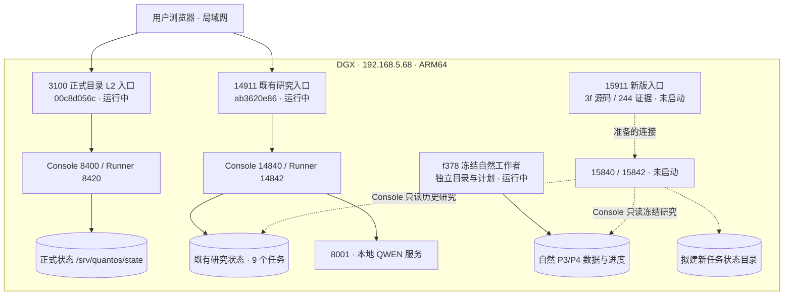
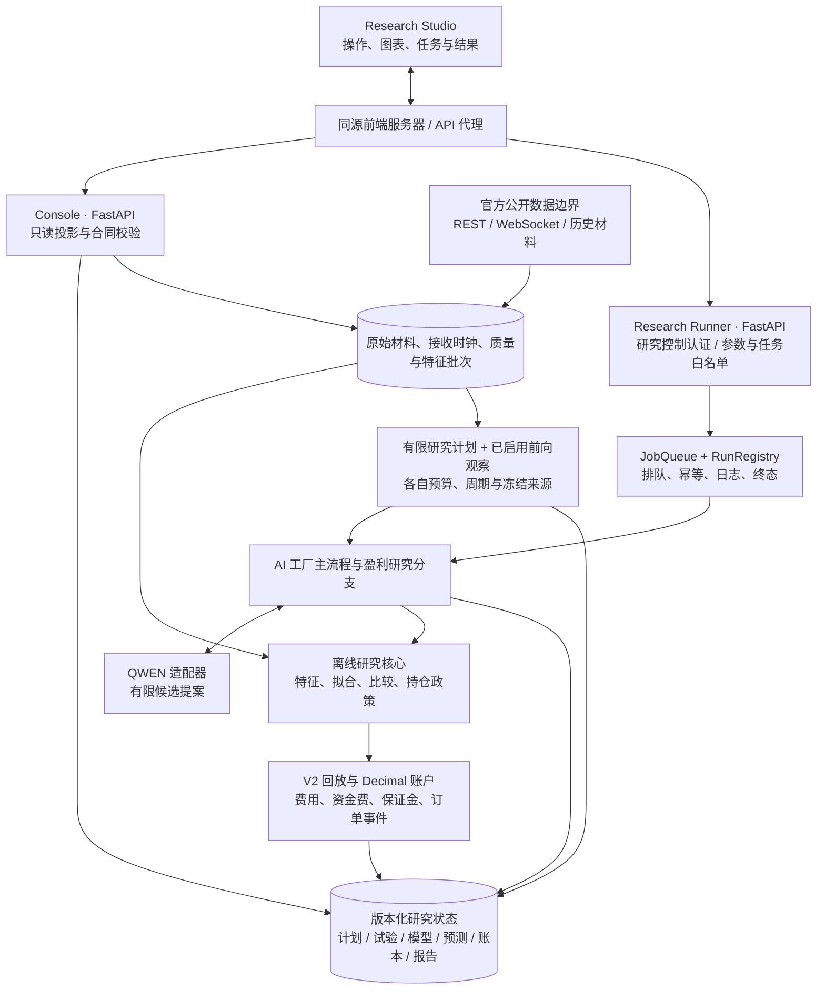
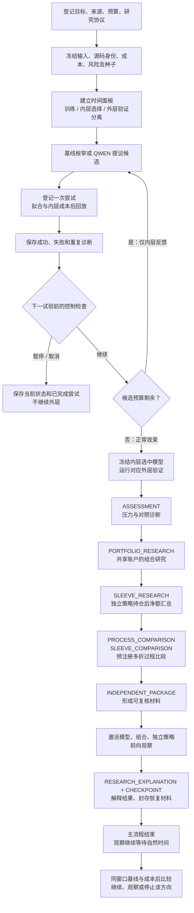
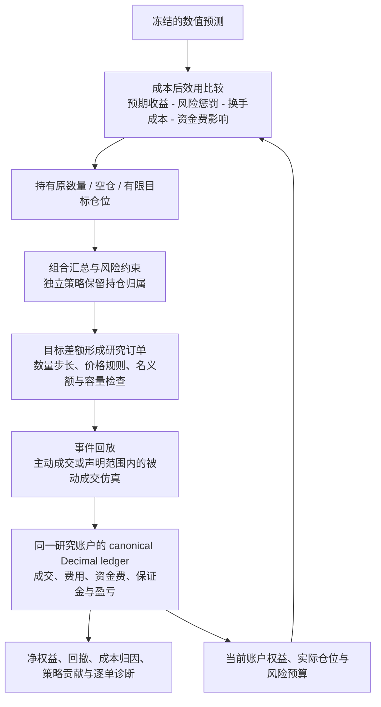
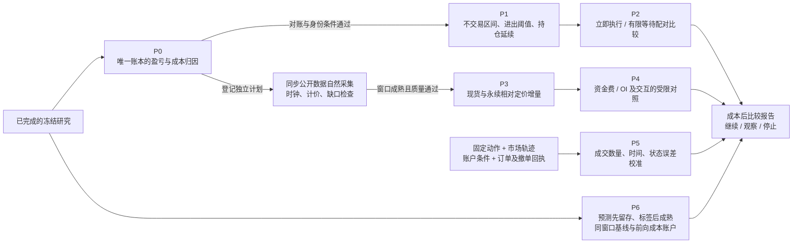
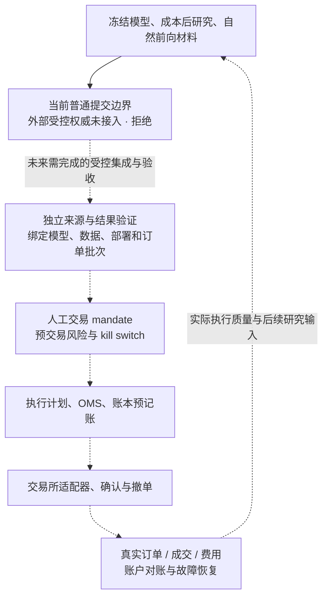

QUANTOS 当前系统：实际运行拓扑、研究流程与架构说明
====================================================

核查时间：2026-09-11 10:27–10:32，Asia/Shanghai。本文描述实际代码与运行现场；不是把目标蓝图全部视为已交付。
核查时工作区 HEAD 为 `3b85403732ff7b902d6fd5149d9500949edff280`。
最近完整验收的运行源码为 `3f65322c527cbb693e1af477ef69f90029c4c0da`，证据提交为 `244dd6fbe3e1ffd88c21da4882602f4602bfea82`。
后续文档提交没有更改该运行源码身份。

**当前定位。** QUANTOS 已有自动研究编排、数值模型训练、成本后持仓决策、Decimal 永续回放、组合研究、自然前向观察与 Studio。当前仍是 L2 研究系统，普通实盘下单通路关闭，尚未形成经验证的稳定成本后盈利。最新软件与当前常驻版本不同，不能将下文所有功能都视为 14911 已上线。

**现场运行拓扑。** 本次只读取服务元数据、HTTP GET、端口和冻结研究材料，没有切换服务、启动实验或生成模型回复。

| 现场组成 | 版本 / 地址 | 本次实际检查 |
|---|---|---|
| 正式目录中的 L2 栈 | `00c8d056c`；前端 3100，Console 8400，Runner 8420 | 三服务 active；前端与 Runner 健康 HTTP 200；工厂 GET 返回 `NO_SNAPSHOT` |
| 既有独立研究栈 | `ab3620e86`；前端 14911，Console 14840，Runner 14842 | 五服务 active；前端与 Runner 健康 HTTP 200；工厂 GET 为 `REAL`，9 个研究任务 |
| 已验收新版研究栈 | 源码 `3f65322c5` / 证据 `244dd6fbe`；拟用 15911 / 15840 / 15842 | 配置与发布包已准备，三个端口均未监听，尚未启动 |
| DGX 本地模型 | `127.0.0.1:8001`，模型标识 `qwen3.8-27b` | `/v1/models` HTTP 200；本次未验证新的生成调用或模型权重身份 |
| 新自然信息窗口 | 独立冻结源码 `f378cf554`，PID 1890754 | 进程及启动身份一致；10:29 心跳约 19.5 秒；USDC、USDT 各 4/504 行，无缺口，0 个新候选试验 |
| 正式环境运维问题 | watchdog、深度前向刷新、L2 backup | 对应 systemd unit 为 failed；服务在线不等于整个运行环境健康 |

`NO_SNAPSHOT` 只表示该状态目录没有对应工厂快照，不代表其他研究空间没有任务。systemd 中 inactive 的周期性一次性任务，也不能一律判为故障。

正式入口的“正式”指安装与运行目录，不代表 mainnet 或经济准入。新版额外空间只读，不把旧工作者迁移到新引擎。
运行配置详见[研究栈交付说明](../engineering/specs/2026-09-11-research-runtime-handoff.md)。

**软件结构。** 主体是 Python 模块化后端，少量独立进程负责服务、采集、调度和推理；前端为 React / TypeScript / Vite。当前 JobQueue 默认一个执行线程，持久化使用 SQLite 与带摘要的文件，并非已经部署分布式研究集群。GPU 上的本地 LLM 服务与普通数值模型训练是两条不同计算路径。

这里“观察器 → 流程”概括不同调度入口：有限 campaign 调用主工厂；前向 daemon 推进已启用观察；独立 P3/P4 工作者只推进自己的冻结信息研究。不是每个观察 tick 都重新训练、调用 QWEN 或执行整条工厂流程。

**一次 AI 研究任务如何完成。** 用户在当前可写空间填写目标、基线或 AI 模式、候选预算及研究协议。Runner 的 `/factory` 创建记录并提交白名单 `ai_factory_pipeline`；持续研究计划通过 `/factory-campaign` 登记有限轮次，再调用相同入口。普通研究作业也有 `/run`，补充输入走 `/profitability-input`。Console GET 不启动计算。

暂停 / 取消走独立状态出口，保留当前及已完成尝试；图中的“正常收束”不代表取消后继续跑外层。
主入口实际先调用 `run_factory`，随后按顺序执行上述 11 个后续 stage。每阶段保存运行状态、完成列表和结果摘要；失败指明阶段并保留材料。
`COMPLETED` 表示研究处理已结束，观察的“激活”不表示标签已成熟，更不表示合格策略自动晋级。
源码：[主流水线](../../tools/ai_factory_pipeline.py)、[主研究](../../tools/ai_quant_factory.py)、[有限调度](../../services/research_runner/factory_campaign.py)。

**AI 的实际职责。** 当前主工厂使用“语言模型选择研究候选 + 数值模型产生预测 + 确定性引擎计算持仓与收益”的分工。

| 组成 | 实际工作 | 边界与范围 |
|---|---|---|
| 本地 QWEN | 阅读目标、来源摘要、剩余候选与内层历史，返回结构化候选 ID | 不能任意执行生成代码，不读取外层结果来继续搜索，不接触交易凭证 |
| `SINGLE_V1` / `THREE_ROLES_V1` | 单提案，或提案、反提案、综合三次有限调用 | 三角色来自同一模型，不是三个独立的经济证据来源；无需人工逐角色审批 |
| 规则 / Ridge / GBM | 拟合并计算未来收益数值预测 | 当前小时主工厂以约 4 小时收益为目标；不是让 QWEN 直接猜买卖价格 |
| 持仓决策器 | 综合预测、已有仓位、风险惩罚与交易成本选择目标 | 允许保持仓位或空仓；预测正值不必然开多 |
| 研究比较与报告 | 汇总成本、回撤、稳定性、基线增量和失败原因 | 文字解释不替代账本，不授予实盘资格 |

主工厂基础特征为 1h / 6h / 24h 收益、24h 波动、主动成交不平衡。V1 候选池 18 项，V2 加入流量交互、波动缩放和反转变换后为 72 项；一次主搜索预算 3–18 次。后续组合与多折研究各有独立有限规格，不能把主搜索预算当作全部回放数量。

36 个公开机构 / 系统来源是可选择的研究目录，单计划选择其中 1–8 项作为研究上下文；不代表已经复刻 36 家私有系统，也不是每轮自动爬完 X 或任意论文、自动部署其中策略。
源码：[候选与特征](../../services/research/ai_factory.py)、[有限角色协议](../../tools/ai_factory_collaboration.py)。

**预测怎样变成持仓、订单和净收益。** 这是系统区别于纯语言模型交易演示的关键计算路径。

唯一账本指同一研究账户及场景中的权威记账路径，不是所有币种、实验共用一个余额。USDC 与 USDT 分账研究，不隐式兑换；组合组件不能各算一份资金再相加冒充同资金预算。
主工厂冻结技术假设包含手续费 4bp 与滑点 5bp，压力比较使用声明的其他场景；这些不是已经核验的实际账户费率。
P5 导入的报告费用作为对照诊断，不能再次扣入已经计入模拟费用的同一账本。缺回执、缺币种转换或缺实际来源时保留 UNKNOWN。

引擎文件：[主动回放](../../services/execution/perpetual_simulation.py)、[被动回放](../../services/execution/passive_perpetual_simulation.py)、[V2 账本](../../services/execution/perpetual_ledger_v2.py)、[持仓决策](../../services/research/ai_factory_decision.py)。

**P0–P6 与主工厂的连接。** 它们已接入研究工作区与 Runner，但不是每个工厂任务都自动完整执行的七段串行流程；冻结研究、输入、时间与质量条件决定哪些分支可以推进。

| 分支 | 交付 / 判断 | 截至本次的实质状态 |
|---|---|---|
| P0 | 毛收益、手续费、滑点等成本、资金费、换手、持仓贡献与账本一致 | 冻结 #4 成本前已亏，不能只归咎手续费 |
| P1 | 同预测、数据、风险预算，对比有限持仓政策 | 已有冻结比较；#4 外层零成交，不构成净盈利证据 |
| P2 | 成交改善、错失行情、超时整体配对；风险减仓不延迟 | 已有受限实现；该冻结案例没有可检验的执行改善机会 |
| P3 / P4 | 两种计价分别采集、控制混杂、按注册预算检验信息增量 | 新窗口各 4/504 行；尚未运行新候选。最早成熟条件为 10 月 2 日 10:06，仍须质量通过 |
| P5 | 固定动作回放、有限校准、真实逐单误差评价 | 公开 / 合成路径及前端已验证；真实私有来源、账户与场所误差证据未验收 |
| P6 | 冻结预测、成熟标签、同窗口基线、前向成本账户 | 软件与观察路径已接；尚无充分自然成熟盈利结论 |

P3/P4 的特征采集不是“结果发生前已保存预测”；P6 才专门记录预测与之后成熟的标签。新窗口成熟日期不是预计盈利日期。
P5 当前原始消息支持范围包含 BTCUSDC / BTCUSDT 单向普通 LIMIT / GTX；不能推广为任意账户模式、条件单、强平、ADL 或实盘 maker 校准已完成。
源码：[盈利总入口](../../tools/profitability_workflow.py)、[信息采集与研究](../../tools/profitability_causal_workflow.py)、[前向成本账户](../../tools/profitability_forward_account.py)。

**与原 11 层蓝图的对应关系。** 下表只列当前主路径的落地映射；目录存在或测试通过不表示该层所有目标均达到实盘验收。

| 蓝图层 | 当前主要职责和实现位置 | 重要限制 |
|---|---|---|
| 01 数据 | `tools/` 公开适配器、`services/data/`；原始行情、接收时钟、冻结版本和质量 | 不同来源可用性不同；公开数据不提供私人真实成交 |
| 02 特征 | `services/research/ai_factory.py` 与 profitability 信息模块 | 小规模可解释特征；P3/P4 自然信息仍积累中 |
| 03 Research OS | Runner、RunRegistry、研究工具、V2 回放、指标与报告 | 研究登记镜像不是经济权威；旧 V1 结果已失效隔离 |
| 04 Alpha Factory | 工厂会话、候选预算、试验登记、有限 campaign、挑战者观察 | 主搜索有限；生命周期页面不表示自动晋级可交易 |
| 05 组合 | 预测组合、独立持仓组件、共享账户、内层选权重、外层比较 | 已有比较未得到稳定成本后增量 |
| 06 风险 | 研究账户风险约束；`services/risk/pre_trade/` 支持的执行门 | 研究的预期收益不能越过真实执行准入 |
| 07 模拟交易 | V2 Decimal 仿真与前向成本账户 | 属技术验证；不能复用旧 V1 paper fill 作为经济证据 |
| 08 执行 | `live/` 的 OMS、适配器、撤单、确认、恢复及风控技术组件 | 普通提交入口阻断；真实账户闭环尚未验收 |
| 09 AI Agent | QWEN 研究适配器、有限角色、内层反馈 | 没有任意代码执行或直接下单权限；三角色同模型 |
| 10 前端 | `apps/research-console/src/studio/` 与 Console 类型合同 | 最新研究空间切换尚未上线；跨空间能力只覆盖工厂与生命周期 |
| 11 运维与证据 | systemd、心跳、审计、检查点、恢复、构建与来源绑定 | 正式运维仍有 failed；异机恢复按此前约定搁置 |

原始目标见[主蓝图](../../QUANTOS_MASTER_BLUEPRINT.md)，当前限制优先于旧完成声明。

**数据与恢复如何组织。** 每个状态根独立，Console 读取获准的空间，Runner 写当前空间。关键存储如下，路径均相对于该空间的状态根。

| 存储 | 作用 |
|---|---|
| `data/cache/research_runs.db` | 作业登记、参数、运行状态、日志及结果镜像 |
| `data/cache/governance_audit.db` | 研究操作的审计记录 |
| `data/cache/ai_factory/factory.db` | 会话、控制命令、campaign、轮次及不可变补充输入版本 |
| `data/cache/ai_factory/trials.db` | 主研究试验记录；其他子研究保留各自绑定的试验记录 |
| `data/cache/ai_factory/<attempt>/` | 冻结计划、模型、结果、流水线、组合、比较与前向材料 |
| `data/cache/profitability/<attempt>/` | P0–P6、自然信息采集、订单校准及组合前向账户 |
| `data/cache/ai_factory_checkpoints/` | 研究检查点归档；不等于全生产基础设施备份 |
| 公开流 SQLite 与特征批次文件 | 原始公开事件、采集游标、质量、新鲜度与特征处理结果 |

市场事件时间、系统实际接收 / 可用时间、决策时间、模拟执行时间、标签成熟时间必须分开。分钟历史组成完整小时后才计算特征，跨切分边界的未来标签被剔除；主模型训练约 65%、内层选择约 17%、外层约 18%，实际行数因隔离区而变化。历史材料缺真实接收时钟时仍是技术历史研究，不声称已证明当时可交易。

重复请求以调用身份去重。Runner 重启会将失去执行器的旧作业标为中断，不让页面永久转圈，也不自动保证任何研究都可透明重跑。主研究逐试验检查暂停 / 取消；普通队列取消为软取消。外层开始后中断不能借“恢复”反复查看同一外层，旧失败与尝试继续保留。
源码：[Runner](../../services/research_runner/runner.py)、[服务与重启处理](../../services/research_runner/main.py)、[工厂持久化](../../services/research/ai_factory_store.py)。

**前端和人机交互。** 最新 Studio 有 11 个主入口，实际可视化取决于所选研究有可核验数据；缺失、断流、未成熟和失败不会补成平滑曲线。

| 入口 | 用户查看 / 操作 | 已实现的主要呈现 |
|---|---|---|
| 研究工作台 | 总览与入口 | 研究、运行与系统概况 |
| Alpha 生命周期 | 登记、暂停、恢复、停止有限计划 | 轮次、预算、触发条件、挑战者与观察状态 |
| AI 研究工厂 | 创建研究、暂停 / 恢复、读结果、导入补充输入 | 阶段进度、试验、压力、组合、P0–P6 与逐单证据 |
| 行情终端 | 标的切换、刷新 / 暂停刷新 | 分钟 K 线、成交量、标记 / 指数、溢价、资金费、有效买卖深度 |
| 实验运行 | 选取运行与查看日志 | 作业状态、参数、结果与失败原因 |
| 研究分析 | 选择研究、政策与比较 | 净权益、回撤、逐观测收益、分布、波动、敞口、费用及相关性热图 |
| 模型诊断 | 查看数值预测质量 | 误差、信息增量与前向成熟度；工厂详情另有校准与残差材料 |
| 前向观察 | 查看冻结预测和标签 | 已成熟 / 待成熟、共同窗口与观察状态 |
| 数据与模块 | 检查模块来源及可用性 | 模块结果、数据合同与诊断 |
| 运行监控 | 发现断流、失败、阻塞与恢复状态 | 服务、任务状态、采集计数、延迟与证据工作区 |
| 系统状态 | 查当前运行条件 | 版本、连接、状态与限制 |

交互支持移动端导航、主题持久化、搜索和自动刷新。任务控制不会要求用户批准每一次候选或每一个 AI 角色。
最新版工厂和生命周期可选择当前空间或登记的只读历史空间，切换时清空任务选择并保持后续链接的空间身份；只读空间隐藏创建表单并禁止写入。其他页面尚不是跨空间聚合视图。
现场旧研究栈的工厂 GET 单次响应约 4.61 MB，说明当前结果展示还依赖较大的快照响应；这次没有测试浏览器在持续轮询下的吞吐与内存，不能据页面可打开声称性能已充分优化。
源码：[导航](../../apps/research-console/src/studio/routes.ts)、[工厂](../../apps/research-console/src/studio/Factory.tsx)、[图表页面](../../apps/research-console/src/studio/Analysis.tsx)、[空间实现与浏览器验收](../engineering/specs/2026-09-11-research-workspaces.md)。

**实盘边界具体在哪里。** 已实现研究与仿真，不等于下面虚线所示的完整真实账户闭环已开放。

代码事实：`is_authoritative_backtest_record` 在外部验证器未集成时拒绝；selection authority 不授予候选晋级；`live_submission_authority_admitted` 返回 false，`submit_live_batch` 在触及普通下单协作者前抛错。不是打开一个前端按钮或改一个布尔值即可形成实盘系统。技术诊断入口的测试与独立受约束的紧急减仓设计，不等于普通 AI 下单能力。
来源：[回测证据边界](../../services/execution/backtest_authority.py)、[普通实盘提交边界](../../services/validation/live_submission_authority.py)、[执行入口](../../live/pipeline.py)。

因此，当前闭合的是研究处理与证据留存的工程流程。实盘所需的自然成熟有效性、真实账户与成交校准、独立受控验证接入、配套运行和恢复验收仍有缺口。已有负结果应支持停止相同方向扩搜，不用新界面、新代理数量或软件绿色测试替代盈利证据。

本次自然观察原始核验保存在 `/home/kerstker/quantos-dev-output/backup-contract-v16-20260911/frozen-window-observation-1789093753449.json`。
最新完整软件验收为 28/28 PASS，含后端 7,893、执行栈 3,442、前端 364 项通过，具体跳过与告警见[验收记录](../engineering/specs/2026-09-11-research-workspaces.md)。这是既有源码的验收记录，本次架构文档没有重新运行这些测试。
合并目标及剩余条件见[路线图实况](2026-09-11-merged-roadmap-status.md)。
