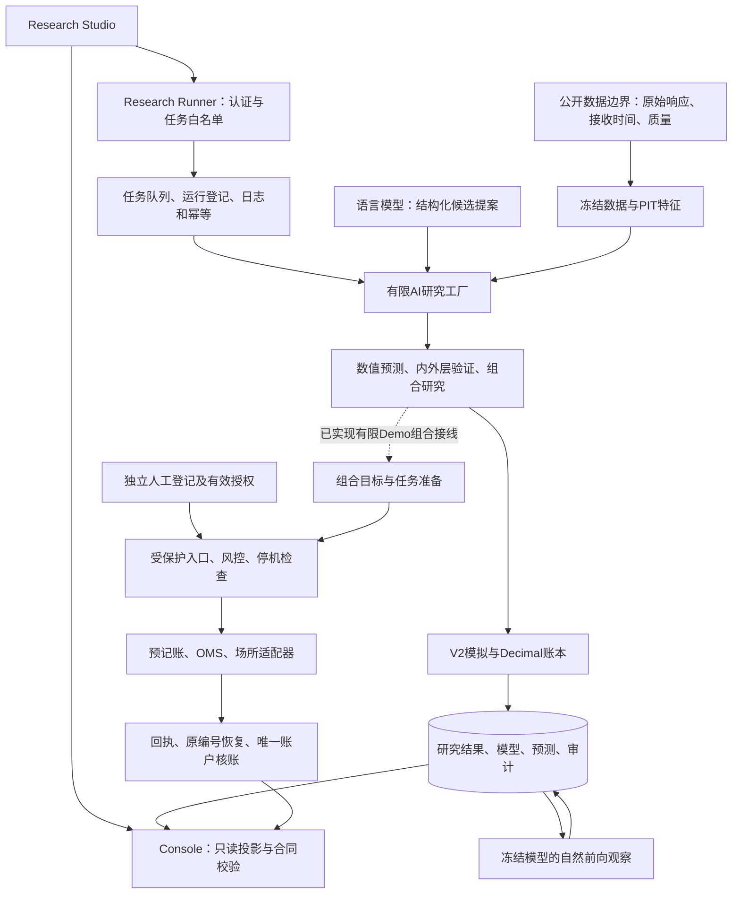

QUANTOS 当前架构、运行流程与研究方法——外部 AI 审核材料
======================================================

整理日期：2026-09-19，Asia/Shanghai。
本次核对的开发 HEAD：`8927210b9a98e76223485547796eb26a21f4d2a1`。

**阅读边界。** 本材料基于当前源码抽查、项目状态和实现记录；没有重新进行全量测试、线上巡检或策略绩效审计。下文运行数字引用带时间的已有记录，不能当作阅读时的实时状态。工作区有既有未跟踪文件，包括9月11日架构/能力报告、投资说明、Order Block报告，以及 `services/data/kraken_account.py` 和对应测试；这些不属于上述提交的已提交内容。账户文件只是离线观察解析实现，不能证明 Kraken 私有账户已经接通。本材料不包含密钥、账户凭证或原始私有回执。

**系统定位。** QUANTOS 是以研究证据、风险隔离和可重放账务为核心的 AI 量化研究平台。当前已有自动研究编排、有限候选搜索、数值预测、成本后持仓决策、永续事件回放、组合研究、自然前向观察、可视化控制台，以及受保护的 Binance Demo 执行与恢复组件。Kraken xStocks / XAUT 已新增公开数据观察。尚未证明稳定成本后盈利，尚未完成 Kraken 多资产账户—策略—执行—现金自动闭环，不能称为无人值守实盘资产管理系统。

**证据规则。** 必须区分以下四类事实：模块存在；特定版本通过测试；特定服务实际运行；经济有效性和交易准入成立。它们不能互相替代。默认研究边界仍为 `L2_DRY_RUN_ONLY`。2026-08-29 以前相关 V1 多周期回测、候选选择、分数复用和 paper fill 路径的历史盈利/权威结论已被 `INVALIDATED_PERP_LEDGER_V1` 覆盖，不能重新引用为有效业绩。V2 输出是 `TECHNICAL_VALIDATION_ONLY`。当前 `backtest_authority.py` 的独立签名验证集成标志仍为 False，正式回测权威入口不接纳任何记录；模块名中的 authoritative 不表示已有经济权威。

**整体架构。** 软件主体为 Python 模块化后端，服务、采集、研究工作者和模型推理按进程分工；前端采用 React / TypeScript / Vite，API 使用 FastAPI，状态主要由 SQLite 与版本化文件承载。运行在 DGX ARM64 环境，开发要求固定 Python 3.12、依赖锁和显式 Node。现有材料不能证明已交付分布式研究集群、低延迟高频交易系统或 GPU 加速全部研究计算。

| 蓝图层 | 当前主要职责与实现位置 | 本次审核应注意的边界 |
|---|---|---|
| 01 数据 | `services/data/`、公开采集工具：规范化、PIT、质量、版本及原始材料留存 | 必须逐源验证知识时间、修订、日历、公司行为；不能把所有市场笼统标为支持 |
| 02 特征 | `services/features/`、研究特征模块：计算、注册、物化、泄漏检查 | 实时特征任务已有失败记录；有离线计算不等于实时流健康 |
| 03 Research OS | `services/research/`、`services/research_runner/`：实验、任务、模型、回放、结果 | 研究作业完成与策略有效性不同；统计方法并非每项任务都自动执行 |
| 04 Alpha Factory | `services/alpha/`、AI工厂：生成、预算、试验登记、比较、血缘及生命周期 | 搜索结果不能自动成为正式交易候选；需有效证据与准入 |
| 05 组合 | `services/portfolio/`、组合/sleeve研究和组合目标桥 | 有优化、风险预算和换手模块；跨资产账户与实际自动往返未验收 |
| 06 风控 | `services/risk/pre_trade/`、研究风险与kill-switch | 策略表达意图，风险决定许可；不能连接已隔离旧风控路径 |
| 07 模拟与前向 | V2事件模拟、前向预测及成本账户、paper相关模块 | 历史V1隔离；正式新paper成交持久化仍受经济准入阻塞 |
| 08 执行 | `live/`、受保护Demo工具：OMS、适配器、提交、确认、撤单及恢复 | Demo回执不是主网执行能力或主网冲击/排队校准证明 |
| 09 AI代理 | `services/intelligence/`、有限QWEN研究协议 | 提案、搜索、反思受限；不接触凭证，不替代人工批准 |
| 10 控制台 | `services/console/`、`apps/research-console/` | 展示数据须保留来源、版本、缺失和陈旧状态；页面存在不证明链路完成 |
| 11 治理运维 | 审计、配置/模型/数据身份、发布、备份、监控和恢复 | 单机备份与进程存活不能证明异机灾备或持续业务健康 |

运行代码、研究数据和开发输出分离：`/opt/quantos/releases/<commit>` 为不可变发布代码；`/srv/quantos/state` 为运行状态；冻结研究输入按来源和摘要保存；开发测试写独立目录。多个研究空间、观察器和服务可能保留不同版本，不能给整个系统随意指定一个统一“运行版本”。

图中的执行分支描述已有组件与有限接线，不表示当前拥有有效授权、可执行策略或已完成实际自动周期。Kraken 目前主要到公开数据入口，不能沿图推断其执行分支已完成。

**一次研究的实际流程。** 用户登记目标、数据来源、研究协议、候选预算及配置；Runner 只接受白名单作业。工厂冻结输入和身份，建立时间面板，先用训练集拟合，再用内层验证选择候选，正常收束后冻结模型并进行外层验证。失败、重复尝试、暂停与取消保留记录；不能只保留最好的回测。

`tools/ai_factory_pipeline.py` 在主研究完成后顺序执行：评估 → 组合研究 → 独立策略组件研究 → 过程比较 → 组件过程比较 → 独立复核材料包 → 单模型自然观察 → 组合观察 → 组件观察 → 研究解释 → 检查点。每阶段记录状态和已完成阶段。所谓“独立材料包”是复核输入，不等于独立机构已经审核或签署。`COMPLETED` 只表示本轮处理完成；观察启动后仍须等待真实时间与标签成熟。

**AI与数值模型的分工。** 当前主工厂的 LLM 负责有限候选选择和研究解释；实际收益预测来自规则模型、Ridge 或 GBM；交易数量与净结果由确定性决策和账本计算。已有 `SINGLE_V1` 与 `THREE_ROLES_V1`，后三个角色为提案、反提案、综合；它们可以来自同一模型，不能算三个独立验证者，也不意味着任意生成代码自动进入执行环境。

源码中基础候选池18项，扩展池72项；单次主搜索预算3–18次，后续组合与多折研究另有预算。基础特征为1/6/24小时收益、24小时波动及主动成交不平衡，扩展包括流量交互、波动缩放和反转。候选数量说明搜索范围，不说明有效信息量。历史小时面板注明历史接收时钟UNKNOWN，因此历史研究仍是技术验证；不能把事后取得的历史数据伪装成当时已知。

**研究方法及其验证目的。**

| 方法 | 当前实现或流程 | 能回答的问题及不能越过的限制 |
|---|---|---|
| 时间因果/PIT | 决策时间、事件时间、标签时间及可用时间约束；Kraken以实际接收时间入库 | 减少未来信息泄漏；数据源没有历史知识时间时，不能自动补出证明 |
| 内外层隔离 | 主工厂时间切分、标签越界剔除，内层反馈选模型，外层评估 | 限制对测试集反复调参；仍须审查跨任务、人工观察和全局记忆的泄漏 |
| Walk-forward / Purged CV / CPCV | `services/validation/` 有对应实现 | 检查跨时段稳定性、重叠标签及样本外分布；存在模块不等于所有主流程都使用 |
| DSR / PBO / 有效试验数 | 修正多次搜索后的Sharpe乐观偏差、估计过拟合概率 | 试验全集和相关性假设必须可信，不能漏掉失败和人工试验 |
| Reality Check / SPA | `reality_check.py` 有平稳bootstrap比较实现 | 判断多个候选相对基线的增量；依赖样本、相关结构和预注册选择 |
| 成本后决策 | 预测、风险、已有仓位、换手和资金费共同决定持有/空仓/调仓 | 正预测不必然开仓；模型化成本不是已校准的真实成本 |
| 组合与sleeve | 共享资金账户研究、独立策略持仓归属、权重与过程比较 | 避免各策略重复占用整份本金后相加；需继续核验相关性、净额和容量 |
| 基线/压力/消融 | 同窗口、同资金/成本条件的比较及受限信息增量研究 | 区分新信息、选样、费用和持仓规则贡献；无成交不能算执行改善 |
| 自然前向观察 | 先冻结预测，再等待标签及成本账户成熟 | 检验真实时间外推；事后回填标签不能变成事前预测 |
| 独立算术/差分 | 已有Fraction参考与VectorBT共同模型对照记录 | 证明适用模型的机械一致性；不能证明真实市场成交或盈利 |

主工厂面板按时间约65%/17%/18%分训练、内层、外层，并检查标签结束时间；这是当前具体实现，不是对任意资产都适用的最优比例。统计审核应检查完整试验登记、重叠收益、自相关、非平稳性、交易次数、现金流、年化口径和零/负权益处理，而不能仅查看最高Sharpe。

**P0–P6盈利研究分支。** P0做账本损益/费用/资金费/换手归因；P1研究不交易区间、阈值与持仓延续；P2比较立即执行和有限等待；P3研究现货—永续相对定价；P4研究资金费/OI等增量；P5做固定动作、订单回执与成交模型误差校准；P6保存自然预测、等待成熟标签并比较成本后账户与基线。这些是受各自输入、时间和质量条件约束的分支，不是每次任务都会完整通过的七个阶段。

**回测与会计内核。** 当前关键路径为 `perpetual_simulation.py`、`passive_perpetual_simulation.py`、`perpetual_public_replay.py` 和 `perpetual_ledger_v2.py`。订单先做准入与资金预留，随后按明确报价、深度与容量执行切片；合法订单的小额部分成交不应重新被整张订单最低名义额拒绝。费用和拟成交后的权益、暴露、保证金参与风险判断；拒绝应撤销本次临时变化，而不能删除此前已发生的损失或资金费。

同一账户的成交、仓位、费用、资金费及权益走统一Decimal账务转换，研究组件不能另算一套利润。结果绑定数据、策略、规则、成本、风险、随机性及源码身份，保留订单、拒绝、现金和对账信息。不同资产、计价币和实验账户不能隐式共用或兑换本金。

必须区分两个API范围：严格归档V2 runner仍有单规则区间、每决策单次执行等限制，拒绝部分成交等不支持场景；策略驱动模拟器另有订单状态与部分成交支持。后者不能倒推出前者支持范围。当前模拟器仍声明每标的单一不可变规则区间，不能用今天的规则覆盖长历史。

9月5日第三批记录有两个参考实现各7个固定案例通过，覆盖共同模型中的空仓、多空、费用、反手与部分成交；资金费、强平、队列、容量和迟到行情不在VectorBT共同模型范围。该历史证据不是对当前HEAD所有执行语义的重新验收。

**安全与实际执行流程。** 策略目标 → 受保护任务准备 → 有效人工登记/mandate及证据绑定 → pre-trade风控与kill-switch → 额度/账本预记账 → 适配器提交 → 回执/原订单号查询 → OMS终态 → 唯一账户现金核对。结果未知应恢复原编号，不能盲目重发。授权到期后的核账与新增风险许可分别处理。跨日累计损失、费用和资金流不能靠重置余额抹除。

默认安全开关保持：`LIVE_TRADING_ENABLED=false`、`REAL_BROKER_ENABLED=false`、`ALLOW_ORDER_SUBMISSION=false`、`ALLOW_AI_DIRECT_TRADING=false`、`REQUIRE_HUMAN_APPROVAL=true`。独立受保护Demo机制必须按自己的环境、签发和运行证据审核，不能解释为普通主网入口已开放。代码中的HUMAN actor不能由AI伪造；运行时门禁无法单独防止有源码权限的可信代码绕过，因此还需要代码审查、治理扫描、操作系统身份与部署隔离。

**最新交付与运行事实。** 下列数字引用已有记录，本次没有重新访问现场服务。

| 范围/记录时间 | 已有证据 | 尚未证明 |
|---|---|---|
| 9月18日组合整合 | 源码`2626199a6`记录完整28/28门禁通过；证据版本`c34f31b70`有安装核对 | 不覆盖后续HEAD；不是组合实际自动往返成功 |
| 既有Binance Demo恢复 | 曾有系统开仓、人工平仓；记录为`MANUAL_ACCOUNT_RECONCILED`，原5000 USDC账本扣费净额-0.49288463 | 是人工恢复后的账务事实，不是自动周期完成或有效策略业绩 |
| 9月19日13:15–13:18观察 | 15份预测、11份标签；14天成本计划成熟日0；组合周期和现金`NO_SNAPSHOT` | 标签数量不代表有效交易样本，钱包余额不等于策略净值 |
| 同一时点运维 | 原四类备份STALE、0/4当前有效恢复点；专用观察备份11:21成功；实时特征/watchdog有失败 | 专用备份不覆盖所有状态；同机恢复不等于异机灾备 |
| 9月19日Kraken首批 | AAPLx/USD、NVDAx/USD、XAUT/USD各720根闭合小时线，两轮有界公开实采；联合48项通过、治理通过 | 不是用户真实持仓清单；不是常驻生产服务；未接账户、策略和执行；未跑完整canonical |

Kraken采集区分`currency`与`tokenized_asset`、保存规则与原始响应，排除最后未确认OHLC条目，零成交量不补成可用流动性。产品上架不等于账户准入；xStocks应按其产品合同审核，不能等同直接持有美股普通股；XAUT也不能按传统黄金期货或永续资金费语义直接处理。当前工作区新增的离线账户解析文件没有改变上述接通状态。

**先进程度判断。** 以下是依据本项目证据作出的内部能力评价，不是行业排名、机构对标或独立认证；本次没有做外部市场调查。

| 维度 | 当前判断 | 判断依据与短板 |
|---|---|---|
| 研究工程 | 已有较系统的实现 | 输入/结果身份、有限搜索、试验记录、内外层比较、自然观察串联；仍需逐入口验证实际使用情况 |
| 研究方法 | 方法覆盖较广，核心预测模型相对简洁 | 有CPCV、DSR、PBO、bootstrap、组合比较；主工厂仍是有限特征与规则/Ridge/GBM，不能据此称前沿模型创新 |
| 交易仿真 | 重视会计与因果约束 | Decimal、成本后风险、状态回滚、部分成交、额度预留；多规则历史、真实队列/冲击、跨产品会计尚有限 |
| AI自主能力 | 有界研究自动化 | LLM提案、诊断与计划编排已有；不代表自主发现新信息、任意策略开发或自动取得交易权 |
| 安全治理 | 多层防护与诚实拒绝较明确 | V1失效保留、独立权威缺失时拒绝、人工门、审计及发布绑定；需对绕过路径与进程隔离做对抗审核 |
| 运维成熟度 | 已有运行与恢复工程，连续性仍有缺口 | 有实际部署/核账/恢复记录，同时仍有过期备份、观察不成熟和失败任务 |
| 跨资产产品化 | 早期接续阶段 | Kraken公开数据已接；已有持仓、币种估值、现货账务、执行及自动配置未闭环 |
| 经济有效性 | 未证明 | 无可据以宣称稳定成本后盈利的成熟独立证据；正式经济权威仍关闭 |

系统较突出的价值是把研究、成本、风险、账务、证据和运行恢复放在同一审查框架里。当前不能从模块数量、代码行数、测试数量、AI角色数或GPU型号推出“行业领先”“机构级盈利能力”或“完成百分比”。下一阶段的关键证据是成熟样本外增量、真实成本与成交校准、产品适配和可恢复的实际闭环。

**可直接交给审核AI的任务。**

> 请把本材料视为待核验的系统自述，而非已认证事实。请分开评价架构、因果正确性、统计研究、会计与执行、权限安全、运维恢复、经济证据和跨资产适配；不要给一个无依据的总完成度或盈利排名。
>
> 对每个重要结论标记：源码已核对、测试/现场证据支持、仅文档声明、未知或矛盾。没有仓库或原始证据时，请明确“无法核实”。对每项发现给出严重级别、具体路径/函数、触发条件、影响、最小修复方案和应补的回归/现场证据。
>
> 重点检查：①PIT知识时间和外层反馈是否泄漏；②失败/重复/跨计划人工试验是否进入多重检验；③收益时间序列、年化和资金流是否正确；④预演与实际入账是否共用语义，部分成交/反手/预留是否守恒；⑤真实回执缺口、未知发送和跨日恢复是否可能重复下单或抹除损失；⑥Demo、研究和主网是否真正隔离；⑦xStocks/XAUT是否被错误套用股票或永续语义；⑧有效权限、版本、数据新鲜度与备份是否承重；⑨独立材料包是否被误称独立经济权威；⑩哪些方法只存在于目录但未进入主路径。
>
> 最后请列出P0/P1/P2问题，分别提出研究有效性、Kraken组合闭环和持续运行所需的最小验收集合。不要要求放松现有风控或直接开启真实交易来证明系统有效，也不要把没有盈利证据判断为已经证明无法盈利。

**核对入口与配套材料。** 按“现行规则 → 最新状态 → 当前实现 → 版本绑定验证记录”的顺序阅读；历史报告的运行状态不能覆盖新记录。

- [主蓝图](../../QUANTOS_MASTER_BLUEPRINT.md)、[当前状态](../PROJECT_STATE.md)、[DGX现行路线](../engineering/plans/2026-09-05-dgx-engine-foundation-roadmap-review.md)。
- [9月19日全模块现场记录](2026-09-19-global-module-status.md)、[Kraken首批实现](../engineering/specs/2026-09-19-kraken-portfolio-automation.md)。
- [组合执行与安装记录](../engineering/specs/2026-09-18-portfolio-execution-bridge.md)、[跨日接续](../engineering/specs/2026-09-18-demo-day-continuation.md)。
- [回测权威边界](../../services/execution/backtest_authority.py)、[严格V2 runner](../../services/execution/authoritative_perpetual_backtest.py)、[策略模拟器](../../services/execution/perpetual_simulation.py)、[Decimal账本](../../services/execution/perpetual_ledger_v2.py)。
- [工厂主流程](../../tools/ai_factory_pipeline.py)、[候选/切分/特征](../../services/research/ai_factory.py)、[统计验证目录](../../services/validation/)、[受支持风控目录](../../services/risk/pre_trade/)。
- [第三批公共回放和差分记录](../engineering/specs/2026-09-05-dgx-engine-foundation-increment3.md)、[DGX开发与隔离规则](../runbooks/dgx-engine-development.md)。

本材料只整理可审查的现状，不改动运行服务、授权、交易开关、账户或策略状态。
