# QUANTOS 投资人尽调与全系统实测报告

> **报告版本**：v1.0
> **权威快照时间**：2026-07-24（运行证据约 15:57–16:02 UTC）
> **当前就绪等级**：`L2_DRY_RUN_ONLY`
> **投资人阅读结论**：`PAPER_ONLY_PENDING_FORWARD`；不是实盘业绩，也不是收益承诺。

---

## 0. 给投资人的一句话

QUANTOS 已经是一套可以运行的量化研究、验证、组合、风险、纸面交易和审计平台；三条 Alpha 都完成了权威历史干跑和实时纸面标记，`scripts/validate.py` 统一验收门为绿色。

但它目前仍是 **L2 研究/干跑系统**：没有真实下单、没有真实成交记录、没有 8 周前向收益证据，GPU 稳健优化也没有找到通过全部硬门的稳定候选。因此，本报告可以证明“系统能够按照明确定义的流程进行研究和纸面执行”，不能证明“未来一定盈利”或“已经具备实盘基金业绩”。

当前最强的候选是 `crowd_contra`：在 10 bps canonical dry-run 下的风险子集 Sharpe 为 1.0697，最大回撤 8.85%，并通过 5/5 反证检查；但前向账本仍是 0/8 个已兑现周期，必须继续纸面观察。

---

## 1. 口径、证据优先级和限制

### 1.1 本报告中的“实测”是什么

本报告将结果分成四个证据等级：

| 等级 | 含义 | 能证明什么 | 不能证明什么 |
|---|---|---|---|
| A | 当前权威代码、测试和 canonical JSON/SQLite 制品 | 流程、数学对账、门禁行为和可复现输出 | 未来市场收益 |
| B | 历史研究、反证、OOS 和容量诊断 | 历史样本中的统计关系和敏感性 | 已经可规模化实盘 |
| C | 实时纸面 mark/funding 账本 | 当前公开行情下的纸面持仓和 PnL | 真实成交、盘口冲击和账户盈亏 |
| D | 设计接缝、人工/外部要求 | 未来可以怎样毕业 | 已经部署或已获授权 |

本报告只使用当前权威制品；历史旧报告、旧截图和旧完成度百分比不覆盖当前制品。所有回测/纸面数字都应由投资人按附录命令复算。

### 1.2 不可混淆的三件事

1. **历史回测收益**：用历史数据重放，不是实盘记录。
2. **纸面 mark PnL**：按公开 Binance mark price 估值，含资金费和系统账本成本，但没有真实撮合队列、私有账户余额或真实成交回报。
3. **前向证据**：在决策时点锁定信号，之后用新数据兑现。三条 Alpha 当前均为 `0/8`，所以没有可报告的前向 Sharpe 或累计收益。

---

## 2. 当前系统结论卡

| 项目 | 当前结果 | 投资人解释 |
|---|---:|---|
| 运行模式 | `L2_DRY_RUN_ONLY` | 研究、干跑、纸面；真实下单被结构性禁止 |
| 统一验收门 | `PASS` | 治理、后端、交易栈、前端检查全部通过 |
| Python 主测试 | `2871 passed, 1 skipped` | 当前完整测试快照 |
| Live/trading/tools 测试 | `1535 passed` | 交易边界和工具栈测试通过 |
| 前端 | `126 tests passed + typecheck + production build` | 控制台可构建、可验证 |
| 治理扫描 | `343 files, 0 violations` | 未发现禁用券商 SDK、真实下单绕过或危险旗标 |
| 数据质量准入 | `PASS` | 当前 14 币种最近闭合日数据质量/血缘通过 |
| 事件投影健康 | `PASS` | 待投影事件 0，死信 0，链完整 |
| 三 Alpha 纸面健康 | `paper_ready=true` | 三条 Alpha 都能标记、计费、对账 |
| 三 Alpha 前向 | `0/8` | 尚未形成前向业绩证明 |
| GPU 稳健优化 | `REJECTED` | 没有稳定区域通过全部硬门 |
| 顶级系统评估 | `NOT_TOP_TIER` | 14/22 PASS、2 PARTIAL、4 FAILED、2 外部/人工证据 |
| 实盘权限 | `live_allowed=false` | 不连接私有账户、不提交真实订单 |

统一门禁最后一次运行通过的完整输出来自 `scripts/validate.py`；当前顶级评估制品为 `evidence/top_tier_assessment.json`。

---

## 3. QUANTOS 的产品和系统功能

QUANTOS 不是单一策略脚本，而是一个带治理边界的量化研究操作系统。它的核心功能如下：

| 层 | 主要功能 | 当前状态 |
|---|---|---|
| Contracts | 安全旗标、PIT 数据、Alpha、组合、订单、风险、事件和审计契约 | 已建、测试覆盖 |
| 数据层 | 双时点/PIT、`knowledge_time`、无幸存者偏差宇宙、版本哈希、原始血缘、质量准入 | 已建；当前数据准入 PASS |
| 特征与 Alpha DSL | 时间序列算子、截面 rank/z-score、窗口、残差化、表达式 canonicalize、泄漏证据 | 已建 |
| Alpha Factory | GP/进化搜索、MCTS、guided search、候选去重、生命周期、相关性和多重检验 | 已建；自动搜索不会自动批准 |
| 统计验证 | IC/ICIR、DSR、PBO、BH-FDR、purged/embargo walk-forward、OOS 选择 | 已建并纳入统一门 |
| 回测引擎 | 单资产和事件驱动回测、next-bar/next-open fill、费用、冲击、融资、整数手、PnL 对账 | 已建；canonical dry-run 正在使用 |
| 组合层 | 约束优化、因子风险、风险平衡、归因、容量和拥挤度诊断 | 已建；部分输入仍需真实交易所数据 |
| 研究风险 | 9 引擎 fail-closed gate：market、liquidity、concentration、correlation、drawdown、regime、stress、capacity、model/alpha | 引擎已建；当前纸面 seam 诚实运行 4/9，5 项标记缺真实输入 |
| 盘前风险 | pre-trade checks、敞口/价格偏差/资金费/拥挤度、Kill Switch、审计 | 已建；失败关闭 |
| 执行边界 | 目标权重 → 整数手 → intents → 风险门 → DryRunAdapter → PaperFill | 已建；真实 BrokerAdapter 在 L2 结构性拒绝 |
| 纸面与前向 | 追加式纸面账本、实时 mark、资金费、前向 decision/realization、健康门 | 已建；前向尚未积累 8 周 |
| 事件和审计 | Durable event log、哈希链、outbox、projection、consumer journal、DLQ、恢复演练 | 已建；单节点模型，当前健康 |
| AI 研究治理 | 非人类 ResearchAgentLoop、guardrails、人工复核队列、禁止凭据和真实交易 | 已建；Agent 不可到达 APPROVED |
| 控制台 | FastAPI 只读 API、React/Vite 控制台、Dry Run、纸面、Alpha、风险、事件和 Go-Live 视图 | 已运行并通过构建测试 |

### 3.1 系统不做的事

- 不把回测或纸面结果写成实盘业绩。
- 不让 AI 自动批准 Alpha、重置 Kill Switch 或下真实订单。
- 不在 `services/` 内访问网络或券商 SDK；网络数据获取在 `tools/` 边界。
- 不用缺失数据、合成默认值或未知输入伪造风险门通过。
- 不在 CUDA 不可用时静默伪造 GPU 结果。

---

## 4. 端到端工作流程

```mermaid
flowchart LR
    A[公开市场数据 tools] --> B[PIT/双时点与血缘]
    B --> C[质量准入]
    C --> D[特征与 Alpha DSL]
    D --> E[IC/DSR/PBO/WF/泄漏/反证]
    E --> F[Alpha Catalog 与生命周期]
    F --> G[组合优化与目标权重]
    G --> H[研究风险 9 引擎]
    H --> I[整数手/交易所过滤器]
    I --> J[Pre-trade Gate + Kill Switch]
    J --> K[DryRun Adapter/PaperFill]
    K --> L[费用/冲击/资金费/PnL 对账]
    L --> M[实时纸面与前向账本]
    M --> N[健康门/Go-No-Go/人工复核]
    K --> O[审计哈希链/Event Projection]
    O --> P[只读 Console]
    Q[非人类 AI ResearchAgentLoop] --> D
    Q -.不可到达 APPROVED/真实订单.-> F
```



### 4.1 每周 Alpha 执行语义

1. 读取 PIT 价格、资金费、OI、全球多空比、Top Trader 比例等已闭合数据。
2. 检查 `knowledge_time`、新鲜度、原始文件哈希、缺失、量纲和前视风险。
3. 在周度调仓时间轴计算三个 Alpha 的截面分数。
4. 在大盘永续宇宙中排序，产生多空尾部和目标权重。
5. 根据最小数量、步长、最小名义价值转换成整数手。
6. 运行研究风险门、拥挤度门、资金费/价格偏差/敞口门和 Kill Switch。
7. 通过后进入 DryRunAdapter 纸面成交；通过失败则记录拒单原因，不绕过。
8. 使用 mark price、资金费、费用和冲击更新账本，检查 PnL 恒等式残差。
9. 写入事件日志、审计链和前向账本；未达到 8 周不产生可实盘结论。

### 4.2 PnL 对账恒等式

系统要求：

```text
equity_end - initial_capital
  = realized_pnl + final_unrealized + funding/dividend_income - total_cost
reconciliation_residual ≈ 0
```

这可以证明账本数学一致，但不能单独证明价格、流动性、冲击参数或未来收益正确。

---

## 5. 三条 Alpha 的定义与经济假设

| Alpha | 实现表达式 | 研究宇宙/频率 | 经济假设 |
|---|---|---|---|
| `carry_oi_majors` | `composite negative funding carry` | 研究阶段 115 个永续；当前 paper 主要大盘宇宙；周度 | 做多资金费最负的一侧、做空资金费最正的一侧，收取永续合约的持仓溢价 |
| `crowd_contra` | `cs_rank(neg(global_ls))` | OI majors，研究快照 24 币；周度 | 反向交易过度拥挤的散户多空结构 |
| `top_contra` | `cs_zscore(neg(top_ls))` | OI majors，研究快照 14 币；周度 | 反向交易 Top Trader 持仓拥挤度；当前证据弱于 crowd，需要继续验证 |

这些公式在本轮优化中没有被重写；本报告比较的是冻结公式在不同研究、干跑和纸面口径下的证据。

---

## 6. Alpha 历史研究实测

### 6.1 Carry：经济边存在，但执行现实显著降低结果

来源：`data/cache/crypto_carry_strategy.json`、`crypto_carry_walkforward.json`、`crypto_carry_voltarget.json`、`carry_binance_validation.json`。

| 指标 | 结果 |
|---|---:|
| 研究宇宙 | 115 个永续 |
| 研究长度 | 2,193 日（不同验证制品最长约 2,206–2,684 期） |
| 平均日换手 | 0.276 |
| 平均资金费 | 5.42 bps/日 |
| 价格腿 Sharpe | 1.366 |
| 价格 + 资金费 Sharpe | 2.233 |
| 净 Sharpe @5 bps | 2.010 |
| 液体 58 币、5 折设计稳健回测 Sharpe | 2.094 |
| 液体 58 币最大回撤 | 25.6% |
| 液体 58 币最差日 | -6.76% |
| 10% 年化波动目标版本 Sharpe | 2.123 |
| 波动目标版本最大回撤 | 20.5% |
| 波动目标版本最差日 | -3.75% |

五个液体宇宙 walk-forward block Sharpe 为 `3.72、1.03、0.38、2.01、2.59`。这说明 carry 的经济边在历史上出现过，但并不意味着每个区间都稳定，也不意味着当前 canonical weekly book 可以复制该结果。

**重要折扣：**研究阶段的 2.01–2.12 Sharpe 与下面 canonical dry-run 的 0.4771/0.7458 不矛盾，它们不是同一个口径：研究阶段是日频液体宇宙诊断，canonical dry-run 包含周度调仓、整数手、冲击模型、研究风险和当前纸面执行结构。

### 6.2 Crowd Contra：当前最完整的第二条边

来源：`data/cache/crypto_oi_verify.json`、`data/cache/crypto_oi_research.json`、`evidence/alpha_readiness_crowd_contra.json`。

| 指标 | 结果 |
|---|---:|
| 研究宇宙 | 24 个 OI majors |
| 研究长度 | 2,199 日 |
| 净 Sharpe @2/5/10/20 bps | 1.096 / 0.943 / 0.687 / 0.175 |
| 一日执行滞后 Sharpe | 1.312 |
| Embargoed OOS 平均 Sharpe | 1.1269 |
| Embargoed OOS 折数 | 10 |
| 反证电池 | 5/5 通过 |
| 方向 sanity | `crowd_contra=+1.198`，`crowd_follow=-1.198` |
| 当前 IC panel mean IC | 0.0047 |
| ICIR / t-stat | 0.0191 / 0.776 |
| IC panel 期数 | 1,643 |
| 参与率容量诊断 | 约 7.16M（`UNCALIBRATED_PRINCIPLED`） |

10 折无窥视选择 OOS 的被选策略和 OOS Sharpe 为：

| 折 | 被选 | OOS Sharpe |
|---:|---|---:|
| 0 | carry | -0.18 |
| 1 | carry | -0.47 |
| 2 | crowd_contra | 2.98 |
| 3 | crowd_contra | 2.69 |
| 4 | crowd_contra | 1.12 |
| 5 | crowd_contra | 0.41 |
| 6 | top_contra | 1.66 |
| 7 | crowd_contra | 0.73 |
| 8 | top_contra | 0.63 |
| 9 | carry | 1.71 |

该结果支持“crowd contra 具有历史增量信息”的研究假设，但 IC t-stat 偏弱、存在幸存者/近期衰减风险，仍需前向验证。

### 6.3 Top Contra：历史收益较好，但证据链尚不如 Crowd 完整

来源：`data/cache/crypto_oi_research.json`、`evidence/three_alpha_paper_flow.json`。

| 指标 | 结果 |
|---|---:|
| 研究宇宙 | 14 个 OI majors |
| 研究长度 | 2,199 日 |
| 价格 Sharpe | 0.727 |
| 经济 Sharpe | 0.879 |
| IC | 0.0216 |
| 增量 IR vs carry | 0.606 |
| 专项反证 | 4/5 通过 |
| 相关 6 折选择 OOS 平均 Sharpe | 0.8142 |
| 相关 OOS 正折比例 | 83.33% |
| 容量诊断 | 约 7.16M，未校准，不是晋级门 |

Top Contra 的强弱方向和收益关系在历史样本中存在，但它的专项反证尚未达到 Crowd 的 5/5，且前向证据为 0/8，因此只能列为研究候选，不应对外表述为已验证策略。

### 6.4 系统如何证伪其他因子

`crypto_oi_research.json` 中，反向方向往往与理论一致地变成负收益，例如：

| 因子 | 价格 Sharpe | 经济 Sharpe |
|---|---:|---:|
| `crowd_contra` | 1.182 | 1.274 |
| `top_contra` | 0.727 | 0.879 |
| `top_follow` | -0.727 | -0.879 |
| `crowd_follow` | -1.182 | -1.274 |
| `dtop_ls5` | -0.218 | -0.263 |
| `oi_px_div` | -0.017 | 0.034 |

这类 NULL/负结果会被记录和拒绝，而不是从投资材料中删除；这是研究平台的可信度证据，但不是盈利保证。

---

## 7. 三条 Alpha 的 canonical weekly dry-run 实测

来源：

- `data/cache/carry_oi_majors_dry_run.json`
- `data/cache/crowd_contra_dry_run.json`
- `data/cache/top_contra_dry_run.json`
- `evidence/three_alpha_paper_flow.json`
- `evidence/dry_run_books.json`

周度风险年化采用 `ppy=52`。回报、Sharpe 和回撤是工具当前 canonical dry-run 口径；全部残差都在恒等式容差内。

| Alpha | 期数 | 成本模型 | 成本口径 | 总回报 | Raw Sharpe | VT Sharpe | Raw 最大回撤 | VT 最大回撤 | 资金费现金流 | 风险子集 | 残差 |
|---|---:|---|---:|---:|---:|---:|---:|---:|---:|---|---:|
| carry_oi_majors | 316 | Almgren–Chriss | 8.5 bps，未校准原则模型 | 150.13% | 0.4771 | 0.7458 | 71.07% | 22.08% | 165,149.72 | `RISK_REJECTED`（回撤） | 4e-9 |
| crowd_contra | 235 | Flat bps | 10 bps | 121.15% | 1.0697 | 1.0950 | 8.85% | 9.715% | 23,794.04 | `RISK_APPROVED`（4/4 子集） | 2e-9 |
| top_contra | 192 | Flat bps | 10 bps | 165.01% | 1.5246 | 1.3013 | 20.15% | 20.15% | 19,126.01 | `RISK_APPROVED`（4/4 子集） | 1e-9 |

### 7.1 逐条解释

**Carry**：历史研究阶段的经济收益较高，但在当前 canonical weekly execution 中暴露出 71.07% raw 最大回撤、22.08% VT 回撤，研究风险门明确拒绝。它不能被描述成当前可部署候选。

**Crowd Contra**：当前 canonical dry-run 的收益/回撤比最均衡，10 bps 成本下没有普通纸面拒单，资金费完整，拥挤度门在 235 期中记录 21 个 block、214 个 warning；这些拒绝/警告是策略运行的一部分，不应被删除。

**Top Contra**：canonical Sharpe 最高，但最大回撤约 20%，且拥挤度门记录 11 个 block、181 个 warning；历史专项反证只有 4/5，必须保守使用。

### 7.2 研究风险门的诚实边界

canonical dry-run 当前实际运行的研究风险输入是：

- 已运行：market、drawdown、concentration、stress。
- 未运行且直接标记缺真实输入：liquidity、correlation、regime、capacity、model/alpha。

因此 `RISK_APPROVED` 在本报告中严格解释为 **4 引擎真实输入的风险子集批准**，不是完整 9 引擎生产批准。缺失输入不会被合成默认值填充。

---

## 8. 实时纸面交易实测

### 8.1 默认 1,000,000 USD 纸面账户

观测时间：2026-07-24 16:01:38 UTC；来源：`data/cache/paper_realtime_status.json` 和 `data/cache/paper_health.json`。

| Alpha | 状态 | fills | 当前权益 | 当前净 PnL | 资金费 PnL | 资金费事件 | 对账残差 |
|---|---|---:|---:|---:|---:|---:|---:|
| carry_oi_majors | `PAPER_MARKED` | 8 | 986,875.18 | -13,124.82 | 317.43 | 24 | 0 |
| crowd_contra | `PAPER_MARKED` | 8 | 1,004,998.97 | +4,998.97 | 65.05 | 24 | 2e-10 |
| top_contra | `PAPER_MARKED` | 8 | 987,127.85 | -12,872.15 | -2.59 | 24 | 0 |

健康门结果：`paper_ready=true`、`paper_mark_ready=true`、`paper_preview_ready=true`、三条 Alpha 资金费数据完整、无 blockers。

### 8.2 10,000 USD 隔离纸面账户

观测时间：2026-07-24 16:01:39 UTC；来源：`data/cache/paper_realtime_10k_status.json` 和 `data/cache/paper_health_10k.json`。

| Alpha | 状态 | fills | 当前权益 | 当前净 PnL | 资金费 PnL | 资金费事件 | 对账残差 |
|---|---|---:|---:|---:|---:|---:|---:|
| carry_oi_majors | `PAPER_MARKED` | 8 | 9,860.74 | -139.26 | 3.13 | 24 | 0 |
| crowd_contra | `PAPER_MARKED` | 7 | 10,093.18 | +93.18 | 0.94 | 21 | 0 |
| top_contra | `PAPER_MARKED` | 7 | 9,892.02 | -107.98 | 0.27 | 21 | 0 |

10,000 USD 账户使用独立账本，不与默认 AUM 复用决策状态。两个账户均为公开 mark-price 纸面估值，未访问私有 Binance API，未读取凭证，未提交订单。

### 8.3 纸面结果的正确解释

当前纸面 mark PnL 是“当前决策到当前 mark 的实时标记结果”，不是完整 8 周前向业绩。前向账本仍显示：

```text
carry_oi_majors: 0/8 realized
crowd_contra:   0/8 realized
top_contra:     0/8 realized
```

所以纸面可运行 ≠ 前向已验证 ≠ 实盘可授权。

---

## 9. Alpha 组合与稳健优化

### 9.1 历史组合诊断

来源：`data/cache/crypto_combo_book.json`、`data/cache/combo_book_snapshot.json`。

三 Alpha 组合优化选择权重：

| Sleeve | 权重 |
|---|---:|
| carry | 20.98% |
| crowd_contra | 35.11% |
| top_contra | 43.91% |

研究阶段组合结果：2,206 日、24 币宇宙，经济 Sharpe 1.787、最大回撤 8.7%，相对最佳单策略提升 0.510。费用敏感性为：

| 费用 | 组合净 Sharpe |
|---:|---:|
| 2 bps | 1.671 |
| 5 bps | 1.498 |
| 10 bps | 1.210 |
| 20 bps | 0.634 |

另一份收益流分散诊断在 231 个共同周上得到 carry/crowd 相关系数 -0.038、逆波动组合 Sharpe 1.977、回撤 7.99%；但该结果是 gross、不同宇宙/规模/网格的相对比较，尚未进入三 Alpha 的前向纸面账本，不能作为可部署组合业绩。

### 9.2 GPU 稳健优化矩阵

来源：`evidence/crypto_robust_optimization.json`，报告哈希：`e47c3cdf4833c351c76eae19a55857a5c7bfa19350bca7723ab4120ad7583ca4`。

| 项目 | 实测结果 |
|---|---:|
| Alpha 数量 | 3 |
| GPU 候选配置 | 2,310 |
| 压力单元 | 374,220 |
| GPU | NVIDIA GeForce RTX 5090 D，device 0 |
| CuPy | 14.1.1 |
| GPU 状态 | `PASS` |
| PIT 数据 | `true` |
| 周度年化 | `ppy=52` |
| 合成默认值 | `false` |
| 全局试验注册 | 2,435 → 2,435，配置哈希 2,310，持久化 |
| 稳定区域 | 空 |
| CPU 精确复核 | 空 |
| 最终分类 | `REJECTED` |

拒绝原因不是“没有最高收益点”，而是没有候选同时满足全部硬门：完整 9 引擎输入仍缺少 Alpha 评估元数据、完整 PIT 价格/资金费区间和交易所 filters；前向有效周期为 0；因此系统没有把某个历史峰值冒充“最优部署参数”。

---

## 10. 风险、执行和治理证明

### 10.1 安全旗标

当前有效安全配置：

```text
LIVE_TRADING_ENABLED=false
REAL_BROKER_ENABLED=false
ALLOW_ORDER_SUBMISSION=false
ALLOW_AI_DIRECT_TRADING=false
REQUIRE_HUMAN_APPROVAL=true
```

运行时验证结果：

- Console API：`READ_ONLY`。
- Research Runner：`live_disallowed=true`。
- Paper health：`live_allowed=false`、`order_submission_allowed=false`。
- 纸面安全字段：`broker_connectivity=false`、`credentials_accessed=false`、`broker_order_submission=false`。
- `LiveBrokerAdapter` 在 L2 构造即拒绝，不导入券商 SDK。
- 非人类 AI Actor 不能到达 `APPROVED`、不能重置 Kill Switch、不能读取凭据。

### 10.2 事件、审计和恢复

最新 `data/cache/domain_event_health.json`：

- `verdict=PASS`
- `pending_events=0`
- `dead_letter_count=0`
- event chain、consumer chain、coordination chain 均有效
- 事件存储采用追加式、告警式 retention，不删除历史

统一门禁还通过了风险恢复演练：Kill Switch 损坏时 fail-closed、盘前门拒绝、账本和审计链可恢复、篡改可检测。

### 10.3 Binance mainnet 代码面状态

`evidence/go_live_readiness.json` 显示 Binance mainnet 的脱敏权限证据为 `SAFE`、只读 smoke 为 `PASS`，但这不是授权交易：

- L2 readiness pin 仍关闭真实提交。
- 当前 mainnet mandate 只授权 BTC/ETH，而 `crowd_contra` 当前信号是 14 腿，13/14 条腿不在授权列表。
- 当前 100 USDT gross 上限下有多腿低于交易所最小名义价值；代码建议至少重签至约 1,100 USDT gross，但这只是人工审核建议，不是自动改权限。
- 任何真实提交仍需外部强身份、多方人工 mandate、人工 `--arm-live` 和独立复核。

---

## 11. 顶级系统评估与剩余缺口

当前 `evidence/top_tier_assessment.json`：

| 分类 | 数量 |
|---|---:|
| PASS | 14 |
| PARTIAL | 2 |
| FAILED | 4 |
| 外部/人工证据 | 2 |
| 总要求 | 22 |
| 红线未关闭 | 4 |
| 机器结论 | `NOT_TOP_TIER` |

主要缺口：

1. 三 Alpha 前向证据尚未累计 8 个已兑现周期。
2. 完整 9 引擎研究风险输入尚未在 paper seam 提供真实数据。
3. GPU 优化没有稳定区域，CPU 精确复核列表为空。
4. 真实 order-book/tick、生产成交样本和多 venue SOR 尚未完成。
5. 外部 OIDC/mTLS、身份生命周期、外部签名和跨主机进程隔离尚未形成生产证据。
6. 供应链有确定性 SBOM、依赖审计和容器扫描，但外部签名 receipt/跨主机复现/独立 admission 仍缺。
7. 全局 Alpha trial ledger 的长期历史证据和外部模型挑战者仍未达到顶级目标成熟度。

这些缺口是系统主动报告出来的，不应隐藏在“功能完成度百分比”里。

---

## 12. 对投资人的真实结论

### 可以支持的陈述

- QUANTOS 已有一条可运行、可测试、可审计的研究到纸面闭环。
- 三条 Alpha 的定义、输入、历史结果、风险结果和当前纸面状态均可复算。
- `crowd_contra` 是当前三条中最值得继续前向观察的候选：反证 5/5、10 bps canonical dry-run 风险子集 Sharpe 1.0697、最大回撤 8.85%。
- 系统会记录并拒绝失败候选，例如 carry 在 canonical 风险门因回撤被拒，而不是只展示历史收益最高点。
- 纸面账本可以使用整数手、资金费、费用、mark price、审计链和对账恒等式运行。

### 不能支持的陈述

- 不能说 QUANTOS 已有实盘 track record。
- 不能说 150%/121%/165% 是可复制的未来年收益；这些是 canonical 历史总回报字段，不是年化实盘收益。
- 不能说 `RISK_APPROVED` 是完整 9 引擎生产批准；当前是 4 引擎真实输入的子集。
- 不能说 GPU 已找到了最优部署参数；最终分类明确为 `REJECTED`。
- 不能说 10,000 USD 纸面正收益已经证明 Alpha 有效；它目前只是当前 mark snapshot。

### 投资阶段判断

最准确的投资阶段描述是：

> **研究平台已经可运行，候选 Alpha 已进入实时纸面阶段，但仍处于前向证据和第三方尽调阶段；暂不构成实盘授权或盈利承诺。**

---

## 13. 进入下一阶段前必须完成的门槛

1. 三条 Alpha 各累计至少 8 个有效前向兑现周期。
2. 每个周期数据质量、血缘、新鲜度、资金费、mark price 和账本残差都通过。
3. 将完整 liquidity、correlation、regime、capacity、model/alpha 输入接入 9 引擎门。
4. 补齐真实 Binance exchange filters、盘口/成交冲击和最小名义价值历史证据。
5. 对 mainnet mandate 重新按当前信号腿人工收敛，并由不同真人完成多方批准。
6. 完成独立第三方复算、风险审阅、强身份、外部签名和进程隔离证据。
7. 只有上述门槛通过后，才由真人决定是否进行受限小额试点；AI 和系统本身不会自动解锁实盘。

---

## 14. 投资人复算入口与证据索引

### 14.1 推荐复算命令

在仓库根目录 `H:\code\QUANTOS` 执行：

```powershell
rtk python scripts/validate.py
rtk python -m tools.forward_track_advance
rtk python -m tools.three_alpha_paper_flow --no-dry-runs
rtk python -m tools.paper_realtime --cycles 1 --health-check
rtk python -m tools.paper_realtime --cycles 1 --health-check --aum 10000 `
  --paper-store data/cache/paper_order_ledger_10k.db `
  --store data/cache/paper_realtime_10k.db `
  --output data/cache/paper_realtime_10k_status.json `
  --health-output data/cache/paper_health_10k.json
rtk python -m tools.paper_health
rtk python -m tools.domain_event_health
```

### 14.2 关键证据文件

| 证据 | 文件 |
|---|---|
| 统一门禁 | `scripts/validate.py` |
| 顶级系统评估 | `evidence/top_tier_assessment.json` |
| 三 Alpha 纸面流程 | `evidence/three_alpha_paper_flow.json` |
| Carry canonical dry-run | `data/cache/carry_oi_majors_dry_run.json` |
| Crowd canonical dry-run | `data/cache/crowd_contra_dry_run.json` |
| Top canonical dry-run | `data/cache/top_contra_dry_run.json` |
| 默认实时纸面 | `data/cache/paper_realtime_status.json` |
| 默认纸面健康 | `data/cache/paper_health.json` |
| 10k 实时纸面 | `data/cache/paper_realtime_10k_status.json` |
| 10k 纸面健康 | `data/cache/paper_health_10k.json` |
| 前向账本 | `data/cache/forward_track_status.json` |
| 数据质量/血缘 | `evidence/data_quality_admission.json` |
| 事件健康 | `data/cache/domain_event_health.json` |
| GPU 稳健优化 | `evidence/crypto_robust_optimization.json` |
| 组合研究 | `data/cache/crypto_combo_book.json`、`data/cache/combo_book_snapshot.json` |
| Binance 上线诊断 | `evidence/go_live_readiness.json` |

### 14.3 数据和研究哈希

GPU 优化制品绑定 PIT 数据版本 `c88d9d667e63b922`、矩阵 SHA-256 `de3750f1a1f7ceeb4a8f8c44ad83ce217d5b7a9ecc46b4709d7f0db87963bc30` 和报告哈希 `e47c3cdf4833c351c76eae19a55857a5c7bfa19350bca7723ab4120ad7583ca4`。三条 canonical dry-run 的 run ID 为：

```text
carry_oi_majors: 90eb3789e575ff54
crowd_contra:   af119aff537f7092
top_contra:     993d3a28a95ea411
```

---

## 15. 最终免责声明

本报告是 QUANTOS 当前代码、测试和本地研究/纸面证据的技术尽调材料，不构成证券、基金、期货或加密资产投资建议，不构成收益承诺，不构成实盘授权。历史回测、纸面 mark PnL、容量诊断和 GPU 参数筛选均可能受到数据、成本、流动性、模型、制度和市场状态变化影响。任何真实资金部署都必须经过独立第三方审阅、完整风险门、法律/合规审查和多方人工批准。

